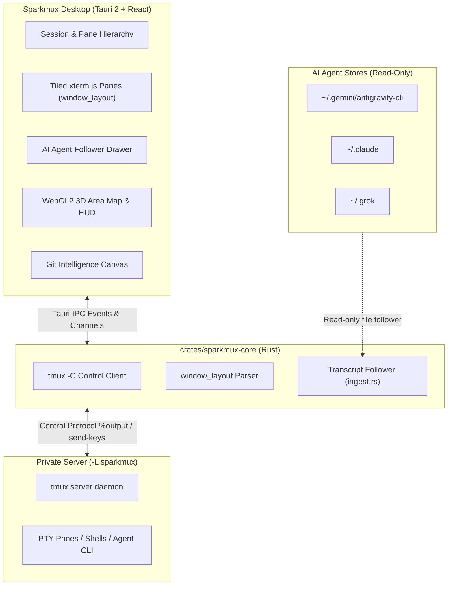

<div align="center">

# ⚡ sparkmux

### *The Terminal Multiplexer Built for the AI Agent Era*

[](https://github.com/darrenkoh/sparkmux/releases)
[](LICENSE)
[](https://github.com/darrenkoh/sparkmux/releases)
[](https://github.com/tmux/tmux)
[](https://tauri.app/)
[](https://github.com/darrenkoh/sparkmux)

<p align="center">
  <b>Private tmux Server</b> &bull;
  <b>Tiled Native xterm.js Terminals</b> &bull;
  <b>Real-Time AI Agent Telemetry</b> &bull;
  <b>3D WebGL Topographical Area Map</b> &bull;
  <b>Sci-Fi Neural HUD</b>
</p>

---

### 🎬 See sparkmux in Action

[](docs/sparkmux-demo.mp4)

*Tiled native tmux terminal with live AI agent follower, instant output stream, and real-time 3D topographical telemetry HUD. ([Watch HD 60fps Video](docs/sparkmux-demo.mp4))*

---

</div>

## 📑 Table of Contents

- [Overview](#-overview)
- [Key Features](#-key-features)
  - [1. Real-Time AI Agent Follower & Intelligence](#1-real-time-ai-agent-follower--intelligence)
  - [2. Interactive 3D Topographical Area Map](#2-interactive-3d-topographical-area-map)
  - [3. Sci-Fi Neural Telemetry HUD](#3-sci-fi-neural-telemetry-hud)
  - [4. Private & Isolated tmux Architecture](#4-private--isolated-tmux-architecture)
  - [5. Visual Git Intelligence Canvas](#5-visual-git-intelligence-canvas)
- [Architecture](#-architecture)
- [Quick Install](#-quick-install)
  - [macOS (Apple Silicon)](#macos-apple-silicon)
  - [Linux (ARM64 / DGX Spark)](#linux-arm64--dgx-spark)
  - [Build from Source](#build-from-source)
- [CLI Reference](#-cli-reference)
- [Keyboard Shortcuts](#-keyboard-shortcuts)
- [Configuration](#-configuration)
- [License](#-license)

---

## 💡 Overview

Modern terminal multiplexers were created decades before autonomous AI coding agents existed. When running agents like **Google Antigravity CLI**, **Claude Code**, or **Grok Build**, terminals get inundated with thousands of tool invocations, hidden reasoning chains, and massive token payloads.

**sparkmux** bridges the terminal and the AI era:
- **Zero Configuration Conflicts**: Launches and controls a private tmux server on `-L sparkmux` without ever touching or interfering with your default tmux sessions.
- **True Tiled Panes**: Each tmux pane renders as an authentic xterm.js instance with pixel-perfect layouts derived directly from tmux `window_layout`.
- **Live Agent Follower**: Non-intrusively tracks agent transcripts in real time, presenting tool calls, thinking phases, and diffs side-by-side with your terminal.
- **3D Topographical Landscapes & Sci-Fi HUD**: Translates token activity and session channels into interactive 3D WebGL islands and real-time synaptogenesis telemetry.

---

## ✨ Key Features

### 1. Real-Time AI Agent Follower & Intelligence

Track the execution loops of your autonomous agents without cluttering your command prompt.


- **Multi-Agent Follower**: Native, zero-overhead transcript follower for:
  - **Google Antigravity CLI** (`agy`)
  - **Claude Code CLI** (`claude`)
  - **Grok Build CLI** (`grok`)
- **Side-by-Side Agent Drawer**: Click **Output** on the status bar to expand live tool executions (`read_file`, `grep`, `run_terminal_command`, `edit_file`), outputs, and reasoning steps as they execute.
- **Cost & Token Telemetry**: Real-time token consumption metrics, including AWS Bedrock API cost estimates and quota monitoring for Claude.
- **Strictly Read-Only**: Follows session files passively without writing to agent directories or intercepting agent CLI state.

---

### 2. Interactive 3D Topographical Area Map

Experience your agent workflows as an interactive WebGL2 3D island terrain with elevation ridges and real-time particle dynamics.


- **Channel-Mapped Elevation Ridges**:
  - `[USER]` &rarr; Human input spikes
  - `[THINK]` &rarr; Chain-of-thought & reasoning plateau
  - `[REPLY]` &rarr; Assistant response valleys
  - `[TOOL]` &rarr; Tool runtime mountain peaks
- **Topological Contours**: Marching-squares elevation lines and ambient floating particle field.
- **Interactive Camera**: Smooth orbit, pan, zoom, auto-rotation, and reset controls.
- **Shader Modes**: Toggle between **Spectral** (full multi-channel color gradient) and **Monochrome** sci-fi amber wireframes.
- **Flexible Workspace**: Explore in the full-screen HUD or **Dock** the 3D map directly to the bottom right of your terminal panes.

---

### 3. Sci-Fi Neural Telemetry HUD

A comprehensive mission-control dashboard for complex multi-agent coding sessions.


- **Neural Cortex Synaptogenesis**: Radar sweep visualizing live synaptic firing and event bursts.
- **Token Spectrum Gauge**: Live circular distribution breakdown of Input tokens, Output tokens, Cache Reads, and Reasoning tokens.
- **Context Buffer & TTFT**: Real-time context window saturation gauge and Time-To-First-Token latency tracker.
- **Code Delta Tracker**: Live count of additions and deletions (`+added / -removed lines`) across all active tools.
- **Actions / Tools Matrix**: Latency benchmarks, call frequency, and status indicators per tool.
- **Event Stream Log**: Filtered chronological audit log with live replay capability.

---

### 4. Private & Isolated tmux Architecture

Enjoy the full power and reliability of tmux without configuration headaches or socket collisions.


- **Dedicated Server**: Runs strictly on `-L sparkmux` — never mutates, lists, or touches your personal tmux server.
- **Persistent Sessions**: Closing or quitting the app **detaches** the client; your commands, builds, and agent runs stay alive in the background. Reopening Sparkmux reconnects instantly.
- **Direct Control Mode**: Driven by `tmux -C` with `%output` and `send-keys -H` for instant terminal responsiveness without capture polling.
- **Session Tree Sidebar**: Drag-to-resize sidebar with session, window, and pane hierarchy, activity pips, and one-click session creation.

---

### 5. Visual Git Intelligence Canvas

Visualize git repository changes and agent edits on an interactive 2D/3D workspace canvas.


- **5 Adaptive Organization Layouts**:
  - **Auto-Fit Grid**: Balanced responsive grid fitting your current window.
  - **Pipeline Kanban**: Stage columns (Agent Edits &rarr; Modified &rarr; Added &rarr; Other).
  - **Architectural Modules**: Directory hierarchy clusters with folder badges.
  - **Impact Churn**: Waterfall prioritized by churn lines and AI edit weight.
  - **Radial Constellation**: Sci-fi orbiting rings with radiating guides.
- **Unified Text Search**: Search file paths, repo clusters, and diff contents with highlighted `<mark>` badges.
- **Inline Split-Pane Diff Viewer**: Resizable 50% split view supporting synchronized Side-by-Side and Unified diffs.
- **Touch & Gesture Physics**: Smooth multi-touch pinch-to-zoom and vertical zoom dial (35% to 200%).

---

## 🏗️ Architecture



---

## 🚀 Quick Install

### One-Line Install (macOS & ARM64 Linux)

Installs `tmux 3.2+` if missing or outdated, then installs the latest [GitHub Release](https://github.com/darrenkoh/sparkmux/releases):

```bash
curl -fsSL https://raw.githubusercontent.com/darrenkoh/sparkmux/main/scripts/install.sh | bash
```

### macOS (Apple Silicon)

1. Ensure tmux 3.2+ is installed:
   ```bash
   brew install tmux
   ```
2. Download the latest `.dmg` from [Releases](https://github.com/darrenkoh/sparkmux/releases).
3. Open the disk image and drag **Sparkmux.app** to your `Applications` folder.
4. **First Launch**: Right-click `Sparkmux.app` &rarr; select **Open** &rarr; click **Open** in the gatekeeper dialog.

### Linux (ARM64 / DGX Spark / Ubuntu 24.04)

1. Ensure tmux 3.2+ is installed:
   ```bash
   sudo apt-get update && sudo apt-get install -y tmux
   ```
2. Download the `.deb` asset from [Releases](https://github.com/darrenkoh/sparkmux/releases) and install:
   ```bash
   sudo dpkg -i sparkmux-desktop_*.deb
   ```
3. Launch `sparkmux-desktop` from your app launcher or terminal.

### Build from Source

Requirements: **Rust 1.88+**, **Node.js 18+**, **pnpm**, **tmux 3.2+** (and WebKitGTK on Linux).

```bash
# 1. Clone repository
git clone https://github.com/darrenkoh/sparkmux.git
cd sparkmux

# 2. Run automated installer with build flags
./scripts/install.sh --from-source

# Or run the desktop dev loop directly:
cd apps/desktop
pnpm install
pnpm run tauri dev
```

> [!TIP]
> **macOS Build Note**: If compilation fails with *"You have not agreed to the Xcode license"*, point Cargo at the Command Line Tools:
> ```bash
> export DEVELOPER_DIR=/Library/Developer/CommandLineTools
> ```

---

## 💻 CLI Reference

`sparkmux` includes a standalone diagnostic and automation CLI:

```bash
# View diagnostic information, tmux version, and socket path
sparkmux doctor

# Dump full session/window/pane hierarchy tree as JSON
sparkmux dump

# Show sparkmux version and detected tmux binary
sparkmux version

# Inspect the user's default system tmux server (-L default)
sparkmux --system dump

# Target a custom socket
sparkmux -L my-socket dump
```

---

## ⌨️ Keyboard Shortcuts

| Shortcut | Context | Action |
|---|---|---|
| <kbd>⌘</kbd> + <kbd>T</kbd> / <kbd>Ctrl</kbd> + <kbd>Shift</kbd> + <kbd>T</kbd> | Global | Create new window in current session |
| <kbd>⌘</kbd> + <kbd>V</kbd> / <kbd>Ctrl</kbd> + <kbd>Shift</kbd> + <kbd>V</kbd> | Terminal | Paste clipboard content to focused pane |
| <kbd>Ctrl</kbd> + <kbd>C</kbd> | Terminal | Send interrupt signal to focused pane |
| <kbd>Left Click + Drag</kbd> | 3D Area Map | Orbit camera angle |
| <kbd>Right Click + Drag</kbd> | 3D Area Map | Pan camera across terrain |
| <kbd>Scroll Wheel</kbd> / <kbd>Pinch</kbd> | 3D Area Map | Zoom in / out |
| <kbd>Double Click</kbd> | 3D Area Map | Reset camera to default perspective |

---

## ⚙️ Configuration

Configuration is automatically read from:
- **macOS**: `~/Library/Application Support/sparkmux/config.toml`
- **Linux**: `~/.config/sparkmux/config.toml`

```toml
# Path to specific tmux binary (defaults to searching PATH)
tmux_bin = ""

# Socket name for the private server
socket_name = "sparkmux"

# Refresh and poll rate for session state in milliseconds
refresh_ms = 1000

# Default initial session name
default_session = "main"
```

---

## 🛡️ License

Released under the [MIT License](LICENSE). Copyright &copy; 2026 Darren Koh.
