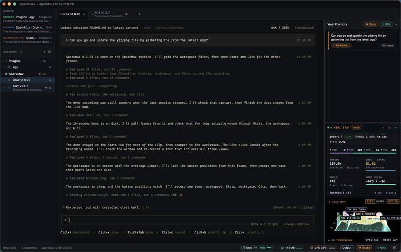
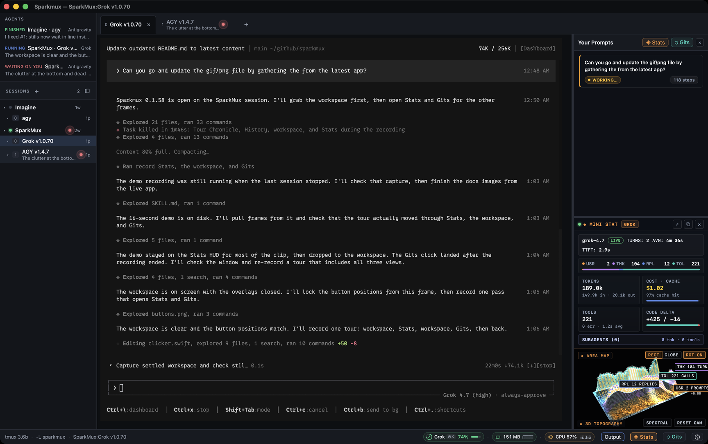
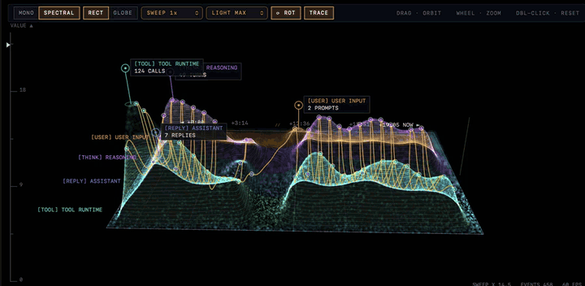
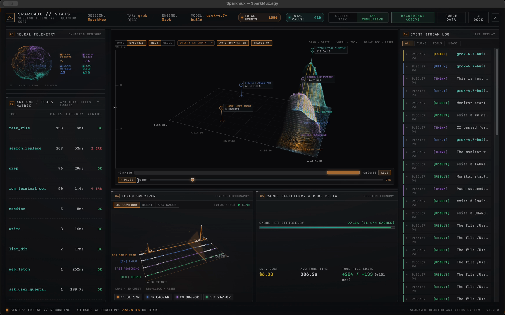
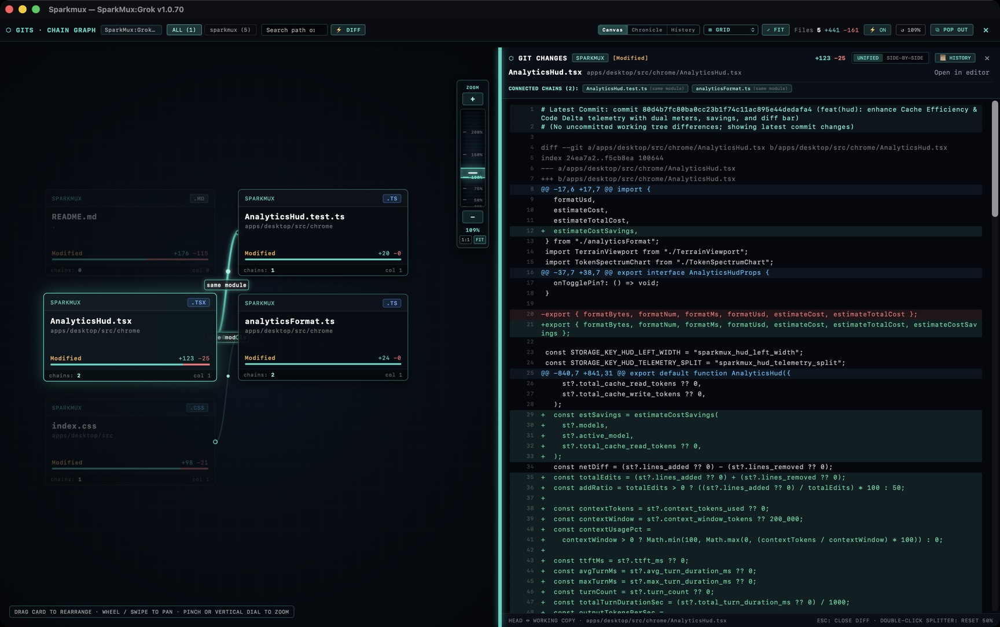
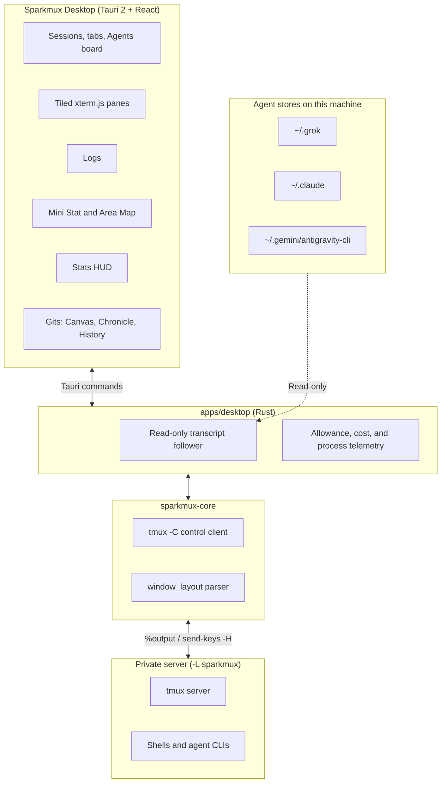

<div align="center">

# ⚡ sparkmux

### *The Terminal Multiplexer Built for the AI Agent Era*

[](https://github.com/darrenkoh/sparkmux/releases)
[](LICENSE)
[](https://github.com/darrenkoh/sparkmux/releases)
[](https://github.com/tmux/tmux)
[](https://tauri.app/)
[](https://github.com/darrenkoh/sparkmux)

<p align="center">
  <b>Private tmux Server</b> &bull;
  <b>Tiled Native xterm.js Terminals</b> &bull;
  <b>Logs</b> &bull;
  <b>3D Area Map &amp; Mini Stat</b> &bull;
  <b>Stats HUD</b> &bull;
  <b>Gits</b> &bull;
  <b>iPhone &amp; iPad</b>
</p>

---

### 🎬 See sparkmux in Action

[](docs/sparkmux-demo.mp4)

*Tiled tmux panes, Logs, and the live area map. ([Watch HD video](docs/sparkmux-demo.mp4))*

---

</div>

## 📑 Table of Contents

- [Overview](#-overview)
- [Key Features](#-key-features)
  - [1. Private tmux Workspace](#1-private-tmux-workspace)
  - [2. Logs](#2-logs)
  - [3. Allowance, Hardware, and Commands](#3-allowance-hardware-and-commands)
  - [4. Area Map and Mini Stat](#4-area-map-and-mini-stat)
  - [5. Stats HUD](#5-stats-hud)
  - [6. Gits](#6-gits)
- [Architecture](#-architecture)
- [Quick Install](#-quick-install)
  - [macOS (Apple Silicon)](#macos-apple-silicon)
  - [Linux (ARM64 / DGX Spark)](#linux-arm64--dgx-spark)
  - [Build from Source](#build-from-source)
  - [Updates](#updates)
- [iPhone and iPad](#-iphone-and-ipad)
  - [Start the page](#start-the-page)
  - [Layouts](#layouts)
  - [Touch](#touch)
- [CLI Reference](#-cli-reference)
- [Keyboard Shortcuts](#-keyboard-shortcuts)
- [Configuration](#-configuration)
- [License](#-license)

---

## 💡 Overview

Modern terminal multiplexers were created decades before autonomous AI coding agents existed. When you run **Grok Build**, **Claude Code**, or **Google Antigravity CLI**, a pane fills with tool calls, reasoning, and token traffic that a plain shell cannot summarize.

**sparkmux** is a desktop front-end for a private tmux server:

- **Isolated server**: The app owns `tmux -L sparkmux`. Your default tmux server stays untouched.
- **True tiled panes**: Each pane is a real xterm.js terminal. Geometry comes from tmux `window_layout`. Live bytes come from control mode (`%output` and `send-keys -H`).
- **Read-only agent follower**: **Logs**, beside the terminal, shows prompts, thinking, tools, and replies from the CLI's own transcript on this machine. Tokens and file edits feed Stats and Gits.
- **Telemetry you can dock or pop out**: Mini Stat and the 3D Area Map sit beside the terminal. Stats and Gits open full-screen, or in their own windows.
- **Phone and tablet**: `sparkmux-desktop --serve` hosts that same UI as a Home Screen web app. The phone opens a page; tmux and the agent CLIs stay on the host. See [iPhone and iPad](#-iphone-and-ipad).

Follow the focused pane from another terminal with:

```bash
tmux -L sparkmux attach
```

---

## ✨ Key Features

### 1. Private tmux Workspace



- **Dedicated server**: Sessions, tabs, and panes live on `-L sparkmux`. Quit detaches the control client and leaves the server running, so shells and agent processes keep going. Reopen Sparkmux and the same sessions are there.
- **Session sidebar**: Drag to resize. Click a session name to attach and expand or collapse its tabs. The disclosure arrow toggles the list on its own. Double-click a name to rename it.
- **Agents board**: Lists Grok, Claude, and Antigravity panes on this socket, with state **Waiting on you**, **Running**, **Finished**, or **Failed**. Choosing a row opens that pane. A hidden tab lights an unread mark when an agent is waiting or reports a failure, and shows the question it is waiting on. When Sparkmux is in the background, the first wait posts a system notification.
- **Automatic tab names**: A tab still named `shell` takes the foreground CLI and its version, such as `Grok v…`, `Claude v…`, or `AGY v…`. A name you typed stays. When the CLI exits, the tab returns to `shell`.
- **Scrollback**: Opening a pane again restores history from tmux, so you can scroll to output from before this attach. **⌘F** / **Ctrl+F** finds text in that scrollback. An `http` or `https` link opens in the default browser.
- **Drop a file or folder** on a pane to paste its absolute path into the prompt. You press Enter. Shell metacharacters are quoted.

---

### 2. Logs

**Output** on the status bar docks **Logs** beside the terminal for the focused pane. It follows that pane's Grok, Claude, or Antigravity transcript, including work from child agents. A pane that is only `ssh` stays a terminal. The panel header is the title and a close button.

- **One card per prompt**: Preview, status (`Working…`, `Done`, `No reply`), and step count. The newest turn is first.
- **Prompt Details**: Full markdown prompt, collapsible thinking and tool steps, the closing reply, and previous / next through the session. Fenced code blocks can be copied.
- **Open a path**: A recorded file path on a tool row opens in your editor.
- **Status-bar borders**: **Output** lights blue while Logs is open. **◈ Stats** lights orange while Mini Stat is docked or the Stats HUD is open. **⬡ Gits** keeps a teal border.

---

### 3. Allowance, Hardware, and Commands

The status bar follows the focused pane.

- **Model quota pills**: Compact badges for the active pools (Grok, Claude, Gemini, Argon, and other limits the CLI reports). Each pill shows the window (`5h`, `Wk`), remaining percent, a meter, and a countdown halo. Hover for every window, the reset time, and which limit is tighter. A Claude process on AWS Bedrock shows session and today API cost in place of a quota meter.
- **Memory and CPU**: This Sparkmux process only, with a memory sparkline and a CPU histogram. Hover either pill for a 30-second waveform, peak, and uptime.
- **Frequently Used Command**: The circled **?** inserts one finished shell command into a normal shell (`zsh`, `bash`, `fish`, `sh`, `dash`) and leaves Enter to you. Recipes cover folder size, free space, listing, file counts, find, grep, `git status`, and `git diff`, with the focused pane's folder filled in. A full-screen agent pane copies the command so it can be pasted by hand.

---

### 4. Area Map and Mini Stat



Activity on the focused agent session becomes a WebGL2 terrain. Channels are **User**, **Think**, **Reply**, and **Tool**.

- **Two bases**: **Rect** is a left-to-right time surface. **Globe** is a sensor disc: the four channels are rings, time runs around the disc, and a radar ping expands outward.
- **Long sessions**: The map shows a 30-minute slice. Quiet stretches fold into short seams, so a multi-hour session stays readable. Drag the window, or jump back to live. The docked map stays on the latest slice.
- **Look**: **Spectral** or **Mono** shading, sweep speed, scan-light intensity, orbit, pan, zoom, auto-rotate, and reset. Auto-rotate is remembered.
- **Mini Stat**: The docked deck shows the live model, turns, average turn time, time to first token, token and cache totals, tool health, code delta, sub-agents, and the terrain underneath. Expand it to the full Stats HUD, or pop Stats out into its own window.

---

### 5. Stats HUD



**◈ Stats** on the status bar opens a mission-control view of the focused pane. The button lights orange while Mini Stat is docked or this view is open. **Current Task** is this session. **Tab Cumulative** keeps the counters for the tab. The terrain itself always draws the active session.

- **Neural telemetry**: A 3D synaptic view of user prompts, thinking blocks, model replies, and tool calls.
- **Actions / Tools matrix**: Calls, average latency, and errors per tool.
- **Subagents**: Tokens, tools, and last activity for Grok, Claude, and Antigravity children launched from this pane. Their work is included in the pane totals. A child's own prompt stays out of your prompt count and average turn time.
- **Token Spectrum**: Cache, input, reasoning, and output over the session. **2D Stack**, **Burst**, and **Arc Gauge**. The same idle-gap fold as the Area Map.
- **Session economy**: Cache-hit rate, estimated cost, average turn time, and lines added and removed.
- **Event stream**: Filter by turns, tools, usage, or agents, and open a row to read the stored text.
- **Recording** can be paused. **Purge Data** deletes captured telemetry for the tab. The CLI transcript stays on disk, and later activity is what counts next.
- **Pop out** Stats into a separate window. Pin it to this tab, or let it follow whichever tab is active in the main window. Closing that window leaves Sparkmux and tmux running.

---

### 6. Gits



**⬡ Gits** on the status bar opens a full-window view of the focused pane's repository and the edits in its current agent session. The button keeps a teal border. Close it from the header or with Escape. It can pop out the same way Stats can.

**Canvas** lays out changed files, git dirty files and agent edits together, with local dependency links.

- **Layouts**: Auto-fit **Grid**, **Pipeline** (agent edits, modified, added, other), **Modules** (directory clusters), **Impact** (churn), and **Radial**. Pick the layout from the dropdown.
- **Search** across paths, clusters, and file text. **⚡ DIFF** searches changed lines. **📄 FULL** searches the working copy. Matches are marked on the cards and in the diff.
- **Diff**: Resizable split between the canvas and a unified or side-by-side diff. Open the file in your editor from the card.

**Chronicle** is the session's edit timeline: a revision deck of each mutating step, churn, and a diff studio with hunk jumps, search, and copy. **● LIVE** returns to the newest step.

**History** is the git log for the repo: commits, branch, changed-file tree, and a unified or side-by-side diff. After you commit, Gits still shows that commit's files when the worktree is clean.

---

## 🏗️ Architecture



All tmux I/O goes through `sparkmux-core`. The desktop app does not spawn `tmux` on its own. The [iPhone and iPad](#-iphone-and-ipad) page is this UI served over HTTP, still on `-L sparkmux`.

---

## 🚀 Quick Install

Sparkmux ships for **Apple Silicon macOS** and **ARM64 Linux** (DGX Spark / Ubuntu 24.04). It needs **tmux 3.2+**.

### One-Line Install (macOS & ARM64 Linux)

Installs tmux 3.2+ when it is missing or older, then installs the latest [GitHub Release](https://github.com/darrenkoh/sparkmux/releases):

```bash
curl -fsSL https://raw.githubusercontent.com/darrenkoh/sparkmux/main/scripts/install.sh | bash
```

| Flag | Effect |
|---|---|
| `--from-source` | Build with Rust and npm instead of downloading a release |
| `--skip-tmux` | Leave tmux installation to you |
| `--prefix DIR` | Linux user-install prefix (default `~/.local`) |

### macOS (Apple Silicon)

1. Ensure tmux 3.2+ is installed:
   ```bash
   brew install tmux
   ```
2. Download the latest `.dmg` from [Releases](https://github.com/darrenkoh/sparkmux/releases).
3. Open the disk image and drag **Sparkmux.app** to `Applications`.
4. **First launch**: Right-click `Sparkmux.app` → **Open** → **Open** in the Gatekeeper dialog. Release builds are unsigned.

### Linux (ARM64 / DGX Spark / Ubuntu 24.04)

1. Ensure tmux 3.2+ is installed:
   ```bash
   sudo apt-get update && sudo apt-get install -y tmux
   ```
2. Download the `.deb` from [Releases](https://github.com/darrenkoh/sparkmux/releases) and install:
   ```bash
   sudo dpkg -i sparkmux-desktop_*.deb
   ```
   Without passwordless `sudo`, the installer places `sparkmux-desktop` under `~/.local/bin` (or `--prefix`).
3. Launch `sparkmux-desktop` from your app launcher or a terminal.

### Build from Source

Requirements: **Rust 1.88+**, **Node.js 20.19+ or 22.12+** with npm, **tmux 3.2+**. Linux also needs WebKitGTK (`libwebkit2gtk-4.1-dev` and GTK 3).

```bash
git clone https://github.com/darrenkoh/sparkmux.git
cd sparkmux
./scripts/install.sh --from-source
```

Developer loop, from `apps/desktop` (the repo root has no `package.json`):

```bash
cd apps/desktop
npm install
npm run tauri dev
```

Release bundles: `npm run tauri build` in `apps/desktop`. Output is under the workspace `target/release/bundle`.

> [!TIP]
> **macOS build note**: If compilation fails with *"You have not agreed to the Xcode license"*, point Cargo at the Command Line Tools:
> ```bash
> export DEVELOPER_DIR=/Library/Developer/CommandLineTools
> ```

### Updates

A packaged build checks GitHub Releases on launch and offers **Later** or **Update Now**. **Update Now** downloads the signed release, installs it, and relaunches. The tmux server stays up. You can also use **Check for Updates…** in the Sparkmux menu on macOS, or in Help on Linux.

---

## 📱 iPhone and iPad

The phone or tablet page is the Sparkmux UI, served from the Mac or Linux machine that owns `tmux -L sparkmux`. tmux, git, and the agent CLIs keep running on that machine. Closing the page leaves those sessions up.

### Start the page

In the desktop app, choose **Start Remote Server**. On macOS that item is in the Sparkmux menu. On Linux it is in File. The window lists the addresses. **Stop Remote Server** closes the page and leaves your tmux sessions running.

From a terminal on the host:

```bash
# Installed app, with no window. Listens on every interface, port 7420.
sparkmux-desktop --serve

# macOS app bundle
/Applications/Sparkmux.app/Contents/MacOS/sparkmux-desktop --serve

# Diagnostic CLI, when `sparkmux` is on your PATH
sparkmux serve
```

To keep the desktop window open and serve the page at the same time (port 7420):

```bash
SPARKMUX_SERVE=1 sparkmux-desktop
```

On startup the terminal prints a pairing URL for this computer, then the same page on each other IPv4 address. The QR code uses a phone address: Wi-Fi (`192.168.x.x`) when one exists, otherwise another private or Tailscale address. In the desktop window, select another address and the code changes to match it. `127.0.0.1` opens on this computer. Bind a specific address when the phone should use that one:

```bash
sparkmux-desktop --serve --bind 100.64.1.2 --port 7420
```

The first successful visit stores a sign-in cookie named `sparkmux_session` and removes `?token=` from the address bar. In Safari, use **Share → Add to Home Screen** for a full-screen icon. The cookie lasts 30 days while this server process keeps the same token. Stopping the server and starting it again issues a new token, so the old link and cookie no longer sign in.

A page opened without the token shows a pairing form. Type the token from the printed URL.

| Flag | Default | Effect |
|---|---|---|
| `--port`, `-p` | `7420` | Listen port |
| `--bind`, `-b` | `0.0.0.0` | Listen address. The default accepts a phone on the LAN or an address already on the host, such as Tailscale. `--bind 127.0.0.1` keeps the page on this machine. |
| `--token` | a new token each start | Bearer token. `SPARKMUX_WEB_TOKEN` pins one for this process. |

With no `--token` and no `SPARKMUX_WEB_TOKEN`, each start generates a new 64-character hex token (32 random bytes). A token from an earlier start stops working. `--token` and `SPARKMUX_WEB_TOKEN` pin the token for this process only. Treat the printed URL as a secret: anyone who can open it can type into your panes.

Stopping the serve process closes the page. The tmux server stays up. Start serve again and the same sessions are there.

### Layouts

The page picks a layout from the screen. Open **tmux** on the key bar and use **Layout** to keep a choice across reloads.

| Layout | When | What you see |
|---|---|---|
| Duo Book | iPhone Duo folded side by side, or a square unfolded touch screen | Tabs, tiled terminal, and the key bar on the left. Map, Logs, and Gits on the right. The hinge stays clear. **Sessions** opens the sidebar over the left side. |
| Duo Clamshell | iPhone Duo folded top and bottom | Map and telemetry on top. Terminal and key bar below. |
| Phone | A touch screen narrower than 680px | **Sessions** opens the sidebar. A window with several panes shows one pane at a time; **Tile** brings the others back. **Output** opens Logs as a sheet along the bottom. Stats and Gits open there the same way. |
| iPad | A wider touch screen | The three-column desktop layout, with larger splitter targets. `?window=stats` and `?window=gits` open those views on their own. |

The on-screen keyboard shortens the page to the visible area so the terminal reflows above the keys.

### Touch

The key bar sits under the terminal on every phone and tablet layout.

| Key | Action |
|---|---|
| esc, tab, shift-tab | Send that key |
| ctrl, opt | Latch, then the next key. ctrl then c sends interrupt. opt prefixes Esc. |
| arrows | Cursor keys, including application-cursor mode |
| paste | Clipboard into the focused pane |
| hide | Dismiss the on-screen keyboard |
| tmux | Split horizontal, split vertical, zoom or unzoom the pane, ^C, ^D, ^Z, ^L, and the layout picker |

One finger dragged on a terminal scrolls that pane. A two-finger pinch sets the terminal font between 11 and 22.

On the area map, one finger orbits. Two fingers zoom and pan. A tap pins a milestone. A double-tap resets the camera.

---

## 💻 CLI Reference

`sparkmux` is a small diagnostic CLI. `serve` hosts the [iPhone and iPad](#-iphone-and-ipad) page. The desktop app is the product UI on a desktop, and `sparkmux-desktop --serve` hosts the same page with no window.

```bash
# Socket, tmux version, and session status
sparkmux doctor

# Session, window, and pane tree as JSON
sparkmux dump

# sparkmux version and the detected tmux binary
sparkmux version

# Inspect the default tmux server (-L default). The desktop app stays on -L sparkmux.
sparkmux --system dump

# Another socket name, or an explicit socket path
sparkmux -L my-socket dump
sparkmux -S /tmp/my.sock doctor

# iPhone / iPad page. See "iPhone and iPad" above.
sparkmux serve
sparkmux serve --bind 127.0.0.1
sparkmux serve --port 7420 --token "$SPARKMUX_WEB_TOKEN"
```

`SPARKMUX_TMUX` or `--tmux-bin` selects the tmux binary. `--config` selects a config file.

---

## ⌨️ Keyboard Shortcuts

| Shortcut | Context | Action |
|---|---|---|
| <kbd>⌘</kbd><kbd>N</kbd> / <kbd>Ctrl</kbd><kbd>Shift</kbd><kbd>N</kbd> | Global | New session |
| <kbd>⌘</kbd><kbd>T</kbd> / <kbd>Ctrl</kbd><kbd>Shift</kbd><kbd>T</kbd> | Global | New tab in the current session |
| <kbd>⌘</kbd><kbd>W</kbd> / <kbd>Ctrl</kbd><kbd>Shift</kbd><kbd>W</kbd> | Global | Close the current tab (asks first) |
| Double-click | Tab or session | Rename |
| Click the session name | Sidebar | Attach, and expand or collapse its tabs |
| <kbd>⌘</kbd><kbd>C</kbd> | Terminal | Copy the selection, or send interrupt when nothing is selected |
| <kbd>⌘</kbd><kbd>V</kbd> / <kbd>Ctrl</kbd><kbd>Shift</kbd><kbd>V</kbd> | Terminal | Paste into the focused pane |
| <kbd>⌘</kbd><kbd>F</kbd> / <kbd>Ctrl</kbd><kbd>F</kbd> | Terminal | Find in pane scrollback |
| Drop a file or folder | Terminal pane | Paste its path. You press Enter |
| <kbd>⌘</kbd><kbd>=</kbd> <kbd>⌘</kbd><kbd>-</kbd> <kbd>⌘</kbd><kbd>0</kbd> | Global | Bigger text, smaller text, actual size |
| <kbd>Ctrl</kbd><kbd>=</kbd> <kbd>Ctrl</kbd><kbd>-</kbd> <kbd>Ctrl</kbd><kbd>0</kbd> | Linux | Same text-size commands |
| <kbd>⌘</kbd><kbd>Shift</kbd><kbd>/</kbd> / <kbd>F1</kbd> | Global | Sparkmux Help |
| <kbd>⌘</kbd><kbd>Q</kbd> | macOS | Quit. Detaches only. The server stays up |
| Left-drag / right-drag | Area Map | Orbit / pan |
| Scroll or pinch | Area Map | Zoom |
| Double-click | Area Map | Reset the camera |
| <kbd>Esc</kbd> | Stats, Gits, dialogs | Close |

On Linux, Quit is in the File menu. Prefix keys are available when you `tmux -L sparkmux attach` from another terminal. Sparkmux does not emulate the tmux prefix inside the panes.

---

## ⚙️ Configuration

Sparkmux reads:

- **macOS**: `~/Library/Application Support/sparkmux/config.toml`
- **Linux**: `~/.config/sparkmux/config.toml`

A flag wins over the environment, which wins over the file. `SPARKMUX_TMUX` overrides `tmux_bin`.

```toml
# tmux binary. Empty searches PATH, then Homebrew and system locations.
tmux_bin = ""

# Private server socket (tmux -L). The desktop app uses this socket.
socket_name = "sparkmux"

# Optional explicit socket path (tmux -S). Empty uses socket_name.
socket_path = ""

# Session-tree refresh interval, in milliseconds.
refresh_ms = 1000

# Created on a cold start when the server has no sessions.
default_session = "main"

# Last session you attached. Sparkmux writes this when you switch.
last_session = ""
```

A session you name from **New Session** is created under that name.

---

## 🛡️ License

Released under the [MIT License](LICENSE). Copyright &copy; 2026 Darren Koh.
