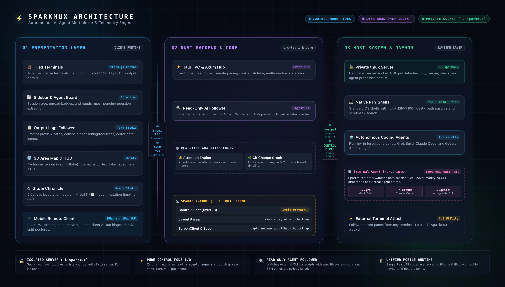

<div align="center">

# ⚡ S P A R K M U X

**MISSION CONTROL FOR THE AUTONOMOUS AI AGENT ERA**

[](https://github.com/darrenkoh/sparkmux/releases)
[](LICENSE)
[](https://github.com/darrenkoh/sparkmux/releases)
[](https://github.com/tmux/tmux)
[](https://tauri.app/)
[](https://github.com/darrenkoh/sparkmux)

`▣ PRIVATE TMUX (-L sparkmux)` · `⚡ CONTROL-MODE I/O` · `🌐 3D AREA MAP` · `◈ STATS HUD` · `⬡ GITS & CHRONICLE` · `📱 MOBILE PWA`

```bash
curl -fsSL https://raw.githubusercontent.com/darrenkoh/sparkmux/main/scripts/install.sh | bash
```

[](docs/sparkmux-demo.mp4)

*Tiled native `xterm.js` panes, live agent follower, and WebGL2 3D topography · [Watch HD Video](docs/sparkmux-demo.mp4)*

</div>

---

## `01 // SYSTEM OVERVIEW`

Traditional terminal multiplexers were built decades before autonomous coding agents existed. When you run **Grok Build**, **Claude Code**, or **Google Antigravity CLI**, raw terminal scrollback cannot surface reasoning chains, subagent trees, token burn, or multi-file git churn.

**sparkmux** pairs a dedicated, persistent `tmux -L sparkmux` server with a real-time sci-fi telemetry deck:

| Subsystem | Signal Source | Capability |
| :--- | :--- | :--- |
| **▣ Tiled Workspace** | `tmux -C` control pipes | True `xterm.js` panes matching `window_layout`, persistent background daemon, auto-named CLI tabs, and a live **Agent Board** (`Waiting`, `Running`, `Finished`, `Failed`). |
| **📋 Output Logs** | Read-only CLI transcripts | Docked prompt cards, collapsible reasoning & tool trees, one-click editor links, and SSH-jailed remote transcript staging. |
| **🌐 3D Area Map** | 4-channel WebGL2 sensor | Live terrain across **User**, **Think**, **Reply**, and **Tool** channels in **Rect** (Cartesian ridge) or **Globe** (polar radar ping) modes with idle-gap folding. |
| **◈ Stats HUD** | Incremental token follower | 3D neural synaptogenesis, token spectrum (`Cache` / `Input` / `Reason` / `Out`), tool latency matrix, subagent rollups, model quota halos, and AWS Bedrock USD cost. |
| **⬡ Gits & Chronicle** | Git worktree + agent turns | 5 interactive canvas layouts (`Grid`, `Pipeline`, `Modules`, `Impact`, `Radial`), turn-by-turn **Chronicle** transit timeline, and unified/split diff studio. |
| **📱 Mobile Command** | Embedded Axum `/ws` | Run `sparkmux-desktop --serve` to project the full UI to iPhone, iPad, or foldable screens with a tactile `tmux` KeyBar. |

---

## `02 // VISUAL SHOWCASE`

### `01` · `▣` Private tmux Workspace & Agent Board


- **Isolated & Persistent**: Exclusively owns `tmux -L sparkmux` (attach externally anytime via `tmux -L sparkmux attach`). Quitting the GUI detaches cleanly—your shells and agents keep running in the background.
- **Agent Attention Board & Output Logs**: Monitors all Grok, Claude, and Antigravity panes, surfaces pending questions with OS notifications when an agent is **Waiting on you**, and docks structured **Output** prompt/reasoning/tool cards beside the terminal.
- **Live Quota & Hardware Pills**: Auto-labels `shell` tabs with the running CLI version, quotes dropped file paths, and displays model quota countdowns (`5h`, `Wk`, or AWS Bedrock USD), Sparkmux RSS/CPU sparklines, and shell command recipes (`?`) in the status bar.

---

### `02` · `🌐` 3D Area Map & Mini Stat


- **4-Channel WebGL2 Topography**: Streams **User**, **Think**, **Reply**, and **Tool** activity onto a Cartesian ridge (**Rect**) or polar radar ring (**Globe**) with Spectral/Mono shaders and outward radar pings.
- **Idle-Gap Time Folding**: Compresses quiet stretches into compact seams across a 30-minute sliding window so multi-hour sessions stay readable—scrub history or jump back to live.
- **Docked Mini Stat Deck**: Keep live model identity, turn count, average turn time, TTFT, token/cache totals, code deltas, and subagent counts docked directly above the 3D terrain.

---

### `03` · `◈` Stats HUD (Mission Control)


- **3D Neural Cortex & Token Spectrum**: Visualize synaptic links between prompts, thinking blocks, replies, and tools alongside **2D Stack**, **Burst**, and **Arc Gauge** token breakdowns.
- **Tool Matrix & Subagent Rollups**: Track per-tool call counts, average latency, error rates, and spawned child agents without skewing your top-level prompt turn metrics.
- **Multi-Monitor Popout**: Toggle between **Current Task** and **Tab Cumulative** counters, filter the raw event stream, or pop **◈ Stats** into a standalone window pinned to a target pane.

---

### `04` · `⬡` Gits, Chronicle & Diff Studio


- **5 Interactive Graph Layouts**: Map dirty git files and active session edits across **Grid**, **Pipeline**, **Modules** (directory clusters), **Impact** (churn), and **Radial** dependency graphs.
- **Instant Diff & Full-Text Search**: Filter changed lines (`⚡ DIFF`) or the entire working tree (`📄 FULL`) with live card markers and a resizable unified or side-by-side diff studio.
- **Chronicle Time-Travel & Git History**: Scrub through every mutating agent turn in **Chronicle**'s revision deck, or switch to **History** to inspect branch commits and clean worktrees.

---

## `03 // SYSTEM ARCHITECTURE`



> [!IMPORTANT]
> **Core Architectural Invariants**
> - **Isolated Socket**: Owns `-L sparkmux` exclusively; your default tmux server remains untouched.
> - **Pure Control Mode**: Live terminal bytes stream via `%output` and `send-keys -H`—no `capture-pane` polling or pseudo-PTY wrappers.
> - **Read-Only Telemetry & SSH Jail**: External agent directories (`~/.grok`, `~/.claude`, `~/.gemini`) are never modified, and `ssh` panes never bind local host transcripts.

---

## `04 // DEPLOYMENT & OPERATIONS`

Requires **tmux 3.2+** on **macOS (Apple Silicon)** or **Linux (ARM64 / DGX Spark / Ubuntu 24.04)**.

```bash
curl -fsSL https://raw.githubusercontent.com/darrenkoh/sparkmux/main/scripts/install.sh | bash
```

<details>
<summary><b>📦 Manual Install, Source Build & Auto-Updates</b></summary>

#### Installer Flags
| Flag | Effect |
| :--- | :--- |
| `--from-source` | Compile locally with Cargo and npm instead of fetching a release binary |
| `--skip-tmux` | Skip automatic `tmux 3.2+` check/installation |
| `--prefix DIR` | Custom Linux user-install prefix (default `~/.local`) |

#### macOS (Apple Silicon)
1. `brew install tmux`
2. Download the latest `.dmg` from [Releases](https://github.com/darrenkoh/sparkmux/releases) and drag **Sparkmux.app** to `Applications`.
3. **First launch**: Right-click `Sparkmux.app` → **Open** → **Open** to bypass Gatekeeper for unsigned release builds.

#### Linux (ARM64 / DGX Spark)
```bash
sudo apt-get update && sudo apt-get install -y tmux
sudo dpkg -i sparkmux-desktop_*.deb
```

#### Build from Source
Requires **Rust 1.88+**, **Node.js 20.19+ / 22.12+**, **tmux 3.2+** (plus `libwebkit2gtk-4.1-dev` on Linux).
```bash
git clone https://github.com/darrenkoh/sparkmux.git && cd sparkmux
./scripts/install.sh --from-source

# Or run the live Tauri dev loop:
cd apps/desktop && npm install && npm run tauri dev
```
*macOS tip*: If Cargo reports an Xcode license error, run `export DEVELOPER_DIR=/Library/Developer/CommandLineTools`.

#### Auto-Updates
Packaged builds check GitHub Releases on launch (**Update Now** downloads, installs, and relaunches while keeping `tmux -L sparkmux` running).

</details>

<details>
<summary><b>📱 iPhone, iPad & Foldable Remote HUD (<code>--serve</code>)</b></summary>

Project your desktop workspace to any mobile browser over LAN or Tailscale while `tmux`, `git`, and agent CLIs stay on the host.

1. Click **Remote** in the bottom-right status bar, or run from a terminal:
   ```bash
   sparkmux-desktop --serve                         # Headless server on 0.0.0.0:7420
   SPARKMUX_SERVE=1 sparkmux-desktop                # Desktop GUI + web server together
   sparkmux-desktop --serve --bind 100.64.1.2 -p 7420
   ```
2. Scan the QR code (or open the printed pairing URL). The first visit exchanges `?token=` for a 30-day `sparkmux_session` cookie (backed by `web_token`, mode `0600` in your config dir) so you can **Add to Home Screen** in Safari as a full-screen PWA. Override per-run with `--token` or `SPARKMUX_WEB_TOKEN`.

| Posture Layout | Trigger | Interface Adaptation |
| :--- | :--- | :--- |
| **Phone** | Width `< 680px` | Single-pane focus with **Tile** toggle, slide-over **Sessions**, and bottom sheets for Logs, Stats, and Gits. |
| **iPad** | Tablet landscape | Full 3-column desktop deck with touch-sized splitters and standalone `?window=stats` / `?window=gits` views. |
| **Duo Book / Clamshell** | Foldable dual-screen | Splits terminal + KeyBar opposite the 3D Map, Logs, and Gits around the hinge. |

**Touch KeyBar**: Includes `esc`, `tab`, `shift-tab`, latching `ctrl`/`opt`, cursor `arrows`, `paste`, keyboard `hide`, and a `tmux` menu (splits, zoom, `^C`/`^D`/`^Z`/`^L`, layout lock). Pinch terminal text to scale (`11–22px`); 1-finger orbit / 2-finger pan on the 3D Area Map.

</details>

<details>
<summary><b>💻 Diagnostic CLI Reference (<code>sparkmux</code>)</b></summary>

```bash
sparkmux doctor                        # Verify socket, tmux version, and session health
sparkmux dump                          # Dump session/window/pane topology as JSON
sparkmux version                       # Print sparkmux and detected tmux binary versions
sparkmux --system dump                 # Inspect default tmux server (-L default) read-only
sparkmux -L custom-sock dump           # Target a named socket (-L) or path (-S)
sparkmux serve --bind 127.0.0.1        # Launch the mobile/web server from the CLI
```

</details>

<details>
<summary><b>⌨️ Keyboard & Mouse Controls</b></summary>

| Shortcut | Context | Action |
| :--- | :--- | :--- |
| <kbd>⌘N</kbd> / <kbd>Ctrl+Shift+N</kbd> | Global | New tmux session |
| <kbd>⌘T</kbd> / <kbd>Ctrl+Shift+T</kbd> | Global | New tab in active session |
| <kbd>⌘W</kbd> / <kbd>Ctrl+Shift+W</kbd> | Global | Close current tab (with confirmation) |
| <kbd>⌘F</kbd> / <kbd>Ctrl+F</kbd> | Terminal | Search pane scrollback |
| <kbd>⌘C</kbd> / <kbd>⌘V</kbd> | Terminal | Copy selection (or send `SIGINT` if empty) / Paste |
| <kbd>⌘=</kbd> <kbd>⌘-</kbd> <kbd>⌘0</kbd> | Global | Adjust font scale (`Ctrl` on Linux) |
| <kbd>⌘⇧/</kbd> / <kbd>F1</kbd> | Global | Sparkmux Help |
| <kbd>⌘Q</kbd> | macOS | Quit GUI and detach cleanly (`-L sparkmux` stays running) |
| <kbd>Esc</kbd> | Overlays | Close Stats HUD, Gits, or active modal |
| **Double-click** | Sidebar / Tab / Map | Rename session or tab · Reset 3D Area Map camera |

</details>

<details>
<summary><b>⚙️ Configuration (<code>config.toml</code>)</b></summary>

Located at `~/Library/Application Support/sparkmux/config.toml` (macOS) or `~/.config/sparkmux/config.toml` (Linux). Precedence: `CLI flags > ENV (SPARKMUX_TMUX) > config.toml`.

```toml
tmux_bin = ""              # Auto-detects PATH / Homebrew when empty
socket_name = "sparkmux"   # Private tmux server (-L sparkmux)
socket_path = ""           # Optional explicit socket path (-S)
refresh_ms = 1000          # Tree sync interval (ms)
default_session = "main"   # Created on cold start if server is empty
last_session = ""          # Auto-persisted when switching sessions
```

</details>

---

<div align="center">

**[Security Policy](SECURITY.md)** · **[MIT License](LICENSE)** · Copyright &copy; 2026 Darren Koh

</div>
