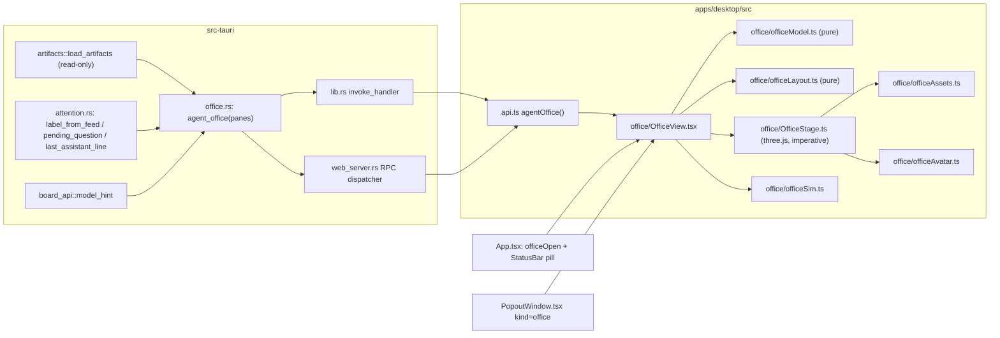
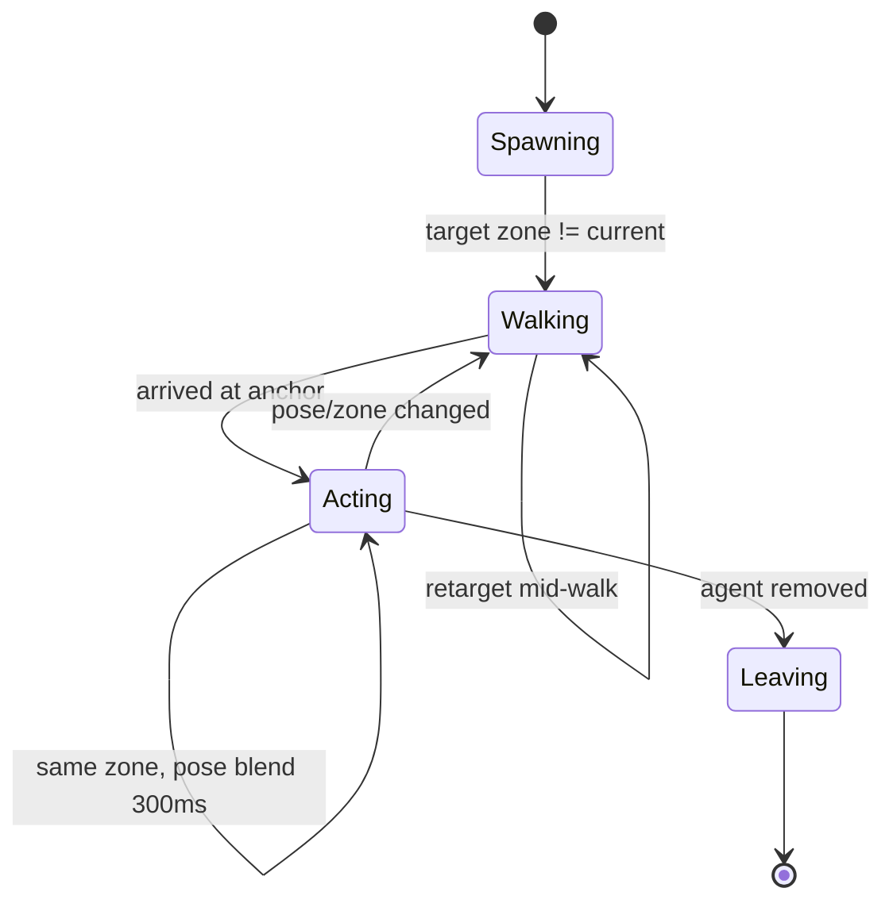

# Agent Office: 3D view of live AI agents

> **Audience:** an LLM or engineer implementing this in the `sparkmux` repo.
> **Status:** design approved for implementation. Follow the phases in order. Every phase ends with the repo test gate (§13).

---

## 0. TL;DR

Add an **⌂ Office** view to Sparkmux. It is an isometric, low-poly 3D office, similar to a management sim game. Every AI-agent pane on the private tmux socket (`-L sparkmux`) appears as an **avatar at a desk**. Each avatar acts out what its agent is doing *right now*: typing for edits, a terminal glow for shell commands, walking to the bookshelf for reads and searches, a thought bubble for thinking, a raised hand with an orange `!` when it needs you, red smoke when it failed, and lounging on the sofa when it is finished or idle. A right-hand panel lists the **Team** and a live **Activity** feed. Click an avatar or a row to jump to that tmux pane.

The view is built from data Sparkmux already has: the attention classifier, artifact transcript feeds, and the agent board. It uses `three` (already a dependency, used by `ChronicleStage.ts`) with **procedural geometry only**. There are no external 3D assets and no new npm dependencies.

---

## 1. Reference analysis

Reference screenshot: `/Users/darrenkoh/Documents/Screenshot 2026-10-30 at 2.47.43 PM.heic` ("David's Staff Virtual Office"). The X post linked by the user (`x.com/dallastesla/status/2115536116162216197`) could not be fetched. Assume it shows the same idea in motion: an isometric office where agents walk between desks and rooms.

What the reference shows, and what we copy:

| Reference element | Sparkmux equivalent |
|---|---|
| Title bar "David's Staff Virtual Office" + `Simulation` chip | `Agent Office · <socket>` + `LIVE` / `SIMULATION` chip |
| Header counters `8 working · 0 need you · 0 idle · 0 free desks` | Same four counters, computed from `OfficeSnapshot` |
| Isometric room: wood floor, glass walls on two sides, back wall with TV and clock, coffee bar, sofa on a round rug, plants | Same. Built procedurally (§7) |
| Colored floor rugs with labels ("RESEARCH AND INTELLIGENCE", "FINANCE"…) holding 1–2 desks | **One rug per tmux session (= "team pod")**. Label = session name. Desks on the rug = that session's agent panes |
| Floating name tags over avatars (`● Scout`) | HTML overlay labels projected from 3D (§7.6) |
| Right panel "Team" (avatar dot, name, role, status, one-line activity) | Team list from `OfficeAgent[]` |
| Right panel "Activity" (time + who + what) | Client-side diff feed (§6.4) |
| Bottom-left legend (Coding, Browsing, In terminal, Thinking, Error, Idle) | Same legend. Colors match `Activity` (§5) |
| Bottom-center `Now / Day / Evening / Night` | Time-of-day lighting presets (§7.5) |
| Bottom-right `Stop Simulation` | `Simulation` toggle. Fake data for demos and dev (§9) |

---

## 2. Goals and non-goals

**Goals**
1. You can see every agent at a glance: who is working, who is blocked on you, who failed, and who is idle.
2. Agent state changes show up as animation within about 2 s.
3. One click focuses the agent's tmux pane, using the same path as the Sidebar Agent Board.
4. It works as an in-app overlay (like `ChangeGraph`/`AnalyticsHud`) and as a popout window (`?window=office`).
5. Zero new npm and crate dependencies. No network. No external assets.
6. Performance: ≤ 4 ms/frame on an M-series Mac with 16 agents; 0 % GPU when the view is hidden.

**Non-goals (v1)**
- Controlling agents from the office (no typing into panes, no approve buttons). Selecting is navigation only. This matches `boardSelectTarget` ("does not write to the terminal").
- Agents on the user's default tmux server. These are never shown (product rule).
- Persisting avatar names or desk positions on the backend.

---

## 3. Product-rule compliance (must not regress)

From `AGENTS.md`:

- **Read-only transcripts.** The new backend code only calls the existing read-only `artifacts::load_artifacts` and `std::fs::metadata`. It never writes into `~/.grok`, `~/.claude`, or `~/.gemini`.
- **SSH isolation.** Skip panes where `attention::command_is_ssh(&pane.command)` is true, exactly like `board_api::agent_board`. They are not shown as agents. They may count as "free desks" (§6.1).
- **No tmux spawning in the app.** The office gets panes from the existing `Snapshot` in React. No new tmux calls.
- **Status bar invariants.** `src-tauri/src/telemetry.rs::the_status_bar_shows_process_use` asserts strings in `StatusBar.tsx`, `App.tsx`, and an exact `.status { … }` block in `index.css`. Do **not** edit that CSS block or remove the asserted strings. Add the new pill button next to the existing `GIT` pill.
- **No polling `capture-pane`.** Not needed here. The office never reads terminal content.

---

## 4. Architecture



The stage follows the same pattern as `ChronicleStage.ts`: React owns the DOM shell and data, and an imperative `mountOffice(host, hooks) → OfficeHandle` owns WebGL. React calls `handle.update(model)` when data changes, and the stage animates toward the new state.

---

## 5. Domain model

### 5.1 Agent state (from the attention classifier)

| `state` (wire) | Source | Meaning |
|---|---|---|
| `needs_user` | `AttentionLabel::NeedsUser` | Pending ask, permission, or plan approval |
| `failed` | `AttentionLabel::Failed` | Last turn errored |
| `succeeded` | `AttentionLabel::Succeeded` | Turn finished, waiting for the next prompt |
| `running` | `AttentionLabel::Running` | Agent is mid-turn |
| `idle` | derived | `running` but the transcript has not changed for `STALE_MS` (default 5 min), **or** the label is `None` |

### 5.2 Activity (what the avatar acts out)

Only meaningful when `state == running`. Derived from the **last** artifact entry (and the last tool entry):

| `activity` | Trigger | Avatar behavior | Legend color |
|---|---|---|---|
| `coding` | last tool is an edit or write tool | at desk, fast typing, monitor shows green code lines | `#8b7cf6` violet |
| `terminal` | last tool is a shell tool | at desk, monitor is black with a blinking cursor; server-rack LEDs flicker | `#f59e0b` amber |
| `reading` | last tool is a read, grep, glob, or list tool | walks to the bookshelf / filing cabinet, holds a "paper" | `#38bdf8` sky |
| `browsing` | last tool is a web or fetch tool | at desk, monitor shows a globe; or at the window wall | `#4ade80` green |
| `delegating` | last tool spawns a subagent | walks to the meeting table. Intern avatars appear (§8, phase 5) | `#f472b6` pink |
| `thinking` | last entry kind is `thinking`, or `assistant` with no newer tool | at desk, leaning back, thought bubble with three pulsing dots | `#facc15` yellow |
| `replying` | last entry kind is `assistant` (text) | at desk, slow typing, speech bubble icon | `#e5e7eb` light |
| `planning` | `TodoWrite`/plan tools | at whiteboard, drawing | `#a3e635` lime |

State overrides activity for the pose:
- `needs_user` → stands at desk facing the camera, raises one arm, bouncing orange `!` marker, orange pulsing ring on the floor, speech bubble with `pending_ask` (truncated to 80 chars).
- `failed` → slumped at desk, monitor red, small red particle "smoke" puff every 2 s, red ring.
- `succeeded` → walks to the coffee bar, then the sofa. Sits there.
- `idle` → sits on the sofa / lounge, `zZ` sprite every few seconds.

### 5.3 Tool-name classification table (implement in Rust, lowercase match)

Match on the tool name, the artifact entry `label` for `kind == "tool"`. Apply rules in order and use the first match. Use `contains` on the lowercased name unless "exact" is noted.

| Activity | Name patterns (Claude / Antigravity / Grok) |
|---|---|
| `delegating` | `task`(exact), `agent`(exact), `invoke_subagent`, `spawn`, `subagent`, `delegate` |
| `planning` | `todowrite`, `todo`, `exitplanmode`, `enterplanmode`, `plan` |
| `coding` | `edit`, `write`, `multiedit`, `notebookedit`, `apply_patch`, `str_replace`, `create_file`, `replace` |
| `terminal` | `bash`, `shell`, `run_command`, `exec`, `terminal`, `manage_task`, `killshell`, `bashoutput` |
| `browsing` | `webfetch`, `websearch`, `web_search`, `search_web`, `fetch`, `browser`, `read_url`, `http` |
| `reading` | `read`, `view`, `grep`, `glob`, `ls`(exact), `list`, `find`, `search`, `cat` |
| fallback | `terminal` if the tool's `body` looks like a shell command; otherwise `coding` |

Put **`browsing` before `reading`** so that `web_search` is not caught by `search`. Put **`coding` before `reading`** for `str_replace` etc. `read_url` must be checked under browsing before reading's `read`. Unit-test every row (§12).

---

## 6. Backend: `apps/desktop/src-tauri/src/office.rs` (new)

### 6.1 Wire types

```rust
//! Agent Office rows: one avatar per Grok, Claude, or Antigravity pane on this socket.
//! Read-only. Reuses the artifact feed and the attention classifier.

use serde::Serialize;

use crate::artifacts::{self, default_roots, ArtifactEntry};
use crate::attention::{self, AttentionLabel};
use crate::board_api::{model_hint, BoardPane};

/// Running agents whose transcript has not grown for this long render as idle.
pub(crate) const STALE_MS: i64 = 5 * 60 * 1000;
const DETAIL_CAP: usize = 160;
const ASK_CAP: usize = 240;
const RECENT_CAP: usize = 6;

#[derive(Debug, Clone, Serialize, PartialEq, Eq)]
pub struct OfficeAgent {
    pub session: String,
    pub window_id: String,
    pub window_name: String,
    pub pane_id: String,
    /// "grok" | "claude" | "antigravity"
    pub cli: String,
    pub model: String,
    /// "needs_user" | "failed" | "succeeded" | "running" | "idle"
    pub state: String,
    /// "coding" | "terminal" | "reading" | "browsing" | "delegating" | "thinking" | "replying" | "planning" | ""
    pub activity: String,
    /// Last tool name, e.g. "Bash". Empty when none.
    pub tool: String,
    /// One-line tool argument summary (path / command / pattern), capped.
    pub tool_arg: String,
    /// One-line: pending ask while waiting, else last assistant line.
    pub detail: String,
    /// Full pending ask (capped) for the speech bubble. Empty unless needs_user.
    pub ask: String,
    /// Transcript mtime in Unix ms. 0 when unknown.
    pub last_activity_ms: i64,
    /// Id of the last artifact entry. The UI diffs this to emit activity-feed lines.
    pub last_entry_id: String,
    /// Last few steps, newest last, for the hover card.
    pub recent: Vec<OfficeStep>,
    /// Pane cwd basename, used as the desk "role" subtitle.
    pub project: String,
}

#[derive(Debug, Clone, Serialize, PartialEq, Eq)]
pub struct OfficeStep {
    pub id: String,
    /// artifact kind: "user" | "assistant" | "thinking" | "tool" | "tool_result"
    pub kind: String,
    pub label: String,
    /// one line, capped at 120 chars
    pub text: String,
}

#[derive(Debug, Clone, Serialize, PartialEq, Eq)]
pub struct OfficeSnapshot {
    pub agents: Vec<OfficeAgent>,
    /// Non-agent, non-ssh panes grouped per session (count of free desks).
    pub free_desks: Vec<FreeDesk>,
    /// Server time, Unix ms. The client uses it for staleness and relative times.
    pub now_ms: i64,
}

#[derive(Debug, Clone, Serialize, PartialEq, Eq)]
pub struct FreeDesk {
    pub session: String,
    pub pane_id: String,
    pub window_name: String,
}
```

### 6.2 Command

```rust
#[tauri::command]
pub async fn agent_office(panes: Vec<BoardPane>) -> Result<OfficeSnapshot, String> {
    tokio::task::spawn_blocking(move || build_office(panes, &default_roots(), crate::analytics::event::now_ms()))
        .await
        .map_err(|e| e.to_string())
}

pub(crate) fn build_office(panes: Vec<BoardPane>, roots: &artifacts::TranscriptRoots, now: i64) -> OfficeSnapshot
```

`build_office`, for each pane:
1. If `attention::command_is_ssh(&pane.command)`, `continue` (do not even list it as a free desk).
2. `feed = artifacts::load_artifacts(&pane.command, &pane.cwd, &pane.title, pane.pid, roots)`.
3. If `feed.cli.is_none()` **and** `artifacts::detect_cli(&pane.command, &pane.title, &[])` is `None`, push a `FreeDesk` and `continue`. (Check visibility: `detect_cli` is `pub(crate)`, which is fine inside the crate.)
4. `(_, label) = attention::label_from_feed(&feed)`, `ask = attention::pending_question(&feed.entries)`, `assistant = attention::last_assistant_line(&feed.entries)`, `model = model_hint(&feed.entries)` (make `model_hint` `pub(crate)`; it already is).
5. `last_activity_ms` = `feed.transcript_path` → `std::fs::metadata(path).modified()` → Unix ms; on any error use 0. This is read-only metadata. For SSH-staged paths this never runs because SSH panes were skipped in step 1.
6. `state = office_state(label, last_activity_ms, now)` (pure fn):
   - `NeedsUser→"needs_user"`, `Failed→"failed"`, `Succeeded→"succeeded"`, `Running→ if last_activity_ms>0 && now-last_activity_ms>STALE_MS {"idle"} else {"running"}`, `None/Noise→"idle"`.
7. `(activity, tool, tool_arg) = classify_activity(&feed.entries)` (pure fn, §5.2/§5.3). Scan from the end:
   - The last entry is `tool` → classify by `label`; `tool_arg` = first line of `body`, capped at 100.
   - The last entry is `tool_result` → use the nearest preceding `tool` (the agent is still in that step).
   - The last entry is `thinking` → `thinking`, but keep the last tool name for the hover card.
   - The last entry is `assistant` → `replying`.
   - The last entry is `user` → `thinking` (the turn just started).
   - Return `""` when there are no entries.
8. `recent` = last `RECENT_CAP` entries mapped to `OfficeStep` (one-line text, 120 chars).
9. `project` = last path component of `pane.cwd`.
10. Model fallback: if `model_hint` is `None`, use the CLI display name. Reuse `attention::cli_label` (make it `pub(crate)` if it is private).

**Optional, deferred:** add a cache keyed by `(transcript_path, file_len)` in a `static Mutex<HashMap<…>>` to skip re-classification. Do not add it unless profiling shows `agent_office` > 50 ms with 16 agents. Use the existing board path as the baseline.

### 6.3 Registration
- `lib.rs`: `mod office;` and add `office::agent_office` to `tauri::generate_handler![…]` next to `board_api::agent_board`.
- `web_server.rs`: add an `"agent_office"` arm next to `"agent_board"` (line ~1193), using the same `panes` deserialization, so the web/iOS remote transport works.
- `board_api.rs`: make `BoardPane` derive `Clone` if needed. Do not change `agent_board` behavior.

### 6.4 Rust unit tests (in `office.rs` `#[cfg(test)]`)
- `classify_activity` for every row in §5.3, including `web_search → browsing` (not reading), `str_replace_based_edit_tool → coding`, `read_url → browsing`, and `tool_result` after `Bash → terminal`.
- `office_state` staleness boundary (exactly `STALE_MS` stays running; +1 ms is idle).
- `build_office` skips an `ssh` pane, and lists a plain `zsh` pane as a `FreeDesk` (use an empty temp `TranscriptRoots` like the existing tests in `attention.rs`/`artifacts.rs`).
- The JSON field names serialize exactly as in §6.1 (snake_case).

---

## 7. Frontend

### 7.1 Files (new folder `apps/desktop/src/chrome/office/`)

| File | Kind | Responsibility |
|---|---|---|
| `officeTypes.ts` | types | TS mirrors of §6.1 (`OfficeAgent`, `OfficeStep`, `OfficeSnapshot`, `FreeDesk`) plus UI types |
| `officeModel.ts` | **pure** | names/colors, counters, feed diffing, pose resolution, legend |
| `officeModel.test.ts` | test | node `--test` |
| `officeLayout.ts` | **pure** | deterministic room/pod/desk placement and the waypoint graph |
| `officeLayout.test.ts` | test | |
| `officeSim.ts` | **pure-ish** | fake `OfficeSnapshot` generator for Simulation mode |
| `officeSim.test.ts` | test | |
| `officeAssets.ts` | three | procedural builders: floor, walls, windows, desk, chair, monitor, plant, sofa, rug, bookshelf, coffee bar, server rack, whiteboard, meeting table, TV, clock |
| `officeAvatar.ts` | three | avatar rig plus the per-avatar animation state machine |
| `OfficeStage.ts` | three | `mountOffice(host, hooks): OfficeHandle`: renderer, camera, lights, picking, label projection, render loop |
| `OfficeView.tsx` | React | shell: header, stage host, label layer, right panel (Team + Activity), legend, time-of-day, simulation toggle, popout/close |
| `office.css` | css | imported by `OfficeView.tsx` (do **not** touch the `.status {}` block in `index.css`) |

`api.ts` addition:

```ts
export function agentOffice(panes: AgentBoardPane[]): Promise<OfficeSnapshot> {
  return rpcInvoke("agent_office", { panes });
}
```

### 7.2 `officeModel.ts` (pure, fully unit-tested)

```ts
export const CALLSIGNS = ["Alfred","Atlas","Scout","Fetch","Warren","Claim","Radar","Nova","Echo","Juno","Orion","Pixel","Quill","Rook","Sage","Vega","Wren","Zephyr","Bolt","Cleo","Dash","Ember","Flint","Gale"];
export const AGENT_PALETTE = [0x3b82f6,0xfacc15,0xf97316,0x38bdf8,0x22c55e,0x9ca3af,0x111827,0x8b5a2b,0xec4899,0xa855f7,0x14b8a6,0xef4444];
export const CLI_ACCENT = { claude: 0xd97757, grok: 0xe5e7eb, antigravity: 0x4f8ff7 } as const;

export type Pose = "type_fast" | "type_slow" | "terminal" | "lean_back" | "raise_hand" | "slump" | "read_standing" | "browse" | "meeting" | "whiteboard" | "sofa" | "coffee";
export type Zone = "desk" | "bookshelf" | "window" | "meeting" | "whiteboard" | "coffee" | "sofa";

export function agentKey(a: { session: string; pane_id: string }): string; // `${session}:${pane_id}`
export function callsign(key: string, taken: Set<string>): string;          // FNV-1a hash → CALLSIGNS index, linear probe on collision
export function agentColor(key: string): number;                            // hash → AGENT_PALETTE
export function resolvePose(a: OfficeAgent): { pose: Pose; zone: Zone; marker: "ask" | "error" | "zzz" | "thought" | null };
export function counters(s: OfficeSnapshot): { working: number; needYou: number; idle: number; freeDesks: number };
export function statusText(a: OfficeAgent): string;  // "Thinking", "Needs you", "Running Bash: cargo test", …
export function teamOrder(agents: OfficeAgent[]): OfficeAgent[]; // needs_user, failed, running, succeeded, idle; then session, window
export interface FeedLine { id: string; at: number; key: string; name: string; tone: "ask"|"error"|"ok"|"work"|"idle"; text: string }
export function diffFeed(prev: OfficeSnapshot | null, next: OfficeSnapshot, names: Map<string,string>, now: number): FeedLine[];
```

`resolvePose` rules: state overrides first (§5.2), then this activity map:
`coding→type_fast@desk`, `terminal→terminal@desk`, `reading→read_standing@bookshelf`, `browsing→browse@desk` (or `@window` when the key hash is odd, for variety), `delegating→meeting@meeting`, `thinking→lean_back@desk (thought)`, `replying→type_slow@desk`, `planning→whiteboard@whiteboard`, `succeeded→coffee@coffee` for 20 s after the transition (client timer), then `sofa`. `idle→sofa (zzz)`.

`diffFeed` emits lines only for **changes**, keyed by `agentKey`:
- new agent → `"<name> arrived at <session> · <window>"` (tone `work`)
- agent gone → `"<name> left the office"` (`idle`)
- state change → `needs_user: "<name> needs you: <ask 60ch>"` (`ask`), `failed: "<name> hit an error"` (`error`), `succeeded: "<name> finished the task"` (`ok`), `idle: "<name> is taking a break"` (`idle`), `running` from another state: `"<name> started working"` (`work`)
- same state but `last_entry_id` changed and `tool` changed → `"<name> is <verb> <tool_arg 50ch>"` with verb from activity (`editing`, `running`, `reading`, `browsing`, `delegating to a subagent`, `planning`). Thinking and replying changes produce at most one line per agent per 15 s (throttle in the caller using `at`).
- On the first snapshot (`prev === null`), emit one `arrived` line per agent with `at = now` (no fake history).
- Keep the feed in React state, newest first, capped at 200 lines.

Names: keep `Map<agentKey, callsign>` in a `useRef`, so names are stable while the view is open. Persist it in `localStorage["sparkmux.office.names"]` (a small JSON object). Prune keys not seen for 7 days. The user can **rename** with a double-click on a Team row. Store the rename in the same map.

### 7.3 `officeLayout.ts` (pure, deterministic)

World units: 1 unit ≈ 1 m. Floor is in XZ, Y is up. The room grows with the agent count.

```ts
export interface DeskSlot { key: string; pod: string; pos: [number, number]; facing: number /*radians*/; chair: [number,number] }
export interface Pod { session: string; rect: { x: number; z: number; w: number; d: number }; color: number; label: string; desks: DeskSlot[] }
export interface Fixture { kind: "bookshelf"|"coffee"|"sofa"|"meeting"|"whiteboard"|"server"|"tv"|"clock"|"plant"; pos: [number,number]; rot: number; anchors: [number,number][] }
export interface OfficeLayout { room: { w: number; d: number }; pods: Pod[]; fixtures: Fixture[]; waypoints: { nodes: [number,number][]; edges: [number,number][] } }
export function layoutOffice(input: { session: string; keys: string[] /* agent + free-desk keys, sorted */ }[]): OfficeLayout;
export function routeBetween(layout: OfficeLayout, from: [number,number], to: [number,number]): [number,number][]; // BFS over the waypoint graph, endpoints snapped to the nearest node
```

Algorithm:
1. Sort sessions by name. Each pod holds its session's desks in a 2-wide grid (a desk is 1.6 × 0.8; 2.4 pitch in X, 2.2 in Z) with 0.6 padding. Pod rug size is derived from the desk count.
2. Pack pods left-to-right into rows of max width `W = max(14, ceil(sqrt(totalDesks)) * 5)`, with 1.6 aisles between pods. **Room `w = W + 6` (lounge strip on the right), `d = podRows depth + 7` (back strip for fixtures).**
3. Fixtures on fixed strips: back wall gets TV, clock, bookshelf ×2, whiteboard, and server rack. Front-right corner gets the sofa L-shape on a round rug with a coffee table. Back-left corner gets the coffee bar. Meeting table is center-right. Plants go at pod corners (deterministic by hash).
4. Waypoints: aisle grid nodes every 1.2 units along the aisles, plus each desk chair position, plus each fixture anchor. Connect with 4-neighbour edges where there is no obstacle AABB.
5. **Stability:** the same input gives the same output. Adding an agent to session B must not move session A's desks unless a row has to re-wrap. Test this.
6. Pod color is `hash(session) → POD_COLORS` (8 muted colors: navy, purple, teal, green, maroon, brown, slate, indigo) with a bright neon border (like the reference). The label is the uppercased session name, max 24 chars.

### 7.4 `OfficeStage.ts` (imperative three.js)

```ts
export interface OfficeHooks {
  onPick(key: string | null): void;          // click on avatar or desk
  onHover(key: string | null, screen: { x: number; y: number } | null): void;
  onLabels(labels: { key: string; x: number; y: number; visible: boolean }[]): void; // throttled ~15 Hz
}
export interface OfficeHandle {
  update(next: { layout: OfficeLayout; agents: StageAgent[] }): void; // StageAgent = { key, name, color, accent, pose, zone, marker, deskKey, ask }
  setTimeOfDay(t: "now" | "day" | "evening" | "night"): void;
  focus(key: string | null): void;           // smooth camera pan to the agent; highlight ring
  resize(): void;
  setPaused(paused: boolean): void;          // stop RAF entirely
  dispose(): void;
}
export function mountOffice(host: HTMLElement, hooks: OfficeHooks): OfficeHandle;
```

Renderer setup:
- `WebGLRenderer({ antialias: true, alpha: false, powerPreference: "high-performance" })`, `setPixelRatio(Math.min(devicePixelRatio, 2))`, `toneMapping = ACESFilmicToneMapping`, `outputColorSpace = SRGBColorSpace`, `shadowMap.enabled = true`, `shadowMap.type = PCFSoftShadowMap`.
- **Camera:** `OrthographicCamera` for the classic isometric look. Position at azimuth 45°, elevation ≈ 35.26° (true isometric) at distance 60, looking at the room center. Frustum fits `room` diagonal × 1.1. Zoom range 0.6–3.0.
- **Controls:** `OrbitControls` with `enableRotate = true`, but clamp `minPolarAngle = 0.6`, `maxPolarAngle = 1.1`, and azimuth to `±60°` around 45°. Use `enableDamping`, `screenSpacePanning`, and clamp the pan to the room bounds. Double-click empty floor resets the camera.
- **Lights:** `HemisphereLight(sky 0xbfd8ff, ground 0x3a2a1a, 0.6)`, `DirectionalLight(sun)` with a shadow camera fitted to the room, `shadow.mapSize 2048`, `shadow.bias -0.0005`, plus `AmbientLight 0.15`.
- **Background:** solid `0x0b1220` (matches the app's dark chrome). The room floats on it like in the reference.
- **Post-processing:** none by default. Optional `UnrealBloomPass` (already typed) only in `night` mode for monitors and lamps, strength 0.6, behind a "Glow" toggle. Off by default to save GPU.

Picking: a `Raycaster` on `pointerdown`/`pointermove` (throttled to 30 Hz) against an invisible pick proxy per avatar (`CylinderGeometry r=0.45 h=1.8`) and per desk. A hit calls `hooks.onPick` / `onHover`.

Render loop:
- `requestAnimationFrame` with a 33 ms frame budget gate (30 fps cap). Use `Clock`-style delta clamped to 0.1 s.
- **Pause** when `document.hidden`, when `setPaused(true)`, or when the host is not intersecting (`IntersectionObserver`). Resume on change.
- `ResizeObserver` on the host → `resize()`.
- `dispose()` traverses the scene and disposes every geometry, material, and texture, calls `renderer.dispose()`, `controls.dispose()`, removes listeners and observers, and cancels RAF. A leak test: open and close 20× should keep `renderer.info.memory` from growing (manual check).

### 7.5 Time of day

| Preset | Sun color / intensity / elevation | Hemisphere | Window glass emissive (sky) | Monitors/lamps emissive |
|---|---|---|---|---|
| `day` | `#fff4e0` / 2.2 / 55° | 0.7 | `#9cc9ff` | 0.3 |
| `evening` | `#ffb070` / 1.4 / 15° | 0.45 | `#ff9a6a → #5b3b8c` gradient | 0.8 |
| `night` | `#7a8cff` / 0.25 / 40° (moon) | 0.2 | `#0b1a3a` with star sprites | 1.6, desk lamps on (PointLight ×≤4, no shadows) |
| `now` | uses local hour: 7–17 day, 17–20 evening, else night. Re-evaluate every 5 min | | | |

Transitions tween over 1.2 s (lerp colors and intensities in the RAF loop). Persist the choice in `localStorage["sparkmux.office.tod"]`.

### 7.6 Labels and bubbles (HTML overlay, not 3D text)

- An absolutely positioned `<div class="office-labels">` over the canvas. For each avatar, project the head position (`Vector3.project(camera)`) to CSS px every frame. Push results to React at most at **15 Hz** via `hooks.onLabels`. Better still, write `style.transform` directly on pre-created DOM nodes the stage owns, to avoid React re-renders. **Recommended:** the stage owns the label DOM nodes (create/remove in `update`) and only calls hooks for pick/hover.
- Label content: `● Name` (dot = state color). With `needs_user`, add a speech bubble under the label with the ask (80 chars, ellipsis). With `failed`, add a red `⚠`.
- Hide labels behind the camera or out of the frustum. When labels overlap (screen distance < 18 px), offset them vertically by 16 px stacks (simple greedy pass, sorted by y).
- Hover card (React): name, `cli · model`, `session · window`, project, `statusText`, last 6 `recent` steps (icon per kind), `last activity 2m ago`. Buttons: **Go to pane**, **Open Stats** (calls the existing `onOpenStats(target)` path if present, otherwise hidden).

### 7.7 Assets (`officeAssets.ts`), all procedural

Use `MeshStandardMaterial` with `roughness 0.8, metalness 0` and flat colors (low-poly toy look like the reference). Share materials in a palette cache. Use `InstancedMesh` for floor planks, chairs, monitors, and plants when there are more than 8 instances.

| Builder | Composition (approx dims, m) |
|---|---|
| `floor(w,d)` | planks: InstancedMesh boxes 0.2×0.04×2.0 with ±6 % color jitter (wood `#b07a45`) plus a dark base slab 0.3 thick with an edge bevel look (slab color `#2a1d12`) |
| `walls(w,d)` | back wall and left wall: dark slate `#2b3240`, h 3.2, thickness 0.15. Right and front sides: **glass** curtain walls (`MeshStandardMaterial transparent opacity 0.18`, mullions as thin dark boxes every 1.4). Front glass is only 1.0 high so the camera sees inside |
| `desk()` | top 1.6×0.06×0.8 (`#e8e4dc`), 4 legs, drawer box |
| `monitor(screenMat)` | stand plus 0.6×0.36 panel. Screen = `MeshBasicMaterial` with a `CanvasTexture` (one shared 256×128 canvas per activity, animated by redrawing on a 4 Hz tick: code lines / terminal cursor / globe / red X / dark) |
| `chair()` | seat, back, and 5-star base (cylinder plus boxes), color `#1f2937` |
| `plant()` | white pot cylinder plus 3–5 cone/icosa leaves `#2f7d32` |
| `sofaL()` | L-shaped teal `#2f6f73` cushions plus grey frame. Round rug `CircleGeometry r=3` green `#2e7d4f` |
| `bookshelf()` | frame plus 3 shelves plus random colored "books" (thin boxes) |
| `coffeeBar()` | counter plus fridge plus espresso machine plus mugs |
| `serverRack()` | black box plus emissive LED strip (instanced small boxes, blink in terminal activity) |
| `whiteboard()` | white panel on legs plus a few colored strokes (CanvasTexture) |
| `meetingTable()` | round table plus 4 chairs |
| `tv()` | wall panel showing a big "office KPI": e.g. `81.7%` = share of agents running, rendered to a CanvasTexture and redrawn when counters change |
| `clock()` | wall disc with hands set to local time (rotate every minute) |
| `rug(w,d,color,label)` | thin box plus neon outline (4 thin emissive boxes) plus a label `CanvasTexture` laid flat on the floor edge, uppercase, letter-spaced |

### 7.8 Avatars (`officeAvatar.ts`)

Rig (≈ 1.6 m tall, chunky toy proportions): `Group` → `hips` → `torso` (rounded box via `CapsuleGeometry r 0.22 len 0.4`, agent color) → `head` (sphere r 0.2, skin palette by hash, 4 tones) → `hair` cap (half-sphere, dark) → `arms` L/R (capsules, pivot at shoulder) → `legs` L/R (capsules, pivot at hip). Add a CLI accent: a small **badge** on the chest (box 0.12, `CLI_ACCENT[cli]`) and a headset ring for `antigravity`/`claude` variety. The floor ring under the avatar is `RingGeometry` (state color), visible only for `needs_user`/`failed`/selected.

Animation state machine per avatar:



- **Spawning:** fade/scale in at the entrance door (left wall door), then walk to the desk.
- **Walking:** follow `routeBetween(...)` polyline at 1.4 m/s. Leg swing is `sin(t*8)*0.6`, arm counter-swing, body bob 0.03. Face the direction of travel (slerp yaw).
- **Acting** poses (procedural, all sinusoidal):
  - `type_fast` / `type_slow`: seated (hips y 0.45, legs rotated −90°), forearms forward, alternating small arm oscillation at 14 Hz / 6 Hz amplitude 0.08.
  - `terminal`: like `type_slow`, plus an occasional head tilt toward the monitor.
  - `lean_back`: seated, torso pitched −15°, one hand at chin. Thought-bubble sprite with three dots pulsing in sequence.
  - `raise_hand`: standing beside the chair facing the camera, right arm up (−170°) waving ±15° at 2 Hz, `!` marker bouncing (y += |sin(t*4)|*0.15), orange ring pulsing scale 1→1.4.
  - `slump`: seated, torso pitched +25°, head down. Red smoke puff (small sprite) every 2 s.
  - `read_standing`: standing at the bookshelf anchor holding a flat box "paper", head down, slight sway.
  - `browse`: seated, slow scroll gesture (one arm).
  - `meeting`: seated at the meeting table, head turning toward the neighbours.
  - `whiteboard`: standing, arm drawing small circles.
  - `coffee`: standing at the coffee bar holding a mug (small cylinder), sipping every 4 s.
  - `sofa`: seated on the sofa anchor, arms relaxed. `zZ` sprite rising for idle.
- **Leaving:** walk to the door, fade out, dispose.
- Zone anchors are reserved first-come-first-served (bookshelf has 3 anchors, sofa 5, coffee 3, meeting 4, whiteboard 2, window N). If a zone is full, fall back to `desk` with an equivalent seated pose.
- Seated poses at the desk use the `DeskSlot.chair` position and `facing`.
- **Reduced motion:** if `matchMedia("(prefers-reduced-motion: reduce)")` matches, teleport instead of walking, and use amplitude × 0.3.

### 7.9 `OfficeView.tsx` (React shell)

Props mirror `ChangeGraph`/`AnalyticsHud` overlays:

```ts
export default function OfficeView(props: {
  snap: Snapshot;                         // to build panes for agent_office
  onClose?: () => void;                   // overlay mode
  onPopOut?: () => void;                  // overlay mode
  onSelectAgent: (session: string, windowId: string, paneId: string) => void;
  variant: "overlay" | "popout";
}): JSX.Element
```

Behavior:
- Build `panes` from `snap` exactly like `App.tsx` lines ~1301–1314 (factor this into a shared helper `boardPanesFromSnapshot(snap)` in `agentBoard.ts` and use it in both places).
- **Poll** `agentOffice(panes)` every **2000 ms** while mounted and `!document.hidden`. Also poll right away when `snap` changes (debounce 250 ms). Use an in-flight guard (skip if the previous call is pending). Keep the last good snapshot on error and show a small "stale" chip.
- Never call `tab_analytics` from here (it has a single-permit busy gate).
- Layout (CSS grid): header (title, LIVE/SIM chip, 4 counters, close/popout buttons) / main (stage host + label layer + legend bottom-left + time-of-day segmented control bottom-center + Simulation toggle bottom-right) / right panel 320 px (Team list, Activity feed). The right panel collapses below 900 px width into a toggle drawer.
- Team row: color dot, name, role = `window_name` (or `project`), status chip (state color + `statusText`), and a one-line `detail`. Click → `handle.focus(key)` + `onSelectAgent(...)`. Hover → highlight the avatar ring.
- Keyboard: `Esc` closes (overlay), `1–4` switch time of day, `Tab`/`Shift+Tab` cycle agents (`focus`), `Enter` goes to the pane.
- Empty state: "No agents on this socket. Start `claude`, `grok`, or `agy` in a pane." The office still renders, with free desks only.
- Accessibility: the canvas has `role="img"` with an `aria-label` summarizing the counters. The Team list is a real `<ul>` of buttons, so everything is reachable without WebGL.
- **WebGL unavailable:** catch the renderer construction error and render only the Team + Activity panels with a notice.

### 7.10 App integration

1. `App.tsx`
   - `const [officeOpen, setOfficeOpen] = useState(false);`
   - Make it mutually exclusive with `graphOpen`/`analyticsOpen`: opening one closes the others, in the same style as the existing setters.
   - Render `{officeOpen && <OfficeView variant="overlay" snap={snap} onClose={() => setOfficeOpen(false)} onPopOut={popOutOffice} onSelectAgent={(s,w,p) => { setOfficeOpen(false); void jumpToTarget(s, w, p); }} />}` next to `<ChangeGraph …/>` (~line 2125).
   - `popOutOffice`: like `popOutGits`, but call `openPopoutWindow("office", target)`.
   - Companion deck (`deck` buttons ~line 1962): add an `Office` button.
   - Listen for a Tauri event `office-focus-pane` (payload `{session, window_id, pane_id}`) and call `jumpToTarget`. Popout windows use this because they cannot call `jumpToTarget` directly. Use `@tauri-apps/api/event` `listen`. `core:event:default` already allows it.
   - Optional menu accelerator in `menu.rs`: `View → Agent Office ⇧⌘O`, emitting the existing menu-event pattern.
2. `StatusBar.tsx`: add `officeOpen?: boolean; onOffice?: () => void;` and a pill **after** the GIT pill:
   ```tsx
   {onOffice && (
     <button type="button" className={`status-pill-btn status-office${officeOpen ? " open" : ""}`}
       aria-pressed={officeOpen} aria-label="Agent office" title="Show agents in the 3D office" onClick={onOffice}>
       <span className="status-pill-btn-icon" aria-hidden="true">⌂</span>
       <span className="status-pill-btn-text">Office</span>
     </button>
   )}
   ```
   Do not remove or rename any existing strings asserted in `telemetry.rs`.
3. Popout:
   - `popoutModel.ts`: `PopoutWindowKind = "stats" | "gits" | "office"`, and accept `"office"` in `parsePopoutWindowKind`. Update `popoutModel.test.ts`.
   - `PopoutWindow.tsx`: for `kind === "office"`, render `<OfficeView variant="popout" snap={snap} onSelectAgent={(s,w,p) => emit("office-focus-pane", {session:s, window_id:w, pane_id:p})} />`. Office is not target-bound, so hide the pin UI for this kind.
   - `commands.rs::open_popout_window`: add `"office" => "office"`, with a default size of 1400×900.
   - `capabilities/default.json`: `"windows": ["main", "stats", "gits", "office"]`.
4. `index.css`: no changes except optional `.status-office` color tokens, appended **after** the existing status pill rules. Never edit the `.status {}` block.

### 7.11 `three.d.ts` additions (required: the repo uses a hand-written `three` typing)

The project has **no `@types/three`**. `src/three.d.ts` declares only what is used. Add declarations (minimal members actually used) for:
`OrthographicCamera` (left/right/top/bottom/near/far/zoom, `updateProjectionMatrix`), `MeshStandardMaterial` (color, roughness, metalness, emissive, emissiveIntensity, transparent, opacity, map), `AmbientLight`, `HemisphereLight`, `DirectionalLight` (`castShadow`, `shadow.mapSize`, `shadow.camera` ortho bounds, `shadow.bias`, `target`), `PointLight`, `Light` base (color, intensity), `SphereGeometry`, `CapsuleGeometry`, `ConeGeometry`, `CircleGeometry`, `IcosahedronGeometry`, `Sprite`, `SpriteMaterial`, `SRGBColorSpace`, `PCFSoftShadowMap`, `Object3D.castShadow/receiveShadow/visible/rotation/scale/traverse/userData/lookAt`, `WebGLRenderer.shadowMap/outputColorSpace/info`, and `MathUtils.lerp/clamp/damp`. Extend existing declarations instead of duplicating them. Do **not** switch to `@types/three` in this feature: it would retype `ChronicleStage.ts`/`TerrainViewport.tsx` and is out of scope.

---

## 8. Phased implementation plan

Each phase must pass §13 before you start the next.

| Phase | Scope | Acceptance |
|---|---|---|
| **1. Backend** | `office.rs` (§6), registration in `lib.rs` + `web_server.rs`, Rust tests | `cargo test -p sparkmux-desktop office` green; the command returns agents for live claude/grok/agy panes |
| **2. Pure models** | `officeTypes.ts`, `officeModel.ts`, `officeLayout.ts`, `officeSim.ts`, tests; `boardPanesFromSnapshot` helper; `api.ts` `agentOffice` | `node --experimental-strip-types --test src/chrome/office/*.test.ts` green |
| **3. Static stage** | `three.d.ts` additions, `officeAssets.ts`, `OfficeStage.ts` with room, pods, desks, fixtures, lighting, camera, time of day; `OfficeView.tsx` shell with Team panel; StatusBar pill + App overlay | Opening `⌂ Office` shows a lit isometric room with one desk per agent pane grouped by session; Team panel lists agents; click row → pane focus |
| **4. Avatars & motion** | `officeAvatar.ts`, state machine, routing, poses, markers, label overlay, hover card, picking, Activity feed diffing | Starting a tool in a Claude pane changes the pose within ≤ 2.5 s; `needs_user` raises a hand with the ask bubble; finishing walks to the coffee bar and then the sofa |
| **5. Popout, polish, subagents** | `?window=office` popout + `office-focus-pane` event; keyboard shortcuts; reduced motion; WebGL fallback; optional bloom at night; **interns**: while `activity == delegating`, spawn 1 small (0.7× scale) intern avatar at the meeting table that despawns when activity changes | Popout works and follows live data; clicking in the popout focuses the main window pane |
| **6. (Optional) Richer subagents** | Extend `OfficeAgent` with `subagents: {id,label,last_ts}[]` read from Sparkmux's **own** analytics store via `analytics::storage::read_tab_events(session, tab_id, 400)` (events with non-empty `g`/`h`, last 5 min). This only works when analytics is enabled and the tab was ingested; otherwise return an empty list | Each live subagent shows as a labeled intern; no external CLI dir is opened beyond the existing read-only paths |

---

## 9. Simulation mode (`officeSim.ts`)

This is needed for demos, screenshots, and developing without real agents (the reference shows "Simulation").

```ts
export function createSim(seed: number, count = 8): { tick(nowMs: number): OfficeSnapshot };
```
- Deterministic PRNG (mulberry32). 3 fake sessions (`research`, `ops`, `frontend`), `count` agents, cli mix 50 % claude / 25 % grok / 25 % antigravity, plus 2 free desks.
- Each agent cycles: `running` (activity random walk every 6–20 s across coding/terminal/reading/browsing/thinking/replying/planning/delegating with realistic tool names and args such as `Bash: cargo test`, `Edit: src/App.tsx`), occasional `needs_user` (5 %/min, with the ask "Approve running `rm -rf target`?"), `failed` (2 %/min), and `succeeded` → `idle` after 60 s → `running` again.
- `last_entry_id` increments on every activity change so `diffFeed` produces lines.
- UI: the Simulation toggle switches the data source from polling to `sim.tick(Date.now())` every 2 s. The chip shows `SIMULATION`. URL param `?window=office&sim=1` starts in simulation.
- Test: the same seed and tick times give an identical snapshot sequence. Counters always sum to `agents.length`.

---

## 10. Performance budget and techniques

| Item | Budget |
|---|---|
| `agent_office` backend call (16 panes) | ≤ 50 ms (same work as `agent_board`) |
| Poll interval | 2 s while visible; 0 when hidden or closed |
| Frame time, 16 agents, 2× DPR | ≤ 4 ms CPU, 30 fps cap |
| Draw calls | ≤ 250 (use InstancedMesh for planks/chairs/monitors/plants; merge static fixture geometry per material if > 300) |
| Monitor CanvasTextures | one per **activity type** (8 total), shared, redrawn at 4 Hz, not one per agent |
| Memory | no growth across 20 open/close cycles |

Shadows: only the sun casts them. Avatars, desks, and fixtures cast; the floor receives. Set the shadow map `autoUpdate = false` and set `needsUpdate = true` only when avatars move (walking) or the layout changes. Seated idle animations do not need shadow updates every frame (update at 5 Hz).

---

## 11. Visual style guide

- Palette: background `#0b1220`; panel `#111827` with border `#1f2937`; text `#e5e7eb`; muted `#9ca3af`. State colors: running `#8b7cf6`, needs_user `#f97316`, failed `#ef4444`, succeeded `#22c55e`, idle `#6b7280`.
- Panels: rounded 12 px, 1 px border, subtle inner shadow. Same font stack as the app.
- Team status chip uses `●` plus text, color = state. Activity time is `h:mm AM/PM` local.
- Keep the rest of Sparkmux's sci-fi HUDs as they are. The Office is deliberately a warm "toy office" look, matching the reference.

---

## 12. Test matrix

**Rust (`office.rs`)**: §6.4.

**TS (node `--test`)**
- `officeModel.test.ts`: `callsign` is stable and collision-free for 30 keys; `agentColor` is deterministic; `resolvePose` covers every state × activity; `counters` (free desks counted, `needs_user` not counted as working); `teamOrder`; `diffFeed` covers arrive/leave/each state change/tool change/first snapshot/no change → `[]`.
- `officeLayout.test.ts`: deterministic output; no desk AABB overlaps; all desks inside the room; adding an agent to the last session does not move desks in earlier sessions; `routeBetween` returns a connected path starting and ending at the snapped nodes for every desk ↔ every fixture anchor.
- `officeSim.test.ts`: determinism and counters invariant.
- `popoutModel.test.ts`: `parsePopoutWindowKind("?window=office") === "office"`.

**Manual QA checklist**
1. With no agents, the room shows free desks and the empty-state copy appears.
2. Start `claude` in pane A: an avatar spawns at the door and walks to A's desk in A's session pod.
3. Ask Claude to run `ls`: the avatar's pose becomes `terminal` and the Activity line shows "is running ls".
4. Trigger a permission prompt: raised hand, orange ring, ask bubble; the header shows `need you 1`. Clicking the avatar focuses pane A (overlay closes).
5. Finish the turn: the avatar walks to the coffee bar, then the sofa after 20 s.
6. `ssh host` in pane B: no avatar, not counted as a free desk.
7. Kill the pane: the avatar walks out of the door.
8. Popout works, and clicking in it focuses the main window pane.
9. Hide the window or switch tabs: CPU/GPU drops to about 0 (Activity Monitor).
10. Time-of-day presets visibly change lighting; `Now` matches the local hour.

---

## 13. Repo test gate (run after every phase)

```bash
cargo fmt
cargo clippy --workspace -- -D warnings
cargo test --workspace
pnpm --dir apps/desktop run build          # tsc strict: noUnusedLocals/Parameters are on
node --experimental-strip-types --test apps/desktop/src/chrome/office/*.test.ts apps/desktop/src/chrome/popoutModel.test.ts
```

---

## 14. Pitfalls for the implementer

1. **`three` typings are hand-written** (`src/three.d.ts`). Every new class or member you import must be declared there, or `tsc` fails. Keep declarations minimal.
2. **`tab_analytics` has a single-permit gate** (`ANALYTICS_TURN.try_acquire`) and returns "analytics busy" on overlap. Never call it per agent from the office.
3. **Do not break `telemetry.rs` UI invariants** (exact strings in `StatusBar.tsx` and `App.tsx`, and the exact `.status {}` CSS block).
4. **SSH panes** must be skipped before `load_artifacts` (mirror `board_api`).
5. **Dispose three.js resources.** Overlays open and close often.
6. **Stable identities:** key everything by `${session}:${pane_id}`. Window names change (auto-rename in `window_label.rs`), so never key by name.
7. **`ArtifactEntry` has no timestamp.** Use transcript mtime for staleness, and client time for feed lines. Do not try to parse per-entry timestamps in v1.
8. TS tests are excluded from `tsc` (`tsconfig.json` excludes `*.test.ts`) and run via node strip-types. Use explicit `.ts` import extensions in test files, matching existing tests (e.g. `agentBoard.test.ts`).
9. `noUnusedLocals`/`noUnusedParameters` are on. Prefix intentionally unused params with `_`.
10. Keep `OfficeStage.ts` free of React, and keep `officeModel.ts`/`officeLayout.ts` free of three.js and DOM, so they stay unit-testable in node.

---

## 15. File change summary

**New**
- `apps/desktop/src-tauri/src/office.rs`
- `apps/desktop/src/chrome/office/{officeTypes.ts, officeModel.ts, officeModel.test.ts, officeLayout.ts, officeLayout.test.ts, officeSim.ts, officeSim.test.ts, officeAssets.ts, officeAvatar.ts, OfficeStage.ts, OfficeView.tsx, office.css}`

**Modified**
- `apps/desktop/src-tauri/src/lib.rs` (mod + handler)
- `apps/desktop/src-tauri/src/web_server.rs` (`agent_office` RPC arm)
- `apps/desktop/src-tauri/src/commands.rs` (`open_popout_window` accepts `office`)
- `apps/desktop/src-tauri/src/attention.rs` (visibility of `cli_label` only, if needed)
- `apps/desktop/src-tauri/capabilities/default.json` (add `office` window)
- `apps/desktop/src-tauri/src/menu.rs` (optional accelerator)
- `apps/desktop/src/api.ts` (`agentOffice`)
- `apps/desktop/src/chrome/agentBoard.ts` (`boardPanesFromSnapshot` helper) and `App.tsx` (use the helper, `officeOpen`, overlay, popout, deck button, `office-focus-pane` listener)
- `apps/desktop/src/chrome/StatusBar.tsx` (Office pill)
- `apps/desktop/src/chrome/popoutModel.ts` (+test), `PopoutWindow.tsx`
- `apps/desktop/src/three.d.ts` (§7.11)
- `AGENTS.md`: add one bullet under `apps/desktop` describing `src/chrome/office/` and `src-tauri/src/office.rs`
