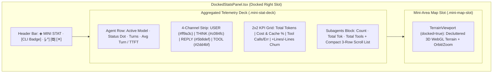

# Feature Plan: Docked Mini Stat & Area Map (`feature_mini_stat_map.md`)

> [!IMPORTANT]
> **Goal**: Replace the current single-purpose docked Area Map (`DockedStatsPanel.tsx`) with a high-density, aggregated **Mini Stat & Area Map** panel. Because space inside the docked right-hand slot is constrained, this panel eliminates raw event logs and noisy 3D HUD overlays in favor of **aggregated telemetry** (Primary Agent status, Sub-agents summary & mini-list, Token/Cost economy, Tool/Code Delta, and 4-Channel Activity Breakdown) stacked above a **streamlined, decluttered 3D WebGL Mini-Area Map**.

---

## 1. Architectural Overview & Design Decisions

### 1.1 Layout Architecture (Top/Bottom Split in Docked Slot)
Inside [DockedStatsPanel.tsx](file:///Users/darrenkoh/github/sparkmux/apps/desktop/src/chrome/DockedStatsPanel.tsx), the panel is organized vertically into three distinct zones:
1. **Compact Header Bar (`28px` fixed)**:
   - Displays title badge `◈ MINI STAT & MAP`, live/standby pulse dot, CLI badge (`CLAUDE`, `GROK`, `ANTIGRAVITY`, or `IDLE`), and window action buttons (`⤢` Expand to Fullscreen HUD, `⧉` Pop Out Window, `✕` Close Dock).
2. **Upper Zone — Aggregated Telemetry Deck (Scrollable / Auto-fit)**:
   - **Card A: Primary Agent Status**: Active model name, live activity indicator (active if last event `< 30s` ago), total turns (`turn_count`), average turn time (`avg_turn_duration_ms`), and TTFT (`ttft_ms`).
   - **Card B: Sub-Agents Aggregated Summary & Mini-List**:
     - Summary header bar: Total subagent count (`subagents.length`), aggregated subagent tokens (`sum(input_tokens + output_tokens)`), aggregated subagent tool calls (`sum(tool_calls)`), and error badge if `sum(tool_errors) > 0`.
     - Expandable/scrollable compact list (shows up to 3 visible rows at `22px` height each before scrolling, or collapsed when `0` subagents): Each row shows a live/idle dot, subagent label/role (`row.label || row.id`), short model tag, token count, and tool call count.
   - **Card C: 4-Channel Activity Breakdown Strip**:
     - Compact 4-pill horizontal bar matching the 3D terrain channels:
       - `USER` (`#ff9a3c`, `user_prompts`)
       - `THINK` (`#c084fc`, `thinking_blocks`)
       - `REPLY` (`#5b8def`, `assistant_replies`)
       - `TOOL` (`#2dd4bf`, `tool_calls`)
     - Includes a proportional 4-segment micro-bar beneath the counts to visualize channel dominance at a glance.
   - **Card D: Token Economy & Code Delta Grid (2x2 Compact Matrix)**:
     - **Tokens**: Total tokens (`input + output + reasoning`) with `IN / OUT` split in subtext.
     - **Cache & Cost**: Cache hit efficiency percentage (`cacheHitRate%`) with mini progress bar + Estimated Cost (`formatUsd(estCost)` in `#facc15`).
     - **Tools Health**: Total `tool_calls` with average tool latency across `stats.tools` and error badge (`tool_errors > 0 ? "N ERR" : "OK"`).
     - **Code Churn**: `+lines_added / -lines_removed` (`netDiff`) with a dual-color teal/red ratio bar.
3. **Lower Zone — Streamlined 3D WebGL Mini-Area Map (`flex: 1`, min-height `130px`)**:
   - Uses [TerrainViewport.tsx](file:///Users/darrenkoh/github/sparkmux/apps/desktop/src/chrome/TerrainViewport.tsx) with `docked={true}` (and a new optional prop `miniMode={true}` or enhanced `docked` behavior).
   - **Decluttered 3D Rendering**: Keeps the 50k WebGL particle heightmap, Marching Squares elevation contours, base grid, chronological scan sweep laser, and glowing agent journey trace, plus pointer drag-to-orbit, wheel-to-zoom, and double-click reset.
   - **Suppressed 2D HUD Noise**: When `docked={true}`, skips drawing the Left Y-Axis Altitude Ruler (`(D)`), the large floating Waypoint Target Pin boxes (`(C)`), and verbose 3D text strings (`(B)`), replacing them with clean, minimal corner micro-labels (`T0` -> `NOW` and channel color dots) so the 3D terrain relief is 100% legible in a small viewport.



---

## 2. Pure Aggregation Helper Module (`miniStatModel.ts`)

To keep [DockedStatsPanel.tsx](file:///Users/darrenkoh/github/sparkmux/apps/desktop/src/chrome/DockedStatsPanel.tsx) clean and make all aggregation math unit-testable without DOM overhead, create a dedicated pure TypeScript helper module at `apps/desktop/src/chrome/miniStatModel.ts`.

### 2.1 File to Create: `apps/desktop/src/chrome/miniStatModel.ts`

```ts
import type { SubagentStat, TabAnalyticsStats, ToolStat } from "../api";
import { estimateTotalCost } from "./analyticsFormat";

export interface AggregatedAgentSummary {
  cliBadge: string;
  activeModel: string;
  isLive: boolean;
  turnCount: number;
  avgTurnMs: number;
  ttftMs: number;
}

export interface AggregatedSubagentRow {
  id: string;
  name: string;
  modelShort: string;
  totalTokens: number;
  toolCalls: number;
  toolErrors: number;
  linesAdded: number;
  linesRemoved: number;
  isLive: boolean;
  lastTs: number;
}

export interface AggregatedSubagentsSummary {
  totalCount: number;
  activeCount: number;
  totalTokens: number;
  totalToolCalls: number;
  totalErrors: number;
  rows: AggregatedSubagentRow[];
}

export interface ChannelBreakdownItem {
  key: "user" | "think" | "reply" | "tool";
  label: string;
  color: string;
  count: number;
  pct: number;
}

export interface AggregatedMiniStats {
  agent: AggregatedAgentSummary;
  subagents: AggregatedSubagentsSummary;
  channels: ChannelBreakdownItem[];
  totalEvents: number;
  totalTokens: number;
  inputTokens: number;
  outputTokens: number;
  reasoningTokens: number;
  cacheReadTokens: number;
  cacheHitRate: number;
  estimatedCostUsd: number;
  toolCalls: number;
  toolErrors: number;
  avgToolLatencyMs: number;
  linesAdded: number;
  linesRemoved: number;
  netLines: number;
  addRatioPct: number;
}
```

### 2.2 Aggregation Logic Requirements in `miniStatModel.ts`
1. **`LIVE_THRESHOLD_MS = 30_000`**:
   - Primary agent `isLive`: `nowMs - (stats.timeline_end ?? 0) <= LIVE_THRESHOLD_MS` (when `timeline_end > 0`).
   - Subagent `isLive`: `nowMs - row.last_ts <= LIVE_THRESHOLD_MS` (when `row.last_ts > 0`).
2. **`shortModelName(model: string): string`**:
   - Strips verbose date suffixes (e.g., `-20250514`, `-20241022`) and prefixes (`claude-`, `models/`) so model names fit cleanly in narrow badges (e.g. `claude-sonnet-4-5-20250929` -> `sonnet-4-5`, `grok-4.7-build` -> `grok-4.7`).
3. **Subagent Sorting & Aggregation (`buildSubagentsSummary`)**:
   - Filters out empty placeholder entries if any, computes `totalTokens = input_tokens + output_tokens + reasoning_tokens` per subagent.
   - Sorts subagents by `isLive` descending, then `last_ts` descending, then `totalTokens` descending so the most relevant subagents appear at the top of the compact list.
   - Sums `totalTokens`, `totalToolCalls`, `totalErrors`, and `activeCount` across all `stats.subagents`.
4. **4-Channel Proportions (`buildChannelBreakdown`)**:
   - Sums `total = user_prompts + thinking_blocks + assistant_replies + tool_calls`.
   - Computes `pct` (`0..100`) for each of the 4 channels (`#ff9a3c`, `#c084fc`, `#5b8def`, `#2dd4bf`).
5. **Token Economy & Cost**:
   - `cacheHitRate`: `total_input_tokens + total_cache_read_tokens > 0 ? (total_cache_read_tokens / (total_input_tokens + total_cache_read_tokens)) * 100 : 0`.
   - `estimatedCostUsd`: Calls `estimateTotalCost(stats.models, stats.active_model, stats.total_input_tokens, stats.total_output_tokens, stats.total_cache_read_tokens, stats.total_cache_write_tokens)`.
6. **Tool Latency & Code Churn**:
   - `avgToolLatencyMs`: Weighted average across `stats.tools` (`sum(t.avg_duration_ms * t.calls) / sum(t.calls)`).
   - `addRatioPct`: `lines_added + lines_removed > 0 ? (lines_added / (lines_added + lines_removed)) * 100 : 50`.

---

## 3. Component Changes

### 3.1 Modify `apps/desktop/src/chrome/TerrainViewport.tsx`
Update `TerrainViewport` so that when `docked={true}`:
1. **Declutter 2D HUD Overlay in `render()`**:
   - Skip Section `(C) Waypoint Target Pins with Leader Lines` when `docked` is true (prevents large floating rectangles from covering the mini terrain).
   - Skip Section `(D) Left Y-Axis Altitude Ruler` when `docked` is true (saves `40px` of left horizontal margin).
   - In Section `(B) 3D Axis Labels`: when `docked` is true, omit verbose strings like `"◄ CHRONO TIME: 00:00 (START)"` and full channel names (`"[USER] USER INPUT"`), and instead render compact 3-letter tags (`USR`, `THK`, `RPL`, `TOL`) on the Z-lanes and compact time bounds (`+0:00` / `NOW`) only if `rect.height >= 110`.
2. **Camera Framing for Docked Mini-Viewport**:
   - Adjust initial camera radius or FOV slightly when `docked` is true (or scale `persistentCam.radius` default from `46` to `40`) so the island fills the smaller canvas aspect ratio with less empty margin.
3. **Remove Duplicate Floating Controls When Hosted in New Header**:
   - Keep `docked-terrain-badge` (`◈ AREA MAP`) minimal in the bottom-left or top-left corner of the canvas, and allow `DockedStatsPanel` to own the top header bar (`⤢`, `⧉`, `✕`) so buttons don't overlap the 3D terrain. (Pass `hideDockedControls?: boolean` to `TerrainViewport` so existing tests or standalone usages still work if needed).

### 3.2 Rewrite `apps/desktop/src/chrome/DockedStatsPanel.tsx`
Transform `DockedStatsPanel` from a bare `TerrainViewport` wrapper into the complete **Mini Stat & Area Map** component:

- **Header Bar (`.mini-stat-header`)**:
  - Left: `<span className="mini-stat-title"><span className="mini-stat-dot" /> MINI STAT</span>` + CLI badge (`cliLabel(data?.cli)`).
  - Right: Action buttons (`⤢` `onExpand`, `⧉` `onPopOut`, `✕` `onClose`) with exact same `aria-label` attributes (`"Expand to Fullscreen Telemetry HUD"`, `"Open Stats in a separate window"`, `"Close Docked Area Map"`) to preserve accessibility and existing test contracts.
- **Upper Telemetry Deck (`.mini-stat-deck`)**:
  - **Row 1 — Primary Agent Strip (`.mini-agent-card`)**:
    - Model badge (`summary.agent.activeModel`), live status pill (`LIVE` green pulse or `IDLE` dim), `TURNS: {turnCount}`, `AVG: {formatDuration(avgTurnMs)}`, `TTFT: {formatMs(ttftMs)}`.
  - **Row 2 — 4-Channel Activity Bar (`.mini-channels-card`)**:
    - 4 compact cells (`USR`, `THK`, `RPL`, `TOL`) with colored dot, label, and formatted count (`formatNum(ch.count)`).
    - Below the 4 cells: a `3px` stacked horizontal bar (`.mini-channel-bar`) with 4 colored segments proportional to `ch.pct`.
  - **Row 3 — 2x2 Aggregated KPI Grid (`.mini-kpi-grid`)**:
    - **Cell 1 (TOKENS)**: Label `TOKENS`, value `{formatNum(totalTokens)}`, sub `{formatNum(inputTokens)} in · {formatNum(outputTokens)} out`.
    - **Cell 2 (ECONOMY)**: Label `COST · CACHE`, value `{formatUsd(estimatedCostUsd)}`, sub `{cacheHitRate.toFixed(0)}% cache hit` + micro fill bar.
    - **Cell 3 (TOOLS)**: Label `TOOLS`, value `{formatNum(toolCalls)}`, sub `{toolErrors > 0 ? "${toolErrors} ERR" : "0 err"} · {formatMs(avgToolLatencyMs)} avg`.
    - **Cell 4 (CODE DELTA)**: Label `CODE DELTA`, value `+{linesAdded} / -{linesRemoved}`, sub dual-color churn bar.
  - **Row 4 — Sub-Agents Aggregated Block (`.mini-subagents-card`)**:
    - Header bar (clickable to toggle collapse/expand of rows when `subagents.totalCount > 0`):
      - `SUBAGENTS ({totalCount})`
      - Aggregated right summary: `{formatNum(subagents.totalTokens)} tok · {subagents.totalToolCalls} tools` + error badge if `subagents.totalErrors > 0`.
    - When `subagents.totalCount > 0` and expanded (default expanded):
      - Renders `.mini-subagent-list` (max-height `68px`, `overflow-y: auto`), displaying each `AggregatedSubagentRow`:
        - Status dot (`live` green or `idle` slate)
        - `.sub-name` (truncated with full tooltip containing model, `+added/-removed`, errors, id)
        - `.sub-model` (`row.modelShort`)
        - `.sub-metrics` (`{formatNum(row.totalTokens)}t · {row.toolCalls}⚙`)
- **Lower Mini-Area Map Slot (`.mini-map-container`)**:
  - Renders `<TerrainViewport ... docked={true} hideDockedControls={true} />`.
  - Overlaid with a subtle bottom-left label `◈ 3D TOPOGRAPHY` and bottom-right quick toggle for `SPECTRAL / MONO` or `RESET CAM` if desired, without obscuring the terrain.

---

## 4. Styling Specifications (`apps/desktop/src/index.css`)

Add dedicated CSS rules under the `RIGHT DOCKED PANELS` section of [index.css](file:///Users/darrenkoh/github/sparkmux/apps/desktop/src/index.css):
- `.docked-stats-panel`: `display: flex; flex-direction: column; background: #06080c; color: #e2e8f0; font-family: ui-monospace, SFMono-Regular, Menlo, monospace;`
- `.mini-stat-header`: `display: flex; align-items: center; justify-content: space-between; height: 28px; padding: 0 8px; background: rgba(12, 16, 23, 0.95); border-bottom: 1px solid rgba(255, 255, 255, 0.08); flex-shrink: 0;`
- `.mini-stat-deck`: `display: flex; flex-direction: column; gap: 5px; padding: 6px 8px; flex: 0 0 auto; max-height: 58%; overflow-y: auto; border-bottom: 1px solid rgba(255, 154, 60, 0.18); background: linear-gradient(180deg, rgba(15, 20, 28, 0.85), rgba(8, 11, 16, 0.95));`
- `.mini-agent-card`: Single-line or wrap-friendly flex bar (`padding: 4px 6px; background: rgba(255, 255, 255, 0.03); border: 1px solid rgba(255, 255, 255, 0.07); border-radius: 3px; font-size: 9.5px;`).
- `.mini-channels-card`: 4-column grid (`grid-template-columns: repeat(4, 1fr); gap: 4px;`) + `3px` progress bar below.
- `.mini-kpi-grid`: `display: grid; grid-template-columns: 1fr 1fr; gap: 4px;` where each `.mini-kpi-cell` has `padding: 4px 6px; background: rgba(255, 255, 255, 0.025); border: 1px solid rgba(255, 255, 255, 0.06); border-radius: 3px;`.
- `.mini-subagents-card`: Compact container with `border: 1px solid rgba(165, 180, 252, 0.2); background: rgba(165, 180, 252, 0.04); border-radius: 3px;`.
- `.mini-subagent-list`: `max-height: 66px; overflow-y: auto; display: flex; flex-direction: column; gap: 2px; padding: 3px 6px;`.
- `.mini-map-container`: `flex: 1 1 120px; min-height: 110px; position: relative; overflow: hidden;`.

---

## 5. Step-by-Step Implementation Checklist for Gemini 3.8 Flash

Follow these steps in order when executing this plan:

- [ ] **Step 1: Create `apps/desktop/src/chrome/miniStatModel.ts`**
  - Implement `shortModelName`, `buildChannelBreakdown`, `buildSubagentsSummary`, and `aggregateMiniStats(stats, cli, nowMs)`.
  - Ensure all edge cases (`null` or `undefined` `stats`, `0` tokens, empty `subagents`, empty `tools`) return safe zeroed defaults without `NaN`.
- [ ] **Step 2: Create Unit Tests in `apps/desktop/src/chrome/miniStatModel.test.ts`**
  - Test empty/null stats handling.
  - Test primary agent live detection (`timeline_end` within 30s vs older).
  - Test subagent aggregation (token sums, tool call sums, error counts, sorting live subagents first, model name shortening).
  - Test 4-channel percentage calculation and cache hit / cost estimation.
- [ ] **Step 3: Update `apps/desktop/src/chrome/TerrainViewport.tsx` for Decluttered Mini-Map**
  - Add `hideDockedControls?: boolean` to `TerrainViewportProps`.
  - In the 2D HUD canvas render block (`render()`), guard `(C) Waypoint Target Pins` and `(D) Left Y-Axis Altitude Ruler` with `if (!docked)` so the mini-map stays clean and unobstructed.
  - In `(B) 3D Axis Labels`, use compact channel labels (`USR`, `THK`, `RPL`, `TOL`) when `docked` is true.
  - When `docked && hideDockedControls` is true, omit the floating `.docked-terrain-controls` inside `TerrainViewport` (since `DockedStatsPanel` renders them in the top header bar).
- [ ] **Step 4: Update `apps/desktop/src/chrome/DockedStatsPanel.tsx`**
  - Import `aggregateMiniStats` from `./miniStatModel`, `cliLabel` from `./artifactModel`, and formatting helpers (`formatNum`, `formatMs`, `formatDuration`, `formatUsd`) from `./analyticsFormat`.
  - Render the Header Bar (with Expand `⤢`, Pop Out `⧉`, Close `✕`), the Aggregated Telemetry Deck (Agent card, 4-Channel strip, 2x2 KPI grid, and collapsible Subagents summary + mini-list), and the lower `TerrainViewport` mini-map slot.
- [ ] **Step 5: Add CSS Styles in `apps/desktop/src/index.css`**
  - Add all `.mini-stat-*`, `.mini-agent-*`, `.mini-channels-*`, `.mini-kpi-*`, `.mini-subagents-*`, and `.mini-map-container` styles.
- [ ] **Step 6: Verify & Run Full Test Suite**
  - Run `pnpm --dir apps/desktop test` (or `npx vitest run` inside `apps/desktop`) and `pnpm --dir apps/desktop run build`.
  - Run `cargo test --workspace` and `cargo clippy --workspace -- -D warnings` to ensure all workspace checks pass.
