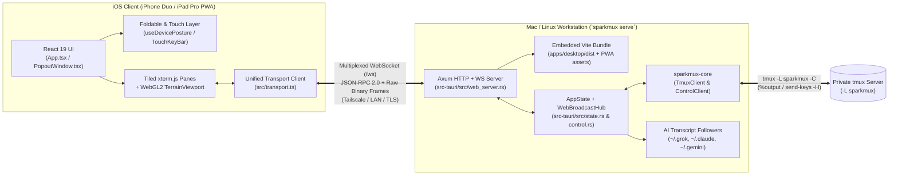

# Sparkmux iOS Design & Implementation Plan (`ios_plan.md`)

> **Target Architecture:** Option 3 — Pure Web App / Installable iOS Progressive Web App (PWA) served by `sparkmux serve` on the Mac/Linux host over Tailscale, LAN, or TLS tunnel.
> **Target Devices:** iPhone Duo (foldable dual-screen / book / clamshell / folded postures) and Large iPad (iPad Pro 11"–13", Stage Manager multi-window scenes, Split View, External Display, Apple Pencil, and Magic Keyboard).

---

## 1. Executive Summary & Architectural Principles

### 1.1 Why Pure Web App / Installable iOS PWA (`sparkmux serve`)
Sparkmux's desktop frontend (`apps/desktop/src`) is built on **React 19, TypeScript, `@xterm/xterm` 5.5, and raw WebGL2 (`TerrainViewport.tsx`)**, while its backend (`crates/sparkmux-core` and `apps/desktop/src-tauri`) manages a private `tmux -L sparkmux` server in control mode (`tmux -C`) and incrementally tails local/SSH AI CLI transcripts (`~/.grok`, `~/.claude`, `~/.gemini/antigravity-cli`).

Because iOS sandboxing forbids spawning local `tmux`, `git`, `ps`, or AI CLI subprocesses directly on-device, and because raw SSH apps on iOS lose all of Sparkmux's GUI capabilities (tiled multi-pane `xterm.js`, 3D WebGL2 Topographical Area Map, Neural Cortex `AnalyticsHud`, `ArtifactPanel`, and `ChangeGraph`/`Chronicle`), serving Sparkmux as an **installable full-screen iOS Web App / PWA directly from the Mac/Linux host (`sparkmux serve`)** provides:

1. **100% Feature Parity with Desktop:** Every Sparkmux capability—live `%output` terminal streaming, `send-keys -H` input, 5,000-line scrollback seeding, real-time token telemetry, 3D Area Map, `ChangeGraph`, and `Chronicle` git diffs—executes natively against the host's `-L sparkmux` socket and filesystem.
2. **Zero Xcode / Zero App Store Friction:** No Apple Developer fee, no provisioning profiles, no TestFlight review delays, and no `#[cfg(target_os = "ios")]` compromises in native crates. Users run `sparkmux serve` on their Mac/Linux workstation, scan a terminal QR code (over Tailscale or LAN) on their iPhone Duo or iPad, and tap **"Add to Home Screen"**.
3. **Instant Reconnect & Zero State Loss:** iOS aggressively suspends background browser/PWA tabs. Because `tmux -L sparkmux` persists on the host, waking the iPhone Duo or iPad automatically reconnects the WebSocket, re-seeds visible panes via `capture-pane`, and resumes `%output` streaming in <100ms.

### 1.2 Strict Adherence to Sparkmux Product Rules (`AGENTS.md`)
All iOS/Web additions strictly enforce the repository's core product invariants:
- **Owns `-L sparkmux`:** Never lists or mutates the user's `-L default` tmux server in the GUI.
- **Quit/Disconnect detaches:** Closing the iOS PWA tab or dropping the WebSocket detaches the subscriber; the `tmux -L sparkmux` server and all running AI agents stay up.
- **Named New Session uses `new_session_ex` only:** Never calls `ensure_ready` when creating a named session (no leftover `main`).
- **Control-mode live path:** Live terminal I/O uses `%output` and `send-keys -H` exclusively. `capture-pane` is used **only** for initial pane seeding (`seed_pane_bytes`) upon subscribe/reconnect—never polled.
- **Strictly read-only AI transcript ingestion:** `ingest.rs` and `artifacts.rs` remain 100% read-only.
- **All tmux I/O stays in `crates/sparkmux-core`:** The web server invokes existing `sparkmux-core` and `sparkmux-desktop` command logic without spawning `tmux` ad-hoc.

---

## 2. System Architecture & Wire Protocol Specification



### 2.1 Multiplexed Single-Socket Wire Protocol (`/ws`)
To avoid head-of-line blocking, HTTP polling overhead, or Base64 bloat on high-frequency terminal output, each iOS client establishes **one** WebSocket connection to `ws(s)://<host>:<port>/ws?token=<auth_token>`.

The WebSocket carries two frame types:

#### A. Text Frames (UTF-8 JSON): RPC Commands & Server Events
1. **Client $\rightarrow$ Server RPC Request:**
   ```json
   {
     "id": 42,
     "cmd": "snapshot",
     "args": {}
   }
   ```
2. **Server $\rightarrow$ Client RPC Response:**
   ```json
   {
     "id": 42,
     "ok": true,
     "data": { "sessions": [...] }
   }
   ```
   Or on error:
   ```json
   {
     "id": 42,
     "ok": false,
     "error": "missing-tmux: could not find tmux binary"
   }
   ```
3. **Server $\rightarrow$ Client Push Event:**
   ```json
   {
     "event": "layout-change",
     "payload": { "window_id": "@1", "layout": { ... } }
   }
   ```
   Supported push events (matching Tauri `listen()` events 1-to-1):
   - `"layout-change"` (`LayoutChangePayload`)
   - `"tree-dirty"` (`null`)
   - `"control-exit"` (`null`)
   - `"server-stopped"` (`null`)
   - `"menu"` (`string`)
   - `"active-target-changed"` (`ActiveTarget`)

#### B. Binary Frames: Zero-Copy Terminal Stream (`%output` & `pane_write`)
Binary WebSocket frames use a compact 2-byte+ header so `Uint8Array` terminal payloads flow directly into `xterm.write(bytes)` without UTF-8/JSON parsing:

```
+---------------+-------------------+------------------------+-----------------------+
| Frame Type    | Pane ID Byte Len  | Pane ID (ASCII bytes)  | Raw Terminal Payload  |
| 1 byte (u8)   | 1 byte (u8)       | N bytes (e.g. "%0")    | Remaining bytes       |
+---------------+-------------------+------------------------+-----------------------+
```

- **Server $\rightarrow$ Client:**
  - `0x01`: **Pane Seed Frame** — The first binary frame sent after `pane_subscribe` containing `seed_pane_bytes` (scrollback + visible screen + CSI CUP cursor position). Triggers `applyPaneSeed()` on the client.
  - `0x02`: **Live `%output` Frame** — Incremental raw bytes from `ControlEvent::Output { pane_id, bytes }`. Triggers `term.write(bytes)` on the client.
- **Client $\rightarrow$ Server:**
  - `0x03`: **Fast `pane_write` Frame** — Raw keystroke/paste bytes from the client sent directly to `ctl.send_keys_raw(pane_id, payload)`. (JSON-RPC `"pane_write"` is also supported as a fallback).

### 2.2 Multi-Client Fan-Out (`PaneSink` & `EventHub`)
On desktop, only a single Tauri window subscribes to a pane at a time (`HashMap<String, PaneFeed>`). When running `sparkmux serve`, a user may have:
- The macOS desktop app open,
- Their **iPhone Duo** connected, AND
- Two **iPad Pro Stage Manager** windows open (`index.html` + `index.html?window=stats`).

To support simultaneous clients cleanly without detaching each other:
1. `PaneFeed` in `apps/desktop/src-tauri/src/state.rs` is generalized to hold a list of `PaneSubscriber`s (`TauriChannel` or `WsSender`) per `pane_id`.
2. When a new WebSocket client calls `pane_subscribe` for `%0`, it receives its own fresh `seed_pane_bytes(&client, "%0")` (`0x01` binary frame) and is registered in the `%0` subscriber list to receive subsequent `0x02` `%output` broadcasts.
3. When a WebSocket disconnects, only that client's `subscriber_id` is removed from `channels`—the `ControlClient` (`tmux -C`) stays connected for any other active clients and never stops the `-L sparkmux` server.

### 2.3 Authentication & Network Security
- **Bind Address:** Defaults to `127.0.0.1:7420` plus automatic binding to the local **Tailscale IPv4 (`100.64.0.0/10`)** if detected, or a user-specified `--bind 0.0.0.0:7420`.
- **Bearer / Session Token:**
  - On startup, `sparkmux serve` reads `SPARKMUX_WEB_TOKEN` (or `--token`) or generates a cryptographically random 32-byte URL-safe token persisted in `<config_dir>/sparkmux/web_token`.
  - Prints a scannable **UTF-8 QR Code** and clickable URL (`http://<tailscale-ip>:7420/?token=<token>`) to the terminal.
  - When the iOS device opens `/?token=<token>`, the server validates the token using constant-time comparison, sets an `HttpOnly; SameSite=Strict; Max-Age=2592000` cookie (`sparkmux_session`), and strips `?token=` from the URL bar via `history.replaceState` so subsequent Home Screen PWA launches authenticate automatically without re-entering the token.

---

## 3. Backend Implementation Specification (Rust)

### 3.1 Workspace & Crate Dependencies

#### Update `Cargo.toml` (Workspace Root)
Add `axum`, `tower-http`, `rust-embed`, `mime_guess`, `rand`, ` subtle`, and `tokio-tungstenite` to `[workspace.dependencies]`:

```toml
# /Cargo.toml (add under [workspace.dependencies])
axum = { version = "0.8", features = ["ws", "macros"] }
tower-http = { version = "0.6", features = ["cors", "set-header"] }
rust-embed = { version = "8", features = ["interpolate-folder-path"] }
mime_guess = "2"
rand = "0.8"
```

#### Update `apps/desktop/src-tauri/Cargo.toml`
```toml
# /apps/desktop/src-tauri/Cargo.toml (add under [dependencies])
axum.workspace = true
tower-http.workspace = true
rust-embed.workspace = true
mime_guess.workspace = true
rand.workspace = true
```

### 3.2 Generalizing `state.rs` and `control.rs` for Multi-Client Tauri + WebSocket Fan-Out

#### Modify `apps/desktop/src-tauri/src/state.rs`
Add `ServerEvent` broadcast channel and multi-subscriber `PaneSink` so both Tauri IPC and WebSocket clients share `AppState` seamlessly:

```rust
// In apps/desktop/src-tauri/src/state.rs
use tokio::sync::{broadcast, mpsc, Mutex};
use std::sync::atomic::{AtomicU64, Ordering};

static NEXT_SUB_ID: AtomicU64 = AtomicU64::new(1);

pub fn next_subscriber_id() -> u64 {
    NEXT_SUB_ID.fetch_add(1, Ordering::Relaxed)
}

#[derive(Clone)]
pub enum PaneSink {
    Tauri(Channel<InvokeResponseBody>),
    WebSocket(mpsc::UnboundedSender<Vec<u8>>),
}

impl PaneSink {
    pub fn send_bytes(&self, is_seed: bool, pane_id: &str, bytes: Vec<u8>) -> bool {
        match self {
            PaneSink::Tauri(ch) => ch.send(InvokeResponseBody::Raw(bytes)).is_ok(),
            PaneSink::WebSocket(tx) => {
                let pane_bytes = pane_id.as_bytes();
                if pane_bytes.len() > 255 {
                    return false;
                }
                let mut frame = Vec::with_capacity(2 + pane_bytes.len() + bytes.len());
                frame.push(if is_seed { 0x01 } else { 0x02 });
                frame.push(pane_bytes.len() as u8);
                frame.extend_from_slice(pane_bytes);
                frame.extend_from_slice(&bytes);
                tx.send(frame).is_ok()
            }
        }
    }
}

pub struct PaneSubscriber {
    pub id: u64,
    pub sink: PaneSink,
    pub seeded: bool,
    pub buf: Vec<Vec<u8>>,
}

#[derive(Debug, Clone, serde::Serialize)]
#[serde(tag = "event", content = "payload")]
pub enum ServerPushEvent {
    #[serde(rename = "layout-change")]
    LayoutChange {
        window_id: String,
        layout: sparkmux_core::LayoutNode,
    },
    #[serde(rename = "tree-dirty")]
    TreeDirty,
    #[serde(rename = "control-exit")]
    ControlExit,
    #[serde(rename = "server-stopped")]
    ServerStopped,
    #[serde(rename = "menu")]
    Menu(String),
    #[serde(rename = "active-target-changed")]
    ActiveTargetChanged(ActiveTarget),
}
```

In `AppState`:
- Add `pub events_tx: broadcast::Sender<ServerPushEvent>` to `AppState` (initialized with `broadcast::channel(256)` in `AppState::new()`).
- Change `Inner::channels` from `Arc<Mutex<HashMap<String, PaneFeed>>>` to `Arc<Mutex<HashMap<String, Vec<PaneSubscriber>>>>`.
- Keep a helper `AppState::emit_event(&self, app: Option<&tauri::AppHandle>, ev: ServerPushEvent)` that emits to both `app` (if running inside Tauri desktop) and `self.events_tx.send(ev)`.

#### Modify `apps/desktop/src-tauri/src/control.rs`
1. Extract `connect_core(app: Option<&AppHandle>, state: &AppState, session: String, cols: u16, rows: u16) -> Result<(), String>` and `subscribe_pane_with_sink(state: &AppState, pane_id: String, sub_id: u64, sink: PaneSink) -> Result<(), String>`.
2. In `spawn_pump`:
   - On `ControlEvent::Output { pane_id, bytes }`: iterate `subscribers` for `pane_id`, retain only subscribers whose `sink.send_bytes(false, &pane_id, bytes.clone())` succeeds (or buffer up to 256 chunks if `!sub.seeded`).
   - On `ControlEvent::LayoutChange`, `SnapshotHint`, `Exit`: emit via `app` (if `Some`) and `events_tx`.
3. Add `unsubscribe_pane_by_id(state: &AppState, pane_id: &str, sub_id: Option<u64>)` and `unsubscribe_all_for_client(state: &AppState, sub_ids: &[u64])` so when an iOS WebSocket disconnects, its pane subscriptions are cleaned up immediately.

### 3.3 Creating `apps/desktop/src-tauri/src/web_server.rs`
Create `apps/desktop/src-tauri/src/web_server.rs` to serve the embedded frontend (`apps/desktop/dist`) and handle `/ws`:

```rust
//! HTTP + WebSocket server for Sparkmux iOS Web App / PWA (`sparkmux serve`).

use std::collections::HashSet;
use std::net::SocketAddr;
use std::sync::Arc;
use std::time::Duration;

use axum::{
    body::Body,
    extract::{
        ws::{Message, WebSocket, WebSocketUpgrade},
        Query, State as AxumState,
    },
    http::{header, HeaderMap, Response, StatusCode, Uri},
    response::IntoResponse,
    routing::get,
    Router,
};
use rust_embed::RustEmbed;
use serde::{Deserialize, Serialize};
use serde_json::{json, Value};
use tokio::sync::mpsc;

use crate::board_api::BoardPane;
use crate::change_graph::SearchFileTarget;
use crate::control;
use crate::state::{next_subscriber_id, ActiveTarget, AppState, PaneSink, ServerPushEvent};

#[derive(RustEmbed)]
#[folder = "../dist/"]
struct DistAssets;

#[derive(Clone)]
pub struct WebServerContext {
    pub state: Arc<AppState>,
    pub auth_token: Arc<String>,
}

#[derive(Deserialize, Default)]
pub struct AuthQuery {
    pub token: Option<String>,
}

#[derive(Deserialize)]
struct RpcRequest {
    id: u64,
    cmd: String,
    #[serde(default)]
    args: Value,
}

#[derive(Serialize)]
struct RpcResponse {
    id: u64,
    ok: bool,
    #[serde(skip_serializing_if = "Option::is_none")]
    data: Option<Value>,
    #[serde(skip_serializing_if = "Option::is_none")]
    error: Option<String>,
}

pub async fn run_web_server(
    state: Arc<AppState>,
    bind_addr: SocketAddr,
    auth_token: String,
) -> Result<(), String> {
    let ctx = WebServerContext {
        state,
        auth_token: Arc::new(auth_token),
    };

    let app = Router::new()
        .route("/ws", get(ws_handler))
        .route("/api/health", get(health_handler))
        .fallback(static_handler)
        .with_state(ctx);

    let listener = tokio::net::TcpListener::bind(bind_addr)
        .await
        .map_err(|e| format!("failed to bind {bind_addr}: {e}"))?;

    tracing::info!("Sparkmux iOS/Web server listening on http://{bind_addr}");
    axum::serve(listener, app)
        .await
        .map_err(|e| format!("web server error: {e}"))
}

async fn health_handler() -> impl IntoResponse {
    axum::Json(json!({ "status": "ok", "version": env!("CARGO_PKG_VERSION") }))
}

fn is_authenticated(headers: &HeaderMap, query: &AuthQuery, expected: &str) -> bool {
    if expected.is_empty() {
        return true;
    }
    if let Some(t) = &query.token {
        if constant_time_eq(t.as_bytes(), expected.as_bytes()) {
            return true;
        }
    }
    if let Some(cookie_hdr) = headers.get(header::COOKIE).and_then(|v| v.to_str().ok()) {
        for part in cookie_hdr.split(';') {
            let trimmed = part.trim();
            if let Some(val) = trimmed.strip_prefix("sparkmux_session=") {
                if constant_time_eq(val.as_bytes(), expected.as_bytes()) {
                    return true;
                }
            }
        }
    }
    false
}

fn constant_time_eq(a: &[u8], b: &[u8]) -> bool {
    if a.len() != b.len() {
        return false;
    }
    let mut diff = 0u8;
    for (x, y) in a.iter().zip(b.iter()) {
        diff |= x ^ y;
    }
    diff == 0
}

async fn static_handler(
    AxumState(ctx): AxumState<WebServerContext>,
    Query(query): Query<AuthQuery>,
    headers: HeaderMap,
    uri: Uri,
) -> Response<Body> {
    let path = uri.path().trim_start_matches('/');
    // Allow manifest and icons so iOS Homescreen icon preflight succeeds, but gate app shell
    let is_public_asset = path == "manifest.webmanifest"
        || path.starts_with("icons/")
        || path == "apple-touch-icon.png";

    if !is_public_asset && !is_authenticated(&headers, &query, &ctx.auth_token) {
        return Response::builder()
            .status(StatusCode::UNAUTHORIZED)
            .header(header::CONTENT_TYPE, "text/html; charset=utf-8")
            .body(Body::from(LOGIN_HTML))
            .unwrap();
    }

    let target = if path.is_empty() { "index.html" } else { path };
    let asset = DistAssets::get(target).or_else(|| DistAssets::get("index.html"));

    match asset {
        Some(content) => {
            let mime = mime_guess::from_path(target).first_or_octet_stream();
            let mut builder = Response::builder()
                .status(StatusCode::OK)
                .header(header::CONTENT_TYPE, mime.as_ref());

            if query.token.is_some() {
                builder = builder.header(
                    header::SET_COOKIE,
                    format!(
                        "sparkmux_session={}; Path=/; HttpOnly; SameSite=Strict; Max-Age=2592000",
                        ctx.auth_token
                    ),
                );
            }
            builder.body(Body::from(content.data.into_owned())).unwrap()
        }
        None => Response::builder()
            .status(StatusCode::NOT_FOUND)
            .body(Body::from("Not found"))
            .unwrap(),
    }
}

async fn ws_handler(
    ws: WebSocketUpgrade,
    AxumState(ctx): AxumState<WebServerContext>,
    Query(query): Query<AuthQuery>,
    headers: HeaderMap,
) -> impl IntoResponse {
    if !is_authenticated(&headers, &query, &ctx.auth_token) {
        return StatusCode::UNAUTHORIZED.into_response();
    }
    ws.on_upgrade(move |socket| handle_ws_client(socket, ctx.state))
}

async fn handle_ws_client(mut socket: WebSocket, state: Arc<AppState>) {
    let (bin_tx, mut bin_rx) = mpsc::unbounded_channel::<Vec<u8>>();
    let mut events_rx = state.events_tx.subscribe();
    let mut client_subs: HashSet<(String, u64)> = HashSet::new();
    let mut ping_interval = tokio::time::interval(Duration::from_secs(20));

    loop {
        tokio::select! {
            _ = ping_interval.tick() => {
                if socket.send(Message::Ping(Vec::new().into())).await.is_err() {
                    break;
                }
            }
            Some(bin_frame) = bin_rx.recv() => {
                if socket.send(Message::Binary(bin_frame.into())).await.is_err() {
                    break;
                }
            }
            Ok(push_ev) = events_rx.recv() => {
                if let Ok(txt) = serde_json::to_string(&push_ev) {
                    if socket.send(Message::Text(txt.into())).await.is_err() {
                        break;
                    }
                }
            }
             maybe_msg = socket.recv() => {
                let Some(Ok(msg)) = maybe_msg else { break };
                match msg {
                    Message::Binary(bytes) => {
                        // Fast binary pane_write: [0x03, pane_id_len, ...pane_id, ...payload]
                        if bytes.len() >= 2 && bytes[0] == 0x03 {
                            let id_len = bytes[1] as usize;
                            if bytes.len() >= 2 + id_len {
                                if let Ok(pane_id) = std::str::from_utf8(&bytes[2..2 + id_len]) {
                                    let payload = &bytes[2 + id_len..];
                                    let _ = crate::commands::pane_write_core(&state, pane_id, payload).await;
                                }
                            }
                        }
                    }
                    Message::Text(text) => {
                        let Ok(req) = serde_json::from_str::<RpcRequest>(&text) else {
                            continue;
                        };
                        let resp = dispatch_rpc(&state, &bin_tx, &mut client_subs, req).await;
                        if let Ok(json_txt) = serde_json::to_string(&resp) {
                            if socket.send(Message::Text(json_txt.into())).await.is_err() {
                                break;
                            }
                        }
                    }
                    Message::Close(_) => break,
                    _ => {}
                }
            }
        }
    }

    // Clean up all pane subscriptions registered by this WebSocket connection
    for (pane_id, sub_id) in client_subs {
        control::unsubscribe_pane_by_id(&state, &pane_id, Some(sub_id)).await;
    }
}
```

#### Complete RPC Command Dispatcher (`dispatch_rpc` in `web_server.rs`)
Every single command in `apps/desktop/src/api.ts` is mapped in `dispatch_rpc`:

| Command Name (`req.cmd`) | Arguments (`req.args`) | Underlying Handler |
| :--- | :--- | :--- |
| `"tmux_status"` | `{}` | `commands::tmux_status_core(&state).await` |
| `"snapshot"` | `{}` | `commands::snapshot_core(&state).await` |
| `"ensure_ready"` | `{}` | `commands::ensure_ready_core(&state).await` |
| `"new_session"` | `{ name }` | `commands::new_session_core(&state, name).await` |
| `"rename_session"` | `{ target, newName }` | `commands::rename_session_core(&state, target, new_name).await` |
| `"kill_session"` | `{ target }` | `commands::kill_session_core(&state, target).await` |
| `"new_window"` | `{ session, name }` | `commands::new_window_core(&state, session, name).await` |
| `"select_window"` | `{ windowId }` | `commands::select_window_core(&state, window_id).await` |
| `"rename_window"` | `{ windowId, name }` | `commands::rename_window_core(&state, window_id, name).await` |
| `"kill_window"` | `{ windowId }` | `commands::kill_window_core(&state, window_id).await` |
| `"kill_pane"` | `{ paneId }` | `commands::kill_pane_core(&state, pane_id).await` |
| `"split_pane"` | `{ paneId, vertical }` | `commands::split_pane_core(&state, pane_id, vertical).await` |
| `"control_connect"` | `{ session, cols, rows }` | `control::connect_core(None, &state, session, cols, rows).await` |
| `"control_disconnect"` | `{}` | No-op for individual WS client (cleans up `client_subs` without killing shared control client) |
| `"pane_subscribe"` | `{ paneId }` | Registers `PaneSink::WebSocket(bin_tx.clone())`, sends `0x01` seed frame |
| `"pane_unsubscribe"` | `{ paneId }` | Removes `(pane_id, sub_id)` from `client_subs` and `state.inner.channels` |
| `"pane_write"` | `{ paneId, data }` | `commands::pane_write_core(&state, &pane_id, &data).await` |
| `"window_resize"` | `{ cols, rows }` | `commands::window_resize_core(&state, cols, rows).await` |
| `"pane_cursor"` | `{ paneId }` | `commands::pane_cursor_core(&state, pane_id).await` |
| `"focus_pane"` | `{ paneId }` | `commands::focus_pane_core(&state, pane_id).await` |
| `"stop_server"` | `{}` | `commands::stop_server_core(None, &state).await` |
| `"remember_session"` | `{ name }` | `commands::remember_session_core(&state, name).await` |
| `"parse_layout"` | `{ layout }` | `commands::parse_layout(layout)` |
| `"attach_target_name"` | `{}` | `commands::attach_target_name_core(&state).await` |
| `"app_telemetry"` | `{}` | `Ok(telemetry::app_telemetry())` |
| `"llm_usage"` | `{ command, title, cwd, pid }` | `Ok(llm_usage::llm_usage(command, title, cwd, pid).await)` |
| `"pane_artifacts"` | `{ command, cwd, title, pid }` | `artifacts::pane_artifacts(command, cwd, title, pid).await` |
| `"change_graph"` | `{ command, cwd, title, pid }` | `change_graph::change_graph(command, cwd, title, pid).await` |
| `"file_diff"` | `{ repoId, path, cwd }` | `change_graph::file_diff(repo_id, path, cwd).await` |
| `"search_changed_files"` | `{ targets, query, scope, cwd }` | `change_graph::search_changed_files(targets, query, scope, cwd).await` |
| `"git_history"` | `{ repoId, cwd, path, maxCount }` | `change_graph::git_history(repo_id, cwd, path, max_count).await` |
| `"git_commit_detail"` | `{ repoId, cwd, commitHash }` | `change_graph::git_commit_detail(repo_id, cwd, commit_hash).await` |
| `"git_commit_diff"` | `{ repoId, cwd, commitHash, path }` | `change_graph::git_commit_diff(repo_id, cwd, commit_hash, path).await` |
| `"chronicle_session"` | `{ command, cwd, title, pid }` | `chronicle::chronicle_session(command, cwd, title, pid).await` |
| `"chronicle_hologram"` | `{ command, cwd, title, pid, stationId }` | `chronicle::chronicle_hologram(command, cwd, title, pid, station_id).await` |
| `"clear_chronicle_cache"` | `{}` | `chronicle::clear_chronicle_cache()` |
| `"tab_analytics"` | `{ sessionName, tabId, command, cwd, title, pid }` | `analytics::tab_analytics(session_name, tab_id, command, cwd, title, pid).await` |
| `"set_analytics_enabled"` | `{ enabled }` | `analytics::set_analytics_enabled(enabled)` |
| `"clear_analytics_data"` | `{}` | `analytics::clear_analytics_data()` |
| `"analytics_config"` | `{}` | `analytics::analytics_config()` |
| `"agent_board"` | `{ panes }` | `board_api::agent_board(panes).await` |
| `"sync_active_target"` | `{ target }` | Updates `state.active_target` and broadcasts `ServerPushEvent::ActiveTargetChanged(target)` |
| `"get_active_target"` | `{}` | `commands::get_active_target_core(&state)` |

### 3.4 CLI Entrypoint (`sparkmux serve`)
In `crates/sparkmux/src/main.rs` and `apps/desktop/src-tauri/src/lib.rs`:
1. Add `Commands::Serve` to `crates/sparkmux/src/main.rs`:
   ```rust
   /// Start the Sparkmux Web/PWA server for iOS (iPhone Duo / iPad)
   Serve {
       /// Port to listen on (default: 7420)
       #[arg(short, long, default_value_t = 7420)]
       port: u16,
       /// Bind IP address (default: 0.0.0.0 so Tailscale/LAN devices can reach it)
       #[arg(short, long, default_value = "0.0.0.0")]
       bind: String,
       /// Optional static bearer token (generated & persisted if omitted)
       #[arg(long, env = "SPARKMUX_WEB_TOKEN")]
       token: Option<String>,
   }
   ```
2. In `apps/desktop/src-tauri/src/lib.rs`, support:
   - `sparkmux-desktop --serve [--port 7420] [--bind 0.0.0.0] [--token ...]` (headless server mode, no macOS GUI window required—ideal for SSH/headless Linux or Mac servers).
   - Automatic background web server startup when `SPARKMUX_SERVE=1` is set on the desktop app, sharing the exact same `Arc<AppState>` as the desktop window.

---

## 4. Frontend Transport Abstraction & PWA Setup

### 4.1 Creating `apps/desktop/src/transport.ts`
Currently, `apps/desktop/src/api.ts` imports `invoke` and `Channel` from `@tauri-apps/api/core` and `listen` from `@tauri-apps/api/event`. On iOS Safari / PWA, `window.__TAURI_INTERNALS__` is not present.

Create `apps/desktop/src/transport.ts` which provides drop-in equivalents `rpcInvoke`, `rpcListen`, and `subscribePaneStream` that automatically route over Tauri IPC when running in the desktop shell and over the multiplexed WebSocket (`/ws`) when running in iOS Safari / PWA:

```typescript
// apps/desktop/src/transport.ts
import { Channel, invoke as tauriInvoke } from "@tauri-apps/api/core";
import { listen as tauriListen, type UnlistenFn } from "@tauri-apps/api/event";

export function isTauriRuntime(): boolean {
  return typeof window !== "undefined" && "__TAURI_INTERNALS__" in window;
}

export function isIOSDevice(): boolean {
  if (typeof navigator === "undefined") return false;
  return (
    /iPad|iPhone|iPod/.test(navigator.userAgent) ||
    (navigator.platform === "MacIntel" && navigator.maxTouchPoints > 1)
  );
}

type PendingRpc = {
  resolve: (val: any) => void;
  reject: (err: Error) => void;
};

type PaneCallback = (bytes: Uint8Array) => void;

class WebSocketTransport {
  private ws: WebSocket | null = null;
  private nextId = 1;
  private pending = new Map<number, PendingRpc>();
  private eventListeners = new Map<string, Set<(payload: any) => void>>();
  private paneSubscribers = new Map<string, PaneCallback>();
  private connectPromise: Promise<WebSocket> | null = null;
  private reconnectTimer: number | undefined;
  private lastSession: { session: string; cols: number; rows: number } | null = null;
  private broadcastChannel: BroadcastChannel | null = null;

  constructor() {
    if (typeof window !== "undefined" && !isTauriRuntime()) {
      // Strip ?token= from URL bar after cookie is set
      const url = new URL(window.location.href);
      if (url.searchParams.has("token")) {
        const token = url.searchParams.get("token")!;
        sessionStorage.setItem("sparkmux.wsToken", token);
        url.searchParams.delete("token");
        window.history.replaceState({}, "", url.toString());
      }

      // Cross-tab BroadcastChannel for iPad Stage Manager / Split View popout windows
      if ("BroadcastChannel" in window) {
        this.broadcastChannel = new BroadcastChannel("sparkmux.events");
        this.broadcastChannel.onmessage = (ev) => {
          if (ev.data?.event && ev.data?.payload !== undefined) {
            this.dispatchEvent(ev.data.event, ev.data.payload);
          }
        };
      }

      // Instant wake-up when iOS Safari / PWA returns from background suspension
      document.addEventListener("visibilitychange", () => {
        if (document.visibilityState === "visible") {
          void this.ensureConnected(true);
        }
      });
      window.addEventListener("pageshow", () => {
        void this.ensureConnected(true);
      });
    }
  }

  private getWsUrl(): string {
    const proto = window.location.protocol === "https:" ? "wss:" : "ws:";
    const token = sessionStorage.getItem("sparkmux.wsToken");
    const qs = token ? `?token=${encodeURIComponent(token)}` : "";
    return `${proto}//${window.location.host}/ws${qs}`;
  }

  public ensureConnected(forceReseed = false): Promise<WebSocket> {
    if (this.ws && this.ws.readyState === WebSocket.OPEN) {
      if (forceReseed) {
        void this.reseedAfterResume();
      }
      return Promise.resolve(this.ws);
    }
    if (this.connectPromise) return this.connectPromise;

    this.connectPromise = new Promise((resolve, reject) => {
      const ws = new WebSocket(this.getWsUrl());
      ws.binaryType = "arraybuffer";

      ws.onopen = () => {
        this.ws = ws;
        this.connectPromise = null;
        void this.reseedAfterResume();
        resolve(ws);
      };

      ws.onmessage = (ev) => {
        if (ev.data instanceof ArrayBuffer) {
          this.handleBinaryFrame(new Uint8Array(ev.data));
          return;
        }
        if (typeof ev.data === "string") {
          try {
            const msg = JSON.parse(ev.data);
            if (typeof msg.id === "number") {
              const req = this.pending.get(msg.id);
              if (req) {
                this.pending.delete(msg.id);
                if (msg.ok) req.resolve(msg.data);
                else req.reject(new Error(msg.error ?? "RPC error"));
              }
            } else if (typeof msg.event === "string") {
              this.dispatchEvent(msg.event, msg.payload);
            }
          } catch {
            /* ignore malformed JSON */
          }
        }
      };

      ws.onclose = () => {
        this.ws = null;
        this.connectPromise = null;
        for (const [, req] of this.pending) {
          req.reject(new Error("WebSocket disconnected"));
        }
        this.pending.clear();
        if (this.reconnectTimer) window.clearTimeout(this.reconnectTimer);
        this.reconnectTimer = window.setTimeout(() => {
          void this.ensureConnected(true).catch(() => {});
        }, 600);
      };

      ws.onerror = () => {
        if (this.connectPromise) {
          this.connectPromise = null;
          reject(new Error("WebSocket connection failed"));
        }
      };
    });

    return this.connectPromise;
  }

  private async reseedAfterResume() {
    if (this.lastSession) {
      try {
        await this.invoke("control_connect", this.lastSession);
      } catch {
        /* ignore reconnect race */
      }
    }
    for (const [paneId] of this.paneSubscribers) {
      try {
        await this.invoke("pane_subscribe", { paneId });
      } catch {
        /* ignore */
      }
    }
    this.dispatchEvent("tree-dirty", null);
  }

  private handleBinaryFrame(buf: Uint8Array) {
    if (buf.length < 2) return;
    const frameType = buf[0];
    if (frameType !== 0x01 && frameType !== 0x02) return;
    const idLen = buf[1];
    if (buf.length < 2 + idLen) return;
    const paneId = new TextDecoder().decode(buf.subarray(2, 2 + idLen));
    const payload = buf.subarray(2 + idLen);
    const cb = this.paneSubscribers.get(paneId);
    if (cb) {
      cb(payload);
    }
  }

  private dispatchEvent(event: string, payload: any) {
    const set = this.eventListeners.get(event);
    if (!set) return;
    for (const fn of set) {
      fn(payload);
    }
  }

  public async invoke<T>(cmd: string, args: Record<string, any> = {}): Promise<T> {
    if (cmd === "control_connect") {
      this.lastSession = {
        session: String(args.session ?? ""),
        cols: Number(args.cols ?? 80),
        rows: Number(args.rows ?? 24),
      };
    }
    if (cmd === "sync_active_target" && args.target) {
      this.broadcastChannel?.postMessage({
        event: "active-target-changed",
        payload: args.target,
      });
    }
    const ws = await this.ensureConnected();
    const id = this.nextId++;
    return new Promise<T>((resolve, reject) => {
      this.pending.set(id, { resolve, reject });
      ws.send(JSON.stringify({ id, cmd, args }));
    });
  }

  public async sendPaneWriteBinary(paneId: string, data: number[] | Uint8Array): Promise<void> {
    const ws = await this.ensureConnected();
    const idBytes = new TextEncoder().encode(paneId);
    const payload = data instanceof Uint8Array ? data : Uint8Array.from(data);
    const frame = new Uint8Array(2 + idBytes.length + payload.length);
    frame[0] = 0x03;
    frame[1] = idBytes.length;
    frame.set(idBytes, 2);
    frame.set(payload, 2 + idBytes.length);
    ws.send(frame.buffer);
  }

  public async subscribePane(paneId: string, onData: PaneCallback): Promise<void> {
    this.paneSubscribers.set(paneId, onData);
    await this.invoke("pane_subscribe", { paneId });
  }

  public async unsubscribePane(paneId: string): Promise<void> {
    this.paneSubscribers.delete(paneId);
    if (this.ws && this.ws.readyState === WebSocket.OPEN) {
      await this.invoke("pane_unsubscribe", { paneId }).catch(() => {});
    }
  }

  public listen<T>(event: string, handler: (payload: T) => void): Promise<UnlistenFn> {
    let set = this.eventListeners.get(event);
    if (!set) {
      set = new Set();
      this.eventListeners.set(event, set);
    }
    set.add(handler);
    void this.ensureConnected().catch(() => {});
    return Promise.resolve(() => {
      set?.delete(handler);
    });
  }
}

export const wsTransport = new WebSocketTransport();

export function rpcInvoke<T>(cmd: string, args?: Record<string, any>): Promise<T> {
  if (isTauriRuntime()) {
    return tauriInvoke<T>(cmd, args);
  }
  return wsTransport.invoke<T>(cmd, args);
}

export function rpcListen<T>(event: string, handler: (payload: T) => void): Promise<UnlistenFn> {
  if (isTauriRuntime()) {
    return tauriListen<T>(event, (e) => handler(e.payload));
  }
  return wsTransport.listen<T>(event, handler);
}
```

### 4.2 Updating `apps/desktop/src/api.ts` for iOS Client-Side Operations
In `apps/desktop/src/api.ts`:
1. Replace internal `invoke(...)` calls with `rpcInvoke(...)` and `listen(...)` calls with `rpcListen(...)`.
2. Update `paneSubscribe`, `paneWrite`, `clipboardWrite`, `pasteIntoPane`, `openHttpUrl`, `openPopoutWindow`, and `postAttentionNotification` so that when `!isTauriRuntime()` (iOS Safari / PWA), they execute on the **iOS client device** rather than on the remote Mac host:

```typescript
// In apps/desktop/src/api.ts

export function paneSubscribe(
  paneId: string,
  onData: Channel<ArrayBuffer | Uint8Array | number[]>,
): Promise<void> {
  if (isTauriRuntime()) {
    return rpcInvoke("pane_subscribe", { paneId, onData });
  }
  return wsTransport.subscribePane(paneId, (bytes) => {
    onData.onmessage?.(bytes);
  });
}

export function paneUnsubscribe(paneId: string): Promise<void> {
  if (isTauriRuntime()) {
    return rpcInvoke("pane_unsubscribe", { paneId });
  }
  return wsTransport.unsubscribePane(paneId);
}

export function paneWrite(paneId: string, data: number[]): Promise<void> {
  if (isTauriRuntime()) {
    return rpcInvoke("pane_write", { paneId, data });
  }
  return wsTransport.sendPaneWriteBinary(paneId, data);
}

export async function clipboardWrite(text: string): Promise<void> {
  if (isTauriRuntime()) {
    return rpcInvoke("clipboard_write", { text });
  }
  if (navigator.clipboard?.writeText) {
    await navigator.clipboard.writeText(text);
    return;
  }
  // iOS non-HTTPS LAN fallback
  const ta = document.createElement("textarea");
  ta.value = text;
  ta.style.position = "fixed";
  ta.style.opacity = "0";
  document.body.appendChild(ta);
  ta.select();
  document.execCommand("copy");
  document.body.removeChild(ta);
}

export async function pasteIntoPane(paneId: string, bracket: boolean): Promise<void> {
  if (isTauriRuntime()) {
    return rpcInvoke("paste_into_pane", { paneId, bracket });
  }
  const raw = await navigator.clipboard.readText();
  if (!raw) return;
  const clipped = raw.slice(0, 1_048_576);
  const cleaned = clipped.replace(/\x1b\[200~/g, "").replace(/\x1b\[201~/g, "");
  const payload = bracket ? `\x1b[200~${cleaned}\x1b[201~` : cleaned;
  const bytes = Array.from(new TextEncoder().encode(payload));
  await paneWrite(paneId, bytes);
}

export async function openHttpUrl(url: string): Promise<void> {
  if (isTauriRuntime()) {
    return rpcInvoke("open_http_url", { url });
  }
  if (/^https?:\/\//i.test(url)) {
    window.open(url, "_blank", "noopener,noreferrer");
  }
}

export async function openPopoutWindow(
  kind: "stats" | "gits",
  target?: ActiveTarget,
): Promise<void> {
  if (target) {
    await syncActiveTarget(target).catch(() => {});
  }
  if (isTauriRuntime()) {
    return rpcInvoke("open_popout_window", { kind, target: target ?? null });
  }
  // On iPadOS Safari / Stage Manager / Split View, opens a standalone window/scene
  window.open(`/?window=${kind}`, `sparkmux-${kind}`, "noopener");
}
```

### 4.3 iOS PWA Manifest & `index.html` Configuration

#### Create `apps/desktop/public/manifest.webmanifest`
```json
{
  "name": "Sparkmux",
  "short_name": "Sparkmux",
  "description": "Tiled tmux control-mode terminal, AI session telemetry, and 3D Area Maps",
  "start_url": "/",
  "display": "standalone",
  "display_override": ["window-controls-overlay", "standalone"],
  "background_color": "#0d0f12",
  "theme_color": "#0d0f12",
  "orientation": "any",
  "icons": [
    {
      "src": "/icons/icon-192.png",
      "sizes": "192x192",
      "type": "image/png"
    },
    {
      "src": "/icons/icon-512.png",
      "sizes": "512x512",
      "type": "image/png",
      "purpose": "any maskable"
    }
  ]
}
```

#### Update `apps/desktop/index.html`
Add iOS PWA meta tags and `viewport-fit=cover` so Sparkmux fills the entire iPhone Duo and iPad Pro edge-to-edge display while respecting safe-area insets:

```html
<!doctype html>
<html lang="en">
  <head>
    <meta charset="UTF-8" />
    <meta
      name="viewport"
      content="width=device-width, initial-scale=1.0, maximum-scale=1.0, user-scalable=no, viewport-fit=cover"
    />
    <meta name="apple-mobile-web-app-capable" content="yes" />
    <meta name="mobile-web-app-capable" content="yes" />
    <meta name="apple-mobile-web-app-status-bar-style" content="black-translucent" />
    <meta name="apple-mobile-web-app-title" content="Sparkmux" />
    <meta name="theme-color" content="#0d0f12" />
    <link rel="manifest" href="/manifest.webmanifest" />
    <link rel="apple-touch-icon" href="/icons/icon-192.png" />
    <title>Sparkmux</title>
  </head>
  <body>
    <div id="root"></div>
    <script type="module" src="/src/main.tsx"></script>
  </body>
</html>
```

---

## 5. Form-Factor UX & Responsive Design: iPhone Duo & Large iPad

### 5.1 Device Posture & Viewport Segments Engine (`apps/desktop/src/ios/useDevicePosture.ts`)
The **iPhone Duo** and **large iPad** introduce four distinct spatial postures that Sparkmux adapts to automatically:

```mermaid
flowchart TD
  Viewport["Viewport & Posture Sensor\n(useDevicePosture.ts)"]
  Viewport -->|"2 Horizontal Segments\nor Duo Book Aspect"| Book["1. iPhone Duo: Book Posture\nLeft Screen: Sidebar + Tiled Terminal + Touch Key Bar\nRight Screen: 3D Terrain Area Map + Telemetry/Artifacts/Gits"]
  Viewport -->|"2 Vertical Segments\nor Duo Tent/Clamshell"| Clamshell["2. iPhone Duo: Clamshell / Laptop Posture\nTop Screen: 3D Area Map / Analytics HUD / Output\nBottom Screen: Active Terminal Pane + Touch Key Bar + Keyboard"]
  Viewport -->|"Single Screen < 768px\n(iPhone Duo Folded)"| Compact["3. Phone Compact Mode\nOff-canvas Sidebar Drawer + Zoomed/Swipeable Terminal\n+ Bottom Sheet for Output / 3D Stats / Gits"]
  Viewport -->|"Width >= 768px\n(Large iPad Pro 11-13\")"| Tablet["4. Large iPad Pro / Stage Manager Mode\nFull 3-Column Desktop Layout + 44pt Touch Targets\n+ Touch Key Bar + Stage Manager ?window=stats|gits"]
```

Create `apps/desktop/src/ios/useDevicePosture.ts`:

```typescript
// apps/desktop/src/ios/useDevicePosture.ts
import { useEffect, useState } from "react";

export type FormFactorPosture =
  | "desktop"
  | "ipad-pro"
  | "duo-book"      // Dual-screen side-by-side (left terminal, right telemetry/3D map)
  | "duo-clamshell" // Dual-screen top/bottom (top telemetry/3D map, bottom terminal + keybar)
  | "phone-compact"; // Single-screen folded phone

export interface ViewportGeometry {
  posture: FormFactorPosture;
  isTouch: boolean;
  /** Hinge/seam rectangle in CSS pixels when spanning two screens on iPhone Duo */
  hingeRect: { x: number; y: number; width: number; height: number } | null;
  leftSegmentWidth: number | null;
  topSegmentHeight: number | null;
  /** Height of the visible viewport above the iOS software keyboard */
  visualHeight: number;
  /** Offset of visualViewport from layout viewport top */
  visualOffsetTop: number;
  /** Height currently occupied by the on-screen iOS software keyboard */
  keyboardInsetBottom: number;
}

const POSTURE_OVERRIDE_KEY = "sparkmux.postureOverride";

export function useDevicePosture(): ViewportGeometry & {
  setPostureOverride: (override: FormFactorPosture | null) => void;
  postureOverride: FormFactorPosture | null;
} {
  const [postureOverride, setPostureOverrideState] = useState<FormFactorPosture | null>(() => {
    try {
      return (localStorage.getItem(POSTURE_OVERRIDE_KEY) as FormFactorPosture) || null;
    } catch {
      return null;
    }
  });

  const setPostureOverride = (next: FormFactorPosture | null) => {
    setPostureOverrideState(next);
    try {
      if (next) localStorage.setItem(POSTURE_OVERRIDE_KEY, next);
      else localStorage.removeItem(POSTURE_OVERRIDE_KEY);
    } catch {}
  };

  const [geo, setGeo] = useState<ViewportGeometry>(() => computeGeometry(postureOverride));

  useEffect(() => {
    const update = () => setGeo(computeGeometry(postureOverride));
    update();

    window.addEventListener("resize", update);
    window.visualViewport?.addEventListener("resize", update);
    window.visualViewport?.addEventListener("scroll", update);
    (navigator as any).devicePosture?.addEventListener?.("change", update);

    return () => {
      window.removeEventListener("resize", update);
      window.visualViewport?.removeEventListener("resize", update);
      window.visualViewport?.removeEventListener("scroll", update);
      (navigator as any).devicePosture?.removeEventListener?.("change", update);
    };
  }, [postureOverride]);

  return { ...geo, postureOverride, setPostureOverride };
}

function computeGeometry(override: FormFactorPosture | null): ViewportGeometry {
  if (typeof window === "undefined") {
    return {
      posture: "desktop",
      isTouch: false,
      hingeRect: null,
      leftSegmentWidth: null,
      topSegmentHeight: null,
      visualHeight: 800,
      visualOffsetTop: 0,
      keyboardInsetBottom: 0,
    };
  }

  const w = window.innerWidth;
  const h = window.innerHeight;
  const vv = window.visualViewport;
  const visualHeight = vv ? vv.height : h;
  const visualOffsetTop = vv ? vv.offsetTop : 0;
  const keyboardInsetBottom = Math.max(0, Math.round(h - visualHeight - visualOffsetTop));

  const isTouch =
    navigator.maxTouchPoints > 0 ||
    "ontouchstart" in window ||
    window.matchMedia("(pointer: coarse)").matches;

  // Check W3C Viewport Segments API (iPhone Duo / foldable devices)
  const segments: DOMRect[] | undefined =
    (vv as any)?.segments || (window as any).getWindowSegments?.();

  let hingeRect: ViewportGeometry["hingeRect"] = null;
  let leftSegmentWidth: number | null = null;
  let topSegmentHeight: number | null = null;
  let detectedPosture: FormFactorPosture = "desktop";

  if (segments && segments.length >= 2) {
    const s0 = segments[0];
    const s1 = segments[1];
    if (s1.left > s0.left) {
      // Side-by-side dual screen (Book posture)
      detectedPosture = "duo-book";
      leftSegmentWidth = s0.width;
      hingeRect = {
        x: s0.right,
        y: 0,
        width: Math.max(0, s1.left - s0.right),
        height: h,
      };
    } else if (s1.top > s0.top) {
      // Top-and-bottom dual screen (Clamshell / Tent posture)
      detectedPosture = "duo-clamshell";
      topSegmentHeight = s0.height;
      hingeRect = {
        x: 0,
        y: s0.bottom,
        width: w,
        height: Math.max(0, s1.top - s0.bottom),
      };
    }
  } else if (isTouch) {
    const devicePostureType: string | undefined = (navigator as any).devicePosture?.type;
    // Detect iPhone Duo unfolded book aspect ratio (~1:1 to 4:3 square-ish foldable canvas, 680px..980px)
    const aspect = w / Math.max(1, h);
    if (devicePostureType === "folded" && w > h) {
      detectedPosture = "duo-book";
      leftSegmentWidth = Math.floor(w / 2);
    } else if (devicePostureType === "folded" && h >= w) {
      detectedPosture = "duo-clamshell";
      topSegmentHeight = Math.floor(h * 0.45);
    } else if (w < 680) {
      detectedPosture = "phone-compact";
    } else if (w >= 680 && w <= 960 && aspect >= 0.82 && aspect <= 1.28) {
      // Unfolded iPhone Duo inner display (book mode)
      detectedPosture = "duo-book";
      leftSegmentWidth = Math.floor(w / 2);
    } else {
      detectedPosture = "ipad-pro";
    }
  }

  const finalPosture = override ?? detectedPosture;
  if (finalPosture === "duo-book" && leftSegmentWidth === null) {
    leftSegmentWidth = Math.floor(w / 2);
  }
  if (finalPosture === "duo-clamshell" && topSegmentHeight === null) {
    topSegmentHeight = Math.floor(visualHeight * 0.44);
  }

  return {
    posture: finalPosture,
    isTouch,
    hingeRect,
    leftSegmentWidth,
    topSegmentHeight,
    visualHeight,
    visualOffsetTop,
    keyboardInsetBottom,
  };
}
```

### 5.2 Posture-Specific Layout Behavior in `App.tsx`

1. **`duo-book` (iPhone Duo Side-by-Side Unfolded):**
   - **Left Screen (`width = leftSegmentWidth`):** Houses the `WindowTabs` bar, the active `TiledWindow` terminal panes, and the bottom `TouchKeyBar`. The `Sidebar` collapses into an instant slide-over drawer toggled from a hamburger button in `WindowTabs` so the left screen maximizes terminal columns.
   - **Hinge Gutter (`hingeRect.width`):** Rendered as a non-occluding seam divider between Left and Right screens.
   - **Right Screen (`flex: 1`):** Dedicated Companion Deck with a segmented switcher header (`[◈ 3D AREA MAP & HUD] [💬 OUTPUT] [⬡ GITS & CHRONICLE] [🎛 SPLIT]`). Opening `AnalyticsHud` or `ChangeGraph` in `duo-book` mode mounts it **inside the Right Screen companion deck** rather than as a full-window modal that covers the left screen's terminal!

2. **`duo-clamshell` (iPhone Duo Half-Folded Laptop/Tent Mode):**
   - **Top Screen (`height = topSegmentHeight`):** Displays the 3D `TerrainViewport` / `AnalyticsHud` / `ArtifactPanel` / `ChangeGraph` so the user can watch live AI token telemetry and 3D topography on the angled upper display.
   - **Bottom Screen:** Displays the active `TiledWindow` terminal + `TouchKeyBar` + iOS software keyboard on the flat lower display.

3. **`phone-compact` (iPhone Duo Folded / Single Screen):**
   - **Off-Canvas `Sidebar` Drawer:** Swiping right from the left edge or tapping the `☰` button in `WindowTabs` opens `Sidebar` as a backdrop-blurred overlay drawer.
   - **Single-Pane Auto-Zoom & Pane Carousel Pills:** When a window has multiple split panes (`win.panes.length > 1`), a compact pill bar (`%0 zsh`, `%1 claude`, `[⊞ Tile / ⤢ Zoom]`) lets the user view one pane at full readable width or toggle back to the tiled split.
   - **Bottom Sheet Telemetry/Artifacts:** Tapping `Output`, `◈ Stats`, or `⬡ Gits` in `StatusBar` opens a full-height slide-up sheet.

4. **`ipad-pro` (Large iPad 11"–13" & External Display):**
   - Preserves the full 3-column desktop layout (`Sidebar` + `TiledWindow` + `docked-panel-container`) with enlarged touch splitters (24px hit target), `TouchKeyBar` (collapsible when Magic Keyboard is attached), and multi-window Stage Manager popouts (`/?window=stats` and `/?window=gits`).

### 5.3 Virtual Terminal Touch Key Bar (`apps/desktop/src/ios/TouchKeyBar.tsx`)
On iOS, the software keyboard lacks `Esc`, `Ctrl`, `Alt/Opt`, `Tab`, arrow keys, and quick `tmux` control shortcuts. Even with an iPad hardware keyboard, users frequently need one-tap access to `Esc`, `Ctrl+C`, `Ctrl+B`, and pane zoom.

Create `apps/desktop/src/ios/TouchKeyBar.tsx`:

```tsx
// apps/desktop/src/ios/TouchKeyBar.tsx
import { useState } from "react";
import { pasteIntoPane, paneWrite, splitPane } from "../api";
import { getTerm } from "../terminal/XtermView";
import type { FormFactorPosture } from "./useDevicePosture";

export interface TouchKeyBarProps {
  paneId: string | null;
  zoomedPaneId: string | null;
  onToggleZoomPane: (paneId: string) => void;
  posture: FormFactorPosture;
  onChangePostureOverride: (next: FormFactorPosture | null) => void;
  postureOverride: FormFactorPosture | null;
}

export default function TouchKeyBar({
  paneId,
  zoomedPaneId,
  onToggleZoomPane,
  posture,
  onChangePostureOverride,
  postureOverride,
}: TouchKeyBarProps) {
  const [ctrlLatched, setCtrlLatched] = useState(false);
  const [altLatched, setAltLatched] = useState(false);
  const [tmuxBarOpen, setTmuxBarOpen] = useState(false);

  function sendRaw(bytes: number[]) {
    if (!paneId) return;
    void paneWrite(paneId, bytes);
    setCtrlLatched(false);
    setAltLatched(false);
    getTerm(paneId)?.focus();
  }

  function sendText(text: string) {
    if (!paneId) return;
    if (ctrlLatched && text.length === 1) {
      const code = text.toUpperCase().charCodeAt(0);
      if (code >= 64 && code <= 95) {
        sendRaw([code - 64]);
        return;
      }
    }
    const prefix = altLatched ? "\x1b" : "";
    const bytes = Array.from(new TextEncoder().encode(prefix + text));
    sendRaw(bytes);
  }

  function sendArrow(dir: "A" | "B" | "C" | "D") {
    if (!paneId) return;
    const term = getTerm(paneId);
    const appCursor = Boolean(term?.modes?.applicationCursorKeysMode);
    const seq = appCursor ? `\x1bO${dir}` : `\x1b[${dir}`;
    sendText(seq);
  }

  // Consume latched Ctrl/Alt if user types next character on the iOS software keyboard
  // (wired via XtermView modifier interceptor; see Section 5.4)
  (window as any).__sparkmuxConsumeModifiers = (data: string): string => {
    if (!ctrlLatched && !altLatched) return data;
    let out = data;
    if (ctrlLatched && data.length === 1) {
      const code = data.toUpperCase().charCodeAt(0);
      if (code >= 64 && code <= 95) {
        out = String.fromCharCode(code - 64);
      }
    }
    if (altLatched) {
      out = `\x1b${out}`;
    }
    setCtrlLatched(false);
    setAltLatched(false);
    return out;
  };

  const preventFocusLoss = (e: React.PointerEvent) => {
    // Keep the iOS software keyboard open when tapping virtual keys
    e.preventDefault();
  };

  return (
    <div className="touch-keybar-wrap" onPointerDown={preventFocusLoss}>
      {tmuxBarOpen && paneId && (
        <div className="touch-keybar-sub" role="toolbar" aria-label="Pane and tmux actions">
          <button
            type="button"
            className="tk-btn tk-accent"
            onClick={() => void splitPane(paneId, false)}
          >
            Split ⇥
          </button>
          <button
            type="button"
            className="tk-btn tk-accent"
            onClick={() => void splitPane(paneId, true)}
          >
            Split  downwards ⇣
          </button>
          <button
            type="button"
            className={`tk-btn ${zoomedPaneId === paneId ? "latched" : ""}`}
            onClick={() => onToggleZoomPane(paneId)}
          >
            {zoomedPaneId === paneId ? "⤡ Unzoom Pane" : "⤢ Zoom Pane"}
          </button>
          <button type="button" className="tk-btn" onClick={() => sendRaw([3])}>
            ^C (SIGINT)
          </button>
          <button type="button" className="tk-btn" onClick={() => sendRaw([4])}>
            ^D (EOF)
          </button>
          <button type="button" className="tk-btn" onClick={() => sendRaw([26])}>
            ^Z (Susp)
          </button>
          <button type="button" className="tk-btn" onClick={() => sendRaw([12])}>
            ^L (Clear)
          </button>
          <select
            className="tk-posture-select"
            value={postureOverride ?? "auto"}
            aria-label="Form factor posture layout"
            onChange={(e) => {
              const v = e.target.value;
              onChangePostureOverride(v === "auto" ? null : (v as FormFactorPosture));
            }}
          >
            <option value="auto">Layout: Auto ({posture})</option>
            <option value="duo-book">Duo Book (Left/Right)</option>
            <option value="duo-clamshell">Duo Clamshell (Top/Bottom)</option>
            <option value="ipad-pro">iPad Pro (3-Col)</option>
            <option value="phone-compact">Phone Compact</option>
          </select>
        </div>
      )}

      <div className="touch-keybar" role="toolbar" aria-label="Terminal extra keys">
        <button type="button" className="tk-btn" onClick={() => sendRaw([27])}>
          esc
        </button>
        <button
          type="button"
          className={`tk-btn ${ctrlLatched ? "latched" : ""}`}
          aria-pressed={ctrlLatched}
          onClick={() => setCtrlLatched((v) => !v)}
        >
          ctrl
        </button>
        <button
          type="button"
          className={`tk-btn ${altLatched ? "latched" : ""}`}
          aria-pressed={altLatched}
          onClick={() => setAltLatched((v) => !v)}
        >
          opt
        </button>
        <button type="button" className="tk-btn" onClick={() => sendRaw([9])}>
          tab
        </button>
        <button type="button" className="tk-btn" onClick={() => sendText("\x1b[Z")}>
          ⇤
        </button>
        <button
          type="button"
          className={`tk-btn tk-tmux ${tmuxBarOpen ? "latched" : ""}`}
          onClick={() => setTmuxBarOpen((v) => !v)}
          title="Pane & tmux controls"
        >
          ⌘/tmux
        </button>

        <span className="tk-sep" />

        <button type="button" className="tk-btn" onClick={() => sendArrow("D")} aria-label="Left">
          ←
        </button>
        <button type="button" className="tk-btn" onClick={() => sendArrow("B")} aria-label="Down">
          ↓
        </button>
        <button type="button" className="tk-btn" onClick={() => sendArrow("A")} aria-label="Up">
          ↑
        </button>
        <button type="button" className="tk-btn" onClick={() => sendArrow("C")} aria-label="Right">
          →
        </button>

        <span className="tk-sep" />

        <button type="button" className="tk-btn" onClick={() => sendText("-")}>
          -
        </button>
        <button type="button" className="tk-btn" onClick={() => sendText("/")}>
          /
        </button>
        <button type="button" className="tk-btn" onClick={() => sendText("|")}>
          |
        </button>
        <button type="button" className="tk-btn" onClick={() => sendText("~")}>
          ~
        </button>
        <button
          type="button"
          className="tk-btn"
          onClick={() => {
            if (!paneId) return;
            const bracket = Boolean(getTerm(paneId)?.modes?.bracketedPasteMode);
            void pasteIntoPane(paneId, bracket);
          }}
        >
          paste
        </button>
        <button
          type="button"
          className="tk-btn"
          aria-label="Hide keyboard"
          onClick={() => {
            (document.activeElement as HTMLElement | null)?.blur();
          }}
        >
          ⌨↓
        </button>
      </div>
    </div>
  );
}
```

### 5.4 Touch Scroll, Pinch-to-Zoom, & Keyboard Handling in `XtermView.tsx`
In `apps/desktop/src/terminal/XtermView.tsx`, three enhancements make `xterm.js` feel native on iOS touchscreens:

1. **Modifier Latch Consumption in `term.onData`:**
   ```typescript
   const dataDisp = term.onData((raw) => {
     if (isEmulatorReport(raw)) return;
     const transform = (window as any).__sparkmuxConsumeModifiers;
     const data = typeof transform === "function" ? transform(raw) : raw;
     if (inputFollowsPrompt(data) && !term.hasSelection()) term.scrollToBottom();
     const bytes = Array.from(new TextEncoder().encode(data));
     void paneWrite(paneId, bytes);
   });
   ```

2. **Single-Finger Touch Inertia Scroll Routing through `decideWheel`:**
   Desktop `XtermView.tsx` uses `term.attachCustomWheelEventHandler` to route trackpad wheel events through `decideWheel(...)` (which decides whether to scroll local scrollback, send SGR mouse wheel reports to Grok/Claude, or send Up/Down arrows in alternate screen). On iOS touchscreens, a single-finger vertical drag emits `touchstart`/`touchmove` rather than `WheelEvent`.
   Add a touch scroll handler to `host` in `XtermView.tsx` that converts vertical 1-finger touch drag deltas into synthetic wheel steps through the exact same `decideWheel` pipeline:
   ```typescript
   let touchScrollY = 0;
   let touchAccumPx = 0;
   let isMultiTouch = false;

   const onTouchStart = (ev: TouchEvent) => {
     if (ev.touches.length !== 1) {
       isMultiTouch = true;
       return;
     }
     isMultiTouch = false;
     touchScrollY = ev.touches[0].clientY;
     touchAccumPx = 0;
     onFocusRef.current(paneId);
     void focusPane(paneId);
   };

   const onTouchMove = (ev: TouchEvent) => {
     if (isMultiTouch || ev.touches.length !== 1) return;
     const curY = ev.touches[0].clientY;
     const dy = touchScrollY - curY; // positive = finger dragged up = scroll down
     touchScrollY = curY;
     touchAccumPx += dy;
     const rowH = Math.max(12, cellHeight(term));
     if (Math.abs(touchAccumPx) < rowH * 0.75) return;

     const fakeWheel = {
       deltaY: touchAccumPx,
       deltaMode: 0,
       shiftKey: false,
       clientX: ev.touches[0].clientX,
       clientY: ev.touches[0].clientY,
     } as WheelEvent;
     touchAccumPx = 0;

     const decision = decideWheel(wheelContext(term, fakeWheel, inputModeRef.current ?? idleMode));
     if (decision.kind === "scroll") {
       term.scrollLines(decision.lines);
       ev.preventDefault();
     } else if (decision.kind === "report") {
       const pos = cellFromWheel(term, fakeWheel);
       const bytes = wheelReport(
         decision.up,
         pos.col,
         pos.row,
         (inputModeRef.current ?? idleMode).mouseSgr,
       );
       void paneWrite(paneId, bytes);
       term.scrollToBottom();
       ev.preventDefault();
     } else if (decision.kind === "arrows") {
       const bytes = altScreenArrows(
         decision.lines < 0,
         Math.abs(decision.lines),
         Boolean(term.modes?.applicationCursorKeysMode),
       );
       void paneWrite(paneId, bytes);
       term.scrollToBottom();
       ev.preventDefault();
     }
   };

   host.addEventListener("touchstart", onTouchStart, { passive: true });
   host.addEventListener("touchmove", onTouchMove, { passive: false });
   ```

3. **Two-Finger Pinch-to-Zoom Terminal Font Size in `App.tsx`:**
   Attach a 2-finger pinch listener on `.term-viewport` in `App.tsx` that smoothly scales `fontSize` between `FONT_MIN` (11) and `FONT_MAX` (22) and triggers `pushClientSize()`.

### 5.5 Multi-Touch Orbit, Pinch-Zoom, Two-Finger Pan, & Apple Pencil Hover in `TerrainViewport.tsx`
In `apps/desktop/src/chrome/TerrainViewport.tsx` (lines 2036–2120), replace the single-pointer `isDraggingRef` handler with a multi-pointer gesture tracker (`activePointers = new Map<number, { x: number; y: number }>()`) so the 3D WebGL2 Topographical Area Map supports:
1. **1-Finger / Apple Pencil Drag:** Orbits `persistentCam.azimuth` and `persistentCam.elevation`.
2. **2-Finger Pinch + Drag:** Zooms `persistentCam.radius` (`clamp(r, 14, 90)`) proportional to pinch distance ratio AND pans `persistentCam.target[0]` / `persistentCam.target[2]` proportional to 2-finger midpoint translation.
3. **Apple Pencil Hover & Tap Milestone Inspection:** When `e.pointerType === "pen"` or `"touch"` taps near a projected milestone (`dist < 28` CSS px on touch vs `18` px on mouse), pins `hoveredMilestone` so the user can inspect User/Think/Reply/Tool elevation peaks without holding a mouse hover.
4. **Double-Tap Reset:** Detects two single-finger taps within `280ms` (`dist < 24px`) on `glCanvas` to trigger `handleDblClick()` (resetting camera azimuth, elevation, and radius).

```typescript
// Replacement pointer/gesture block in apps/desktop/src/chrome/TerrainViewport.tsx (lines 2036-2120)
const activePointers = new Map<number, { x: number; y: number }>();
let pinchPrevDist = 0;
let pinchPrevMid: { x: number; y: number } | null = null;
let lastTapTime = 0;
let lastTapPos = { x: 0, y: 0 };

const findMilestoneAt = (clientX: number, clientY: number, hitRadius: number) => {
  const rect = glCanvas.getBoundingClientRect();
  const mouseX = clientX - rect.left;
  const mouseY = clientY - rect.top;
  const cam = persistentCam;
  const orbitRadius = dockedRef.current ? cam.radius * (40 / 46) : cam.radius;
  const eyeX = cam.target[0] + orbitRadius * Math.cos(cam.elevation) * Math.sin(cam.azimuth);
  const eyeY = cam.target[1] + orbitRadius * Math.sin(cam.elevation);
  const eyeZ = cam.target[2] + orbitRadius * Math.cos(cam.elevation) * Math.cos(cam.azimuth);
  const matProj = perspective(38 * (Math.PI / 180), rect.width / rect.height, 0.5, 260.0);
  const matView = lookAt([eyeX, eyeY, eyeZ], cam.target);
  const matVP = multiply(matProj, matView);

  if (!showTraceRef.current) return null;
  const extentX = baseShapeRef.current === "globe" ? GLOBE_RADIUS : RECT_HX;
  const curMaxX =
    scrubProgressRef.current >= 0.98
      ? extentX + 2.0
      : (scrubProgressRef.current * 2 - 1) * extentX;
  const globeHover = baseShapeRef.current === "globe";
  const revealedHover = scrubProgressRef.current >= 0.98 ? 1 : scrubProgressRef.current;

  for (const m of terrainMetaRef.current.keyMilestones) {
    const pastHead = globeHover
      ? (m.tNorm + 1) / 2 > revealedHover + 0.008
      : m.x > curMaxX + 0.2;
    if (pastHead) continue;
    const pt = projectPoint(matVP, [m.x, m.y, m.z], rect.width, rect.height);
    if (pt && Math.hypot(pt[0] - mouseX, pt[1] - mouseY) < hitRadius) {
      return { info: m, screenX: pt[0], screenY: pt[1] };
    }
  }
  return null;
};

const handleDown = (e: PointerEvent) => {
  activePointers.set(e.pointerId, { x: e.clientX, y: e.clientY });
  glCanvas.setPointerCapture(e.pointerId);

  if (activePointers.size === 1) {
    const now = performance.now();
    if (
      now - lastTapTime < 280 &&
      Math.hypot(e.clientX - lastTapPos.x, e.clientY - lastTapPos.y) < 24
    ) {
      handleDblClick();
      lastTapTime = 0;
      return;
    }
    lastTapTime = now;
    lastTapPos = { x: e.clientX, y: e.clientY };

    isDraggingRef.current = true;
    lastXRef.current = e.clientX;
    lastYRef.current = e.clientY;

    if (e.pointerType === "touch" || e.pointerType === "pen") {
      const hit = findMilestoneAt(e.clientX, e.clientY, 28);
      if (hit) setHoveredMilestone(hit);
    }
  } else if (activePointers.size === 2) {
    const pts = Array.from(activePointers.values());
    pinchPrevDist = Math.hypot(pts[1].x - pts[0].x, pts[1].y - pts[0].y);
    pinchPrevMid = { x: (pts[0].x + pts[1].x) / 2, y: (pts[0].y + pts[1].y) / 2 };
  }
};

const handleMove = (e: PointerEvent) => {
  if (activePointers.has(e.pointerId)) {
    activePointers.set(e.pointerId, { x: e.clientX, y: e.clientY });
  }

  if (activePointers.size === 2) {
    const pts = Array.from(activePointers.values());
    const dist = Math.hypot(pts[1].x - pts[0].x, pts[1].y - pts[0].y);
    const mid = { x: (pts[0].x + pts[1].x) / 2, y: (pts[0].y + pts[1].y) / 2 };
    if (pinchPrevDist > 10 && dist > 10) {
      const scale = pinchPrevDist / dist;
      persistentCam.radius = clamp(persistentCam.radius * scale, 14, 90);
    }
    if (pinchPrevMid) {
      const dx = mid.x - pinchPrevMid.x;
      const dy = mid.y - pinchPrevMid.y;
      const cosA = Math.cos(persistentCam.azimuth);
      const sinA = Math.sin(persistentCam.azimuth);
      const panScale = persistentCam.radius * 0.0012;
      persistentCam.target[0] = clamp(persistentCam.target[0] - (dx * cosA) * panScale, -10, 10);
      persistentCam.target[2] = clamp(persistentCam.target[2] + (dx * sinA + dy) * panScale, -8, 8);
    }
    pinchPrevDist = dist;
    pinchPrevMid = mid;
    return;
  }

  if (activePointers.size === 1 && isDraggingRef.current) {
    const dx = e.clientX - lastXRef.current;
    const dy = e.clientY - lastYRef.current;
    lastXRef.current = e.clientX;
    lastYRef.current = e.clientY;
    persistentCam.azimuth -= dx * 0.005;
    persistentCam.elevation = clamp(persistentCam.elevation + dy * 0.004, 0.06, 1.35);
    if (Math.hypot(dx, dy) > 3 && hoveredMilestone) setHoveredMilestone(null);
    return;
  }

  // Hover proximity check for mouse & Apple Pencil hover
  setHoveredMilestone(findMilestoneAt(e.clientX, e.clientY, e.pointerType === "pen" ? 24 : 18));
};

const handleUp = (e: PointerEvent) => {
  activePointers.delete(e.pointerId);
  if (activePointers.size < 2) {
    pinchPrevDist = 0;
    pinchPrevMid = null;
  }
  if (activePointers.size === 1) {
    const remaining = activePointers.values().next().value!;
    lastXRef.current = remaining.x;
    lastYRef.current = remaining.y;
  } else if (activePointers.size === 0) {
    isDraggingRef.current = false;
  }
  try {
    glCanvas.releasePointerCapture(e.pointerId);
  } catch {}
};
```

### 5.6 Upgrading `Splitter.tsx` and `DockSplitters.tsx` to Pointer Events
In `apps/desktop/src/chrome/Splitter.tsx` and `apps/desktop/src/chrome/DockSplitters.tsx`:
- Replace `onMouseDown`, `mousemove`, and `mouseup` with `onPointerDown`, `pointermove`, and `pointerup` using `e.currentTarget.setPointerCapture(e.pointerId)`.
- Add `touch-action: none` in CSS on `.splitter` and `.dock-splitter`, and add a `::before` pseudo-element with `inset: 0 -10px` (vertical splitters) or `inset: -10px 0` (horizontal splitters) so touch and Apple Pencil users get a generous **24px touch target** around the crisp 1px visual divider.

### 5.7 Responsive & Foldable CSS (`apps/desktop/src/index.css`)
Append the iOS / iPhone Duo / iPad Pro stylesheet rules to `apps/desktop/src/index.css`:

```css
/* ==========================================================================
   iOS PWA, iPhone Duo Foldable Postures, & Large iPad Touch Enhancements
   ========================================================================== */

:root {
  --safe-top: env(safe-area-inset-top, 0px);
  --safe-right: env(safe-area-inset-right, 0px);
  --safe-bottom: env(safe-area-inset-bottom, 0px);
  --safe-left: env(safe-area-inset-left, 0px);
}

.app {
  padding-top: var(--safe-top);
  padding-left: var(--safe-left);
  padding-right: var(--safe-right);
  padding-bottom: var(--safe-bottom);
}

.splitter,
.dock-splitter,
.scifi-terrain-canvas {
  touch-action: none;
}

.splitter {
  position: relative;
}
.splitter::before,
.dock-splitter-w::before {
  content: "";
  position: absolute;
  top: 0;
  bottom: 0;
  left: -10px;
  right: -10px;
  z-index: 10;
}
.dock-splitter-h::before {
  content: "";
  position: absolute;
  left: 0;
  right: 0;
  top: -10px;
  bottom: -10px;
  z-index: 10;
}

/* Virtual Terminal Touch Key Bar */
.touch-keybar-wrap {
  display: flex;
  flex-direction: column;
  background: #12151b;
  border-top: 1px solid var(--border);
  user-select: none;
  -webkit-user-select: none;
  flex: 0 0 auto;
}

.touch-keybar,
.touch-keybar-sub {
  display: flex;
  align-items: center;
  gap: 5px;
  padding: 5px 8px;
  overflow-x: auto;
  scrollbar-width: none;
}
.touch-keybar::-webkit-scrollbar,
.touch-keybar-sub::-webkit-scrollbar {
  display: none;
}

.touch-keybar-sub {
  background: #0d0f12;
  border-bottom: 1px solid var(--border);
}

.tk-btn {
  flex: 0 0 auto;
  min-width: 36px;
  height: 32px;
  padding: 0 9px;
  border-radius: 6px;
  border: 1px solid #2a2f3a;
  background: #1a1f29;
  color: var(--fg);
  font-family: ui-monospace, SFMono-Regular, Menlo, monospace;
  font-size: 12px;
  font-weight: 500;
  display: inline-flex;
  align-items: center;
  justify-content: center;
  cursor: pointer;
  touch-action: manipulation;
}

.tk-btn:active {
  background: #2a3446;
  transform: translateY(0.5px);
}

.tk-btn.latched {
  background: var(--accent);
  border-color: var(--accent);
  color: #ffffff;
}

.tk-btn.tk-tmux {
  color: #60a5fa;
  border-color: rgba(96, 165, 250, 0.35);
}

.tk-sep {
  width: 1px;
  height: 20px;
  background: var(--border);
  flex: 0 0 1px;
  margin: 0 2px;
}

/* iPhone Duo Book Mode (Left Screen Terminal / Right Screen Companion Deck) */
.app.posture-duo-book .term-stage {
  display: flex;
  flex-direction: row;
}

.duo-hinge-spacer {
  flex: 0 0 auto;
  background: #07080a;
  border-left: 1px solid var(--border);
  border-right: 1px solid var(--border);
}

/* iPhone Duo Clamshell Mode (Top Screen Telemetry / Bottom Screen Terminal) */
.app.posture-duo-clamshell .term-stage {
  display: flex;
  flex-direction: column-reverse;
}

/* Compact Phone Drawer Overlay */
.app.posture-phone-compact .sidebar-slot {
  position: fixed;
  top: var(--safe-top);
  bottom: var(--safe-bottom);
  left: 0;
  z-index: 200;
  box-shadow: 12px 0 32px rgba(0, 0, 0, 0.65);
}
```

---

## 6. File-by-File Implementation Checklist

When implementing this plan, execute the changes in the following order:

1. **Workspace & Backend Dependencies (`Cargo.toml`, `apps/desktop/src-tauri/Cargo.toml`, `crates/sparkmux/Cargo.toml`)**
   - Add `axum`, `tower-http`, `rust-embed`, `mime_guess`, `rand`.
2. **Multi-Subscriber State & Control (`apps/desktop/src-tauri/src/state.rs`, `apps/desktop/src-tauri/src/control.rs`, `apps/desktop/src-tauri/src/commands.rs`)**
   - Generalize `PaneFeed` to `Vec<PaneSubscriber>` with `PaneSink::{Tauri, WebSocket}`.
   - Add `events_tx: broadcast::Sender<ServerPushEvent>` to `AppState`.
   - Extract `*_core(&AppState, ...)` functions in `commands.rs` so both `#[tauri::command]` wrappers and `web_server.rs` call the exact same business logic without duplicating code.
3. **Web & WebSocket Server (`apps/desktop/src-tauri/src/web_server.rs`, `apps/desktop/src-tauri/src/lib.rs`, `crates/sparkmux/src/main.rs`)**
   - Implement `/ws`, `/api/health`, token auth + cookie session, and static asset serving from `../dist/`.
   - Expose `--serve` flag in `sparkmux-desktop` and `sparkmux serve` subcommand in `crates/sparkmux`.
4. **Frontend Transport & iOS Client APIs (`apps/desktop/src/transport.ts`, `apps/desktop/src/api.ts`)**
   - Implement `WebSocketTransport` with binary `0x01`/`0x02`/`0x03` framing, automatic `visibilitychange`/`pageshow` reconnect + re-seed, and `BroadcastChannel` multi-window sync.
   - Route `api.ts` through `rpcInvoke` / `rpcListen` with client-local iOS clipboard, URL opening, and Stage Manager popout windows.
5. **iOS Foldable Posture, Touch Key Bar, & Multi-Touch Gestures**
   - Create `apps/desktop/src/ios/useDevicePosture.ts` and `apps/desktop/src/ios/TouchKeyBar.tsx`.
   - Update `apps/desktop/src/terminal/XtermView.tsx` (1-finger touch scroll through `decideWheel` + modifier latch integration).
   - Update `apps/desktop/src/chrome/TerrainViewport.tsx` (multi-pointer 1-finger orbit, 2-finger pinch-zoom + pan, double-tap reset, Apple Pencil hover/tap milestones).
   - Update `apps/desktop/src/chrome/Splitter.tsx` and `apps/desktop/src/chrome/DockSplitters.tsx` to Pointer Events with 24px touch hit slop.
   - Wire `useDevicePosture()`, `TouchKeyBar`, and single-pane zoom toggle (`zoomedPaneId`) into `apps/desktop/src/App.tsx` and `apps/desktop/src/terminal/TiledWindow.tsx`.
   - Add PWA manifest (`apps/desktop/public/manifest.webmanifest`) and update `apps/desktop/index.html` and `apps/desktop/src/index.css`.

---

## 7. Verification & Test Suite Plan

All changes must pass the existing workspace test suite and lint gates without regression:

```bash
# 1. Build frontend bundle first (so RustEmbed ../dist/ has assets)
pnpm --dir apps/desktop run build

# 2. Run all Rust unit & integration tests (including telemetry.rs StatusBar invariants)
cargo test --workspace

# 3. Run Clippy with warnings as errors
cargo clippy --workspace -- -D warnings

# 4. Verify formatting
cargo fmt --check
```

### New Automated Tests to Include
1. **`apps/desktop/src-tauri/src/web_server.rs` (`#[cfg(test)] mod tests`):**
   - `auth_accepts_valid_query_token_and_cookie_and_rejects_invalid`: Verifies constant-time token check and `Set-Cookie` header generation.
   - `binary_frame_encoding_roundtrips_seed_and_output`: Verifies `0x01` (seed), `0x02` (`%output`), and `0x03` (`pane_write`) binary framing for pane IDs `%0` through `%999`.
   - `rpc_dispatch_routes_parse_layout_and_telemetry`: Verifies JSON-RPC request/response cycle against `AppState`.
2. **Existing Test Invariant Preservation (`apps/desktop/src-tauri/src/telemetry.rs`):**
   - Keep exact strings `"Sparkmux memory:"`, `"Sparkmux CPU:"`, `"aria-label=\"Frequently Used Command\""`, and `"status-recipes-icon"` in `StatusBar.tsx` and `App.tsx` so `telemetry::tests::the_status_bar_shows_process_use` passes untouched.

---

## 8. Complete Code Reference for Modified & New Files

This section provides the exact, copy-pasteable code implementations for every module referenced in the checklist above so an implementing agent can apply them without ambiguity.

### 8.1 Complete `dispatch_rpc` & Terminal QR Pairing in `apps/desktop/src-tauri/src/web_server.rs`

```rust
// Continuation of apps/desktop/src-tauri/src/web_server.rs

const LOGIN_HTML: &str = r#"<!doctype html>
<html lang="en">
<head>
  <meta charset="utf-8" />
  <meta name="viewport" content="width=device-width, initial-scale=1, viewport-fit=cover" />
  <title>Sparkmux — Pair iOS Device</title>
  <style>
    body {
      margin: 0; height: 100vh; display: flex; align-items: center; justify-content: center;
      background: #0d0f12; color: #e6e8ee; font-family: -apple-system, BlinkMacSystemFont, sans-serif;
    }
    form {
      background: #12151b; border: 1px solid #2a2f3a; border-radius: 10px;
      padding: 24px; width: min(360px, 90vw); display: flex; flex-direction: column; gap: 12px;
    }
    h1 { margin: 0; font-size: 16px; letter-spacing: 0.04em; }
    p { margin: 0; font-size: 13px; color: #8b93a1; line-height: 1.4; }
    input {
      background: #0d0f12; border: 1px solid #2a2f3a; border-radius: 6px;
      padding: 10px 12px; color: #e6e8ee; font-family: ui-monospace, monospace; font-size: 14px;
    }
    button {
      background: #5b8def; color: #fff; border: 0; border-radius: 6px;
      padding: 10px 14px; font-weight: 600; font-size: 14px; cursor: pointer;
    }
  </style>
</head>
<body>
  <form method="GET" action="/">
    <h1>◈ SPARKMUX iOS PAIRING</h1>
    <p>Enter the pairing token printed by <code>sparkmux serve</code> or scan the terminal QR code.</p>
    <input type="password" name="token" placeholder="Pairing token" required autofocus />
    <button type="submit">Connect to -L sparkmux</button>
  </form>
</body>
</html>"#;

async fn dispatch_rpc(
    state: &Arc<AppState>,
    bin_tx: &mpsc::UnboundedSender<Vec<u8>>,
    client_subs: &mut HashSet<(String, u64)>,
    req: RpcRequest,
) -> RpcResponse {
    let id = req.id;
    let res = dispatch_rpc_inner(state, bin_tx, client_subs, &req.cmd, req.args).await;
    match res {
        Ok(data) => RpcResponse {
            id,
            ok: true,
            data: Some(data),
            error: None,
        },
        Err(err) => RpcResponse {
            id,
            ok: false,
            data: None,
            error: Some(err),
        },
    }
}

fn str_arg(args: &Value, key: &str) -> String {
    args.get(key)
        .and_then(|v| v.as_str())
        .unwrap_or_default()
        .to_string()
}

fn u16_arg(args: &Value, key: &str, default: u16) -> u16 {
    args.get(key)
        .and_then(|v| v.as_u64())
        .and_then(|n| u16::try_from(n).ok())
        .unwrap_or(default)
}

fn u32_arg(args: &Value, key: &str) -> u32 {
    args.get(key)
        .and_then(|v| v.as_u64())
        .and_then(|n| u32::try_from(n).ok())
        .unwrap_or(0)
}

fn bool_arg(args: &Value, key: &str) -> bool {
    args.get(key).and_then(|v| v.as_bool()).unwrap_or(false)
}

async fn dispatch_rpc_inner(
    state: &Arc<AppState>,
    bin_tx: &mpsc::UnboundedSender<Vec<u8>>,
    client_subs: &mut HashSet<(String, u64)>,
    cmd: &str,
    args: Value,
) -> Result<Value, String> {
    match cmd {
        "tmux_status" => {
            let st = crate::commands::tmux_status_core(state).await?;
            serde_json::to_value(st).map_err(|e| e.to_string())
        }
        "snapshot" => {
            let snap = crate::commands::snapshot_core(state).await?;
            serde_json::to_value(snap).map_err(|e| e.to_string())
        }
        "ensure_ready" => {
            let snap = crate::commands::ensure_ready_core(state).await?;
            serde_json::to_value(snap).map_err(|e| e.to_string())
        }
        "new_session" => {
            crate::commands::new_session_core(state, str_arg(&args, "name")).await?;
            Ok(Value::Null)
        }
        "rename_session" => {
            crate::commands::rename_session_core(
                state,
                str_arg(&args, "target"),
                str_arg(&args, "newName"),
            )
            .await?;
            Ok(Value::Null)
        }
        "kill_session" => {
            crate::commands::kill_session_core(state, str_arg(&args, "target")).await?;
            Ok(Value::Null)
        }
        "new_window" => {
            crate::commands::new_window_core(
                state,
                str_arg(&args, "session"),
                str_arg(&args, "name"),
            )
            .await?;
            Ok(Value::Null)
        }
        "select_window" => {
            crate::commands::select_window_core(state, str_arg(&args, "windowId")).await?;
            Ok(Value::Null)
        }
        "rename_window" => {
            crate::commands::rename_window_core(
                state,
                str_arg(&args, "windowId"),
                str_arg(&args, "name"),
            )
            .await?;
            Ok(Value::Null)
        }
        "kill_window" => {
            crate::commands::kill_window_core(state, str_arg(&args, "windowId")).await?;
            Ok(Value::Null)
        }
        "kill_pane" => {
            crate::commands::kill_pane_core(state, str_arg(&args, "paneId")).await?;
            Ok(Value::Null)
        }
        "split_pane" => {
            crate::commands::split_pane_core(
                state,
                str_arg(&args, "paneId"),
                bool_arg(&args, "vertical"),
            )
            .await?;
            Ok(Value::Null)
        }
        "control_connect" => {
            control::connect_core(
                None,
                state,
                str_arg(&args, "session"),
                u16_arg(&args, "cols", 80),
                u16_arg(&args, "rows", 24),
            )
            .await?;
            Ok(Value::Null)
        }
        "control_disconnect" => {
            for (pane_id, sub_id) in client_subs.drain() {
                control::unsubscribe_pane_by_id(state, &pane_id, Some(sub_id)).await;
            }
            Ok(Value::Null)
        }
        "pane_subscribe" => {
            let pane_id = str_arg(&args, "paneId");
            // Remove any prior subscription for the same pane from this WS connection
            let existing: Vec<u64> = client_subs
                .iter()
                .filter(|(p, _)| p == &pane_id)
                .map(|(_, s)| *s)
                .collect();
            for old_sub in existing {
                client_subs.remove(&(pane_id.clone(), old_sub));
                control::unsubscribe_pane_by_id(state, &pane_id, Some(old_sub)).await;
            }
            let sub_id = next_subscriber_id();
            client_subs.insert((pane_id.clone(), sub_id));
            control::subscribe_pane_with_sink(
                state,
                pane_id,
                sub_id,
                PaneSink::WebSocket(bin_tx.clone()),
            )
            .await?;
            Ok(Value::Null)
        }
        "pane_unsubscribe" => {
            let pane_id = str_arg(&args, "paneId");
            let matching: Vec<u64> = client_subs
                .iter()
                .filter(|(p, _)| p == &pane_id)
                .map(|(_, s)| *s)
                .collect();
            for sub_id in matching {
                client_subs.remove(&(pane_id.clone(), sub_id));
                control::unsubscribe_pane_by_id(state, &pane_id, Some(sub_id)).await;
            }
            Ok(Value::Null)
        }
        "pane_write" => {
            let pane_id = str_arg(&args, "paneId");
            let data: Vec<u8> = serde_json::from_value(
                args.get("data").cloned().unwrap_or(Value::Array(vec![])),
            )
            .map_err(|e| e.to_string())?;
            crate::commands::pane_write_core(state, &pane_id, &data).await?;
            Ok(Value::Null)
        }
        "window_resize" => {
            crate::commands::window_resize_core(
                state,
                u16_arg(&args, "cols", 80),
                u16_arg(&args, "rows", 24),
            )
            .await?;
            Ok(Value::Null)
        }
        "pane_cursor" => {
            let cur = crate::commands::pane_cursor_core(state, str_arg(&args, "paneId")).await?;
            serde_json::to_value(cur).map_err(|e| e.to_string())
        }
        "focus_pane" => {
            crate::commands::focus_pane_core(state, str_arg(&args, "paneId")).await?;
            Ok(Value::Null)
        }
        "stop_server" => {
            crate::commands::stop_server_core(None, state).await?;
            Ok(Value::Null)
        }
        "remember_session" => {
            crate::commands::remember_session_core(state, str_arg(&args, "name")).await?;
            Ok(Value::Null)
        }
        "parse_layout" => {
            let node = crate::commands::parse_layout(str_arg(&args, "layout"))?;
            serde_json::to_value(node).map_err(|e| e.to_string())
        }
        "attach_target_name" => {
            let name = crate::commands::attach_target_name_core(state).await?;
            serde_json::to_value(name).map_err(|e| e.to_string())
        }
        "app_telemetry" => {
            let tel = crate::telemetry::app_telemetry();
            serde_json::to_value(tel).map_err(|e| e.to_string())
        }
        "llm_usage" => {
            let usage = crate::llm_usage::llm_usage(
                str_arg(&args, "command"),
                str_arg(&args, "title"),
                str_arg(&args, "cwd"),
                u32_arg(&args, "pid"),
            )
            .await;
            serde_json::to_value(usage).map_err(|e| e.to_string())
        }
        "pane_artifacts" => {
            let feed = crate::artifacts::pane_artifacts(
                str_arg(&args, "command"),
                str_arg(&args, "cwd"),
                str_arg(&args, "title"),
                u32_arg(&args, "pid"),
            )
            .await?;
            serde_json::to_value(feed).map_err(|e| e.to_string())
        }
        "change_graph" => {
            let graph = crate::change_graph::change_graph(
                str_arg(&args, "command"),
                str_arg(&args, "cwd"),
                str_arg(&args, "title"),
                u32_arg(&args, "pid"),
            )
            .await?;
            serde_json::to_value(graph).map_err(|e| e.to_string())
        }
        "file_diff" => {
            let diff = crate::change_graph::file_diff(
                str_arg(&args, "repoId"),
                str_arg(&args, "path"),
                str_arg(&args, "cwd"),
            )
            .await?;
            serde_json::to_value(diff).map_err(|e| e.to_string())
        }
        "search_changed_files" => {
            let targets: Vec<SearchFileTarget> = serde_json::from_value(
                args.get("targets").cloned().unwrap_or(Value::Array(vec![])),
            )
            .map_err(|e| e.to_string())?;
            let matches = crate::change_graph::search_changed_files(
                targets,
                str_arg(&args, "query"),
                str_arg(&args, "scope"),
                str_arg(&args, "cwd"),
            )
            .await?;
            serde_json::to_value(matches).map_err(|e| e.to_string())
        }
        "git_history" => {
            let path = args.get("path").and_then(|v| v.as_str()).map(String::from);
            let max_count = args
                .get("maxCount")
                .and_then(|v| v.as_u64())
                .and_then(|n| usize::try_from(n).ok());
            let hist = crate::change_graph::git_history(
                str_arg(&args, "repoId"),
                str_arg(&args, "cwd"),
                path,
                max_count,
            )
            .await?;
            serde_json::to_value(hist).map_err(|e| e.to_string())
        }
        "git_commit_detail" => {
            let detail = crate::change_graph::git_commit_detail(
                str_arg(&args, "repoId"),
                str_arg(&args, "cwd"),
                str_arg(&args, "commitHash"),
            )
            .await?;
            serde_json::to_value(detail).map_err(|e| e.to_string())
        }
        "git_commit_diff" => {
            let diff = crate::change_graph::git_commit_diff(
                str_arg(&args, "repoId"),
                str_arg(&args, "cwd"),
                str_arg(&args, "commitHash"),
                str_arg(&args, "path"),
            )
            .await?;
            serde_json::to_value(diff).map_err(|e| e.to_string())
        }
        "chronicle_session" => {
            let sess = crate::chronicle::chronicle_session(
                str_arg(&args, "command"),
                str_arg(&args, "cwd"),
                str_arg(&args, "title"),
                u32_arg(&args, "pid"),
            )
            .await?;
            serde_json::to_value(sess).map_err(|e| e.to_string())
        }
        "chronicle_hologram" => {
            let holo = crate::chronicle::chronicle_hologram(
                str_arg(&args, "command"),
                str_arg(&args, "cwd"),
                str_arg(&args, "title"),
                u32_arg(&args, "pid"),
                str_arg(&args, "stationId"),
            )
            .await?;
            serde_json::to_value(holo).map_err(|e| e.to_string())
        }
        "clear_chronicle_cache" => {
            crate::chronicle::clear_chronicle_cache()?;
            Ok(Value::Null)
        }
        "tab_analytics" => {
            let resp = crate::analytics::tab_analytics(
                str_arg(&args, "sessionName"),
                str_arg(&args, "tabId"),
                str_arg(&args, "command"),
                str_arg(&args, "cwd"),
                str_arg(&args, "title"),
                u32_arg(&args, "pid"),
            )
            .await?;
            serde_json::to_value(resp).map_err(|e| e.to_string())
        }
        "set_analytics_enabled" => {
            crate::analytics::set_analytics_enabled(bool_arg(&args, "enabled"))?;
            Ok(Value::Null)
        }
        "clear_analytics_data" => {
            crate::analytics::clear_analytics_data()?;
            Ok(Value::Null)
        }
        "analytics_config" => {
            let cfg = crate::analytics::analytics_config()?;
            serde_json::to_value(cfg).map_err(|e| e.to_string())
        }
        "agent_board" => {
            let panes: Vec<BoardPane> = serde_json::from_value(
                args.get("panes").cloned().unwrap_or(Value::Array(vec![])),
            )
            .map_err(|e| e.to_string())?;
            let rows = crate::board_api::agent_board(panes).await?;
            serde_json::to_value(rows).map_err(|e| e.to_string())
        }
        "sync_active_target" => {
            let target: ActiveTarget = serde_json::from_value(
                args.get("target").cloned().unwrap_or(Value::Null),
            )
            .map_err(|e| e.to_string())?;
            crate::commands::sync_active_target_core(None, state, target)?;
            Ok(Value::Null)
        }
        "get_active_target" => {
            let target = crate::commands::get_active_target_core(state)?;
            serde_json::to_value(target).map_err(|e| e.to_string())
        }
        other => Err(format!("unsupported RPC command: {other}")),
    }
}
```

### 8.2 Complete `TiledWindow.tsx` Update with `zoomedPaneId` Support
Update `apps/desktop/src/terminal/TiledWindow.tsx` so that on iPhone Duo (compact folded posture or side-by-side book mode) or iPad, double-tapping a pane or tapping `⤢ Zoom Pane` in `TouchKeyBar` maximizes that pane in-place while keeping other panes alive in the DOM (via `display: none` so `xterm.js` instances never lose their WebSocket subscription or scrollback state):

```tsx
// In apps/desktop/src/terminal/TiledWindow.tsx
export default function TiledWindow({
  node,
  focusedPane,
  zoomedPaneId,
  onToggleZoomPane,
  dropTarget,
  onFocus,
  onCellSize,
  fontSize,
  paneModes,
}: {
  node: LayoutNode;
  focusedPane: string | null;
  zoomedPaneId?: string | null;
  onToggleZoomPane?: (paneId: string) => void;
  dropTarget: string | null;
  onFocus: (paneId: string) => void;
  onCellSize?: (
    paneId: string,
    w: number,
    h: number,
    cols: number,
    rows: number,
  ) => void;
  fontSize: number;
  paneModes?: ReadonlyMap<string, PaneInputMode>;
}) {
  if ("Pane" in node) {
    const paneId = `%${node.Pane.pane_id}`;
    const focused = focusedPane === paneId;
    const dropping = dropTarget === paneId;
    const hiddenByZoom = Boolean(zoomedPaneId && zoomedPaneId !== paneId);
    return (
      <div
        key={paneId}
        data-pane-id={paneId}
        style={hiddenByZoom ? { display: "none" } : undefined}
        className={`tile-leaf pane-frame${focused ? " focused" : ""}${dropping ? " drop-target" : ""}${zoomedPaneId === paneId ? " zoomed" : ""}`}
        onDoubleClick={(e) => {
          if (e.target instanceof HTMLElement && e.target.closest(".pane-find")) return;
          onToggleZoomPane?.(paneId);
        }}
      >
        <XtermView
          key={paneId}
          paneId={paneId}
          focused={focused}
          onFocus={onFocus}
          onCellSize={
            onCellSize
              ? (w, h, cols, rows) => onCellSize(paneId, w, h, cols, rows)
              : undefined
          }
          fontSize={fontSize}
          inputMode={paneModes?.get(paneId)}
        />
      </div>
    );
  }
  const split = node.Split;
  const dir = split.dir === "LeftRight" ? "row" : "column";
  const parentSize = split.dir === "LeftRight" ? split.w : split.h;
  return (
    <div className={`tile-split ${dir === "row" ? "row" : "col"}`} style={{ flexDirection: dir }}>
      {split.children.map((child, i) => {
        const size = nodeSize(child, split.dir === "LeftRight");
        const pct = parentSize > 0 ? (size / parentSize) * 100 : 100 / split.children.length;
        const containsZoomed = zoomedPaneId ? subtreeHasPane(child, zoomedPaneId) : true;
        return (
          <div
            key={leafKey(child, i)}
            className="tile-child"
            style={{
              flex: zoomedPaneId ? (containsZoomed ? "1 1 100%" : "0 0 0%") : `${pct} 1 0%`,
              display: zoomedPaneId && !containsZoomed ? "none" : undefined,
              minWidth: 0,
              minHeight: 0,
            }}
          >
            <TiledWindow
              node={child}
              focusedPane={focusedPane}
              zoomedPaneId={zoomedPaneId}
              onToggleZoomPane={onToggleZoomPane}
              dropTarget={dropTarget}
              onFocus={onFocus}
              onCellSize={onCellSize}
              fontSize={fontSize}
              paneModes={paneModes}
            />
          </div>
        );
      })}
    </div>
  );
}

function subtreeHasPane(node: LayoutNode, targetPaneId: string): boolean {
  if ("Pane" in node) return `%${node.Pane.pane_id}` === targetPaneId;
  return node.Split.children.some((c) => subtreeHasPane(c, targetPaneId));
}
```

### 8.3 Complete PointerEvent Upgrade for `Splitter.tsx` and `DockSplitters.tsx`

#### `apps/desktop/src/chrome/Splitter.tsx`
Replace `onMouseDown` with `onPointerDown`:
```tsx
  const onPointerDown = useCallback(
    (e: React.PointerEvent<HTMLDivElement>) => {
      if ((e.target as HTMLElement).closest(".splitter-toggle")) return;
      e.preventDefault();
      const target = e.currentTarget;
      target.setPointerCapture(e.pointerId);
      const startX = e.clientX;
      const startW = collapsedRef.current ? 0 : widthRef.current;
      const prevSelect = document.body.style.userSelect;
      document.body.style.userSelect = "none";
      document.body.classList.add("is-resizing");

      const move = (ev: PointerEvent) => {
        const raw = startW + ev.clientX - startX;
        if (raw < COLLAPSE_PX) {
          onCollapsed(true);
          return;
        }
        onCollapsed(false);
        onWidth(Math.min(SIDEBAR_MAX, Math.max(SIDEBAR_MIN, raw)));
      };
      const up = () => {
        target.removeEventListener("pointermove", move);
        target.removeEventListener("pointerup", up);
        target.removeEventListener("pointercancel", up);
        document.body.style.userSelect = prevSelect;
        document.body.classList.remove("is-resizing");
      };
      target.addEventListener("pointermove", move);
      target.addEventListener("pointerup", up);
      target.addEventListener("pointercancel", up);
    },
    [onWidth, onCollapsed],
  );
```

#### `apps/desktop/src/chrome/DockSplitters.tsx`
Apply the identical `onPointerDown` + `setPointerCapture(e.pointerId)` pattern to `DockWidthSplitter` and `DockHeightSplitter` so dragging the dock width and vertical split ratio works smoothly with both touch and Apple Pencil on iPad Pro and iPhone Duo.

### 8.4 Integration into `apps/desktop/src/App.tsx`
In `apps/desktop/src/App.tsx`:
1. Import `useDevicePosture` and `TouchKeyBar`:
   ```tsx
   import { useDevicePosture } from "./ios/useDevicePosture";
   import TouchKeyBar from "./ios/TouchKeyBar";
   ```
2. Track `zoomedPaneId` state (`const [zoomedPaneId, setZoomedPaneId] = useState<string | null>(null);`) and reset `setZoomedPaneId(null)` inside `applyWindow` when switching tabs.
3. Call `const postureInfo = useDevicePosture();` and compute:
   - In `duo-book` mode: when `outputOpen || statsDocked || analyticsOpen || graphOpen`, allocate the Right Screen segment (`width: window.innerWidth - (postureInfo.leftSegmentWidth ?? window.innerWidth / 2) - (postureInfo.hingeRect?.width ?? 0)`) to the companion panel so the Left Screen terminal is never covered by full-window overlays.
   - Apply `style={{ height: postureInfo.keyboardInsetBottom > 0 ? \`\${postureInfo.visualHeight}px\` : "100%" }}` on `.app` so when the iOS software keyboard slides up on iPhone Duo or iPad, the terminal viewport and `TouchKeyBar` automatically resize above the keyboard and `ResizeObserver` triggers `pushClientSize()` so `tmux` reflows rows to the exact visible area above the keyboard!
   - Render `<TouchKeyBar>` directly below `.term-stage` whenever `postureInfo.isTouch || postureInfo.posture !== "desktop"` and `showTiles` is active.
