# Sparkmux Mobile Client — Architecture & Design Specification (`mobile_client_plan.md`)

> **Target Device Profile:** iPhone 17 Pro Max (iOS 19 / Safari WebKit / Standalone Home Screen PWA)
> **Display Geometry:**
> - **Portrait (Vertical):** `440 × 956 pt` (`1320 × 2868 px` @ 3x), Dynamic Island top inset (`59pt`), Home Indicator bottom inset (`34pt`).
> - **Landscape (Horizontal):** `956 × 440 pt`, Dynamic Island left/right horizontal safe-area inset (`59pt`), Home Indicator bottom inset (`21pt`).
> - **Refresh Rate & Rendering:** 120Hz ProMotion, P3 Wide Color, OLED True Black (`#07080a` / `#0d0f12`), WebGL2 (`TerrainViewport`), HTML5 Canvas (`ChangeGraph`, `xterm` canvas/DOM).

---

## 1. Executive Summary & Design Philosophy

Sparkmux's remote server (`sparkmux serve` / Desktop **Remote Server** on port `7420`) streams real-time `tmux -L sparkmux` control-mode (`-C`) terminal panes, AI agent telemetry (Grok Build, Claude Code, Antigravity), 3D Topographical Area Maps, and Git Change Graph / Chronicle explorers over a single multiplexed WebSocket (`/ws`).

This specification defines a sophisticated, zero-compromise mobile experience tailored for the **iPhone 17 Pro Max** across both **Portrait** and **Landscape** orientations. Every architectural choice respects existing Sparkmux invariants while introducing native-grade iOS ergonomics:

1. **Portrait Mode (`phone-portrait` — Unified Bottom Command Deck):**
   - Designed for **one-handed thumb operation**.
   - Ultra-compact **Dynamic Island Context Pill Bar** at the top (`36px` below safe area).
   - Full-height terminal canvas in the center.
   - **Interactive 3-Detent Bottom Sheet** (`Collapsed / Peek 68px`, `Half 48vh`, `Expanded 86vh`) housing **AI Output**, **3D Area Map & Telemetry**, **⬡ Gits / Chronicle**, and **Sessions & Agent Board**, docked cleanly above **TouchKeyBar 2.0** and the **Compact Status Pill Bar**.
2. **Landscape Mode (`phone-landscape` — Full-Width Terminal Cinema):**
   - Designed for **two-handed coding & side-by-side multi-pane terminal workflows**.
   - **100% width dedicated to the terminal stage** so side-by-side (`LeftRight`) splits or wide 130+ column terminals breathe effortlessly across the `956pt` display.
   - Companion views (**Output**, **3D Map**, **Gits**, **Sessions**) summon on demand as sleek **Glass Slide-Over Drawers** (`420pt` width, right-anchored with backdrop blur) or full-bleed modals without permanently stealing horizontal terminal columns.
3. **Per-Client Independent Terminal Sizing (`ResizeMode`):**
   - By default, connecting from the iPhone **never mutates the desktop's tmux window geometry** (`mirror-desktop` mode).
   - Users have an explicit 1-tap **Fit Phone / Mirror Desktop** geometry controller in the Top Context Bar and TouchKeyBar:
     - **Mirror Desktop (Default when desktop is attached):** Keeps the server's exact `cols × rows` intact, enabling smooth 2D inertial pan + pinch-to-scale on the iPhone viewport.
     - **Fit Phone (Explicit trigger or Headless default):** Explicitly invokes `window_resize( { cols, rows, force: true } )` to reflow the tmux window to the iPhone's exact fitted character grid (`~52×36` in Portrait or `~118×18` in Landscape).
4. **Quick-Reply AI Action Banner:**
   - Whenever an agent enters `needs_user` (`waiting`) or surfaces a `pending_ask` question, a floating glass **AI Action Banner** slides in directly above `TouchKeyBar 2.0`.
   - Allows the user to read the full question, tap detected 1-tap choice pills (`[1] Proceed`, `[2] Cancel`, `[y/n]`), or type a natural-language response in a native iOS `<textarea>` with voice dictation/autocorrect and dispatch it straight into the pane (`pane_write` + `\r`).
5. **Ergonomic TouchKeyBar 2.0:**
   - Features a **Swipe-to-Move Cursor Trackpad** along the keybar surface, sticky/lockable `ctrl` and `opt` modifiers, instant tmux split/zoom/pane-cycle actions, and adaptive Portrait (2-tier) vs. Landscape (split thumb-zone or ultra-slim `30px` rail) modes.
6. **Connection Resilience & Pair-Once UX:**
   - Persistent long-lived device token pairing (stored in `localStorage` + `HttpOnly` 30-day cookie fallback so iOS Home Screen PWAs survive restarts), live WebSocket RTT latency/state indicator in the header, and seamless background-wake re-seeding.

---

## 2. Posture & Viewport Geometry Engine (`src/ios/posture.ts`)

### 2.1 Posture Classification Problem in Current Code
Currently in [`src/ios/posture.ts`](file:///Users/darrenkoh/github/sparkmux/apps/desktop/src/ios/posture.ts#L124-L141):
- `w < 680` resolves to `"phone-compact"`.
- On an iPhone 17 Pro Max in **Portrait** (`440 × 956 pt`), `w = 440 < 680` → `"phone-compact"`.
- However, in **Landscape** (`956 × 440 pt`), `w = 956`, `h = 440`, `aspect = 2.17`. Because `w >= 680` and `aspect > 1.28`, `resolvePosture` misclassifies the iPhone 17 Pro Max in Landscape as `"ipad-pro"`!

### 2.2 Updated `FormFactorPosture` Union & Detection Rules
Update [`src/ios/posture.ts`](file:///Users/darrenkoh/github/sparkmux/apps/desktop/src/ios/posture.ts) while maintaining backward compatibility for existing posture tests:

```ts
export type FormFactorPosture =
  | "desktop"
  | "ipad-pro"
  | "duo-book"
  | "duo-clamshell"
  | "phone-compact"      // Portrait phone (e.g. iPhone 17 Pro Max 440×956)
  | "phone-landscape";   // Landscape phone (e.g. iPhone 17 Pro Max 956×440)
```

#### Detection Rule for `phone-landscape`:
In `resolvePosture(input: PostureInput)`:
1. If `segments && segments.length >= 2` → keep existing `"duo-book"` / `"duo-clamshell"` logic.
2. Else if `isTouch`:
   - Let `shortEdge = Math.min(w, h)` and `longEdge = Math.max(w, h)`.
   - If `folded` → keep existing `"duo-book"` / `"duo-clamshell"` logic.
   - Else if `w < 680` → `"phone-compact"` (Portrait phone, including iPhone 17 Pro Max `w = 440`).
   - Else if `h < 500 && w > h && longEdge <= 1024` → `"phone-landscape"` (Landscape iPhone, including iPhone 17 Pro Max `956 × 440`, iPhone 16/17 Pro `874 × 402`, iPhone SE/Mini).
   - Else if `w >= 680 && w <= 960 && aspect >= 0.82 && aspect <= 1.28` → `"duo-book"`.
   - Else → `"ipad-pro"`.

### 2.3 Extended `ViewportGeometry` Contract
Extend `ViewportGeometry` in `src/ios/posture.ts`:
```ts
export interface ViewportGeometry {
  posture: FormFactorPosture;
  isTouch: boolean;
   isPhone: boolean; // true when posture === "phone-compact" || posture === "phone-landscape"
  orientation: "portrait" | "landscape";
  hingeRect: HingeRect | null;
  leftSegmentWidth: number | null;
  topSegmentHeight: number | null;
  visualHeight: number;
  visualOffsetTop: number;
  keyboardInsetBottom: number;
}
```
- **Software Keyboard Inset Handling:**
  - When the iOS virtual keyboard opens, `window.visualViewport.height` shrinks (e.g., from `956pt` to `~580pt` in Portrait, or `440pt` to `~210pt` in Landscape).
  - `appShellHeight(geo)` locks `.app` height to `${geo.visualHeight}px` and translates top offset if iOS Safari scrolls `visualViewport.offsetTop > 0`, ensuring the Top Bar, Quick-Reply Banner, and TouchKeyBar remain pinned above the keyboard with zero page bounce.

---

## 3. Spatial Architecture: Vertical vs. Horizontal Layouts

```mermaid
flowchart TD
  subgraph Portrait["iPhone 17 Pro Max — Portrait (440 × 956 pt)"]
    P_Top["1. Top Context Header (38px)\n[≡ Drawer] [Session › Window ▾] [⚡ Agent Badge] [⇄ Fit/Mirror] [● 8ms]"]
    P_Pills["2. Conditional Sub-Bar (30px)\nPane Switcher Pills (%0 zsh | %1 claude | ⤢ Tile/Zoom)"]
    P_Term["3. Full-Height Terminal Stage (flex: 1)\nxterm.js Canvas + Inertial Scroll + Pinch Font/Zoom"]
    P_Ask["4. Conditional AI Quick-Reply Banner\nFloating Glass Prompt for 'needs_user' / 'pending_ask'"]
    P_Sheet["5. Unified Bottom Command Sheet\nDetents: Closed | Peek (64px) | Half (48vh) | Full (86vh)\nTabs: [Output] [3D Map] [Gits] [Stats] [Agents]"]
    P_Keys["6. TouchKeyBar 2.0 (38px + Trackpad Scrub)\nesc | ctrl | opt | tab | ← ↓ ↑ → | - / | ~ | paste | ⌨"]
    P_Status["7. Ultra-Compact Status Pill Bar (28px)\n[● Live] [Model Halo 78%] [CPU/RAM] [Deck Triggers]"]
    P_Top --> P_Pills --> P_Term --> P_Ask --> P_Sheet --> P_Keys --> P_Status
  end

  subgraph Landscape["iPhone 17 Pro Max — Landscape Cinema (956 × 440 pt)"]
    L_Top["1. Ultra-Slim Cinema Top Bar (30px, auto-collapsible)\n[≡] [Session:Window Tabs] [Pane Pills] [⚡ Ask] [⇄ Size] [Output | 3D | Gits] [● 8ms]"]
    L_Stage["2. 100% Width Terminal Cinema Stage (flex: 1)\nSide-by-Side Tiled Panes (%0 Left | %1 Right) or Wide 120-Col Single Pane"]
    L_Drawer["3. On-Demand Right Glass Slide-Over Drawer (width: 420px)\nOverlays right half only when Output / 3D Map / Gits is active"]
    L_Keys["4. Landscape Ergonomic Key Rail (32px)\nSplit Thumb-Zone or Compact Single Row + Cursor Trackpad"]
    L_Top --> L_Stage
    L_Stage -. "Slide-Over Overlay" .-> L_Drawer
    L_Stage --> L_Keys
  end
```



### 3.1 Vertical Layout (`posture-phone-compact` — 440 × 956 pt)
Designed around the **Unified Bottom Command Deck** so all frequent interactions happen in the lower 60% of the screen:

1. **Dynamic Island Safe-Area & Top Context Bar (`MobileTopBar.tsx`, `height: 38px`):**
   - Respects `padding-top: env(safe-area-inset-top)`.
   - **Left:** `[≡]` Hamburger/Session Drawer button with an unread/attention badge dot if any background session/window has `needs_user` or `failed`.
   - **Center-Left:** Interactive Breadcrumb Pill (`session_name › window_name ▾`). Tapping opens a quick Window/Session switcher popover or expands the Bottom Sheet to the **Sessions & Agents** tab.
   - **Center-Right:** **Geometry Mode Pill (`⇄ Mirror 140×42` or `⊡ Fit 54×38`)** — 1-tap toggle for Per-Client Independent Sizing (Section 4).
   - **Right:** **Connection & Latency Pill (`● 6ms`)** — Green dot + RTT in ms (or amber spinning reconnect indicator).
2. **Pane Switcher Strip (`height: 30px`, shown when `visiblePanes.length > 1`):**
   - Horizontal scrollable pill strip: `[%0 agy *] [%1 cargo test] [⊞ Tile / ⤢ Zoom]`.
   - In Portrait, defaults to **Zoomed Single-Pane Focus** so text is crisp at `13–14px` font size (~54 cols), while allowing 1-tap toggle into **Tiled Stack** view.
3. **Terminal Stage (`flex: 1`):**
   - Edge-to-edge `XtermView` with zero wasted horizontal margins (`padding: 2px 4px`).
   - Supports 1-finger vertical inertial scrollback (`decideWheel`), 2-finger pinch-to-zoom font size (`11px–22px`), double-tap to toggle pane zoom, and long-press context menu (Copy selection, Paste, Search scrollback, Send `^C`).
4. **Unified Bottom Command Sheet (`MobileBottomSheet.tsx`):**
   - Docked directly above `TouchKeyBar`.
   - **Four Snap Detents:**
     - `closed` (`0px`): Hidden when full terminal height is desired.
     - `peek` (`64px`): Shows a sleek grabber handle, the active companion tab strip (`[Output] [3D Map] [Gits] [Stats] [Agents]`), and a 1-line live ticker (e.g., latest AI tool action or active agent status).
     - `half` (`48vh` / `~450px`): Splits the screen ~50/50 vertically—Terminal remains live and interactive on top while the user inspects AI Output, orbits the 3D Area Map, or reads Git diffs on the bottom!
     - `full` (`86vh`): Nearly full-screen sheet for deep reading of diffs, Chronicle timelines, or full Sci-Fi Analytics HUD.
   - **Spring Physics & Drag Gestures:**
     - Dragging the sheet header `.sheet-grabber-zone` tracks finger `clientY` at 120fps via `transform: translate3d(0, y, 0)` and snaps to the nearest detent based on release velocity (`vy > 0.4 px/ms` flings to next detent; downward fling from `half` collapses to `peek` or `closed`).
   - **Keyboard-Open Auto-Collapse:** When the iOS software keyboard opens (`keyboardInsetBottom > 80`), if the Bottom Sheet is in `half` or `peek`, it temporarily collapses to `0px` so the terminal prompt and Quick-Reply Banner stay visible.
5. **TouchKeyBar 2.0 & Compact Status Bar:**
   - Pinned at the bottom above `env(safe-area-inset-bottom)`.

---

### 3.2 Horizontal Layout (`posture-phone-landscape` — 956 × 440 pt)
Designed as **Full-Width Terminal Cinema** for maximum horizontal terminal density:

1. **Safe-Area Gutter Discipline:**
   - In Landscape, the Dynamic Island and rounded corners sit on the left or right edge (`env(safe-area-inset-left)` / `env(safe-area-inset-right)` ~ `59pt`).
   - Background surfaces (`#0d0f12` and `#12151b` bars) bleed edge-to-edge into the cutouts, while interactive controls and `.term-viewport` apply `padding-left: max(8px, env(safe-area-inset-left))` and `padding-right: max(8px, env(safe-area-inset-right))` so terminal characters are never clipped by the Dynamic Island.
2. **Ultra-Slim Cinema Top Bar (`height: 30px`, with "Zen Fullscreen" toggle):**
   - Consolidates Window Tabs, Pane Switcher Pills, Geometry Sizing Toggle (`⊡ Fit 116×19` / `⇄ Mirror`), Companion Drawer triggers (`Output`, `3D Map`, `Gits`), and Connection Status (`● 6ms`) into a single `30px` top bar.
   - Notice: The bottom `StatusBar` is **hidden in `phone-landscape`** (its telemetry indicators—Model Quota Halo, CPU/RAM badge, and Deck triggers—are merged into the right side of the `30px` Cinema Top Bar), reclaiming `28px` of precious vertical height (roughly 2 extra terminal rows!).
   - **Zen Mode Toggle (`⤢`):** Collapses even the `30px` top bar into a tiny translucent corner pill (`24×24px`), giving **100% of the `440pt` vertical height** to the terminal panes (useful when using an external Bluetooth keyboard or monitoring multi-pane logs).
3. **100% Width Multi-Pane Terminal Stage:**
   - Unlike Portrait (which auto-zooms a single pane by default), `phone-landscape` **defaults to Tiled Multi-Pane rendering** when a window has 2–3 panes (e.g. Left pane running Claude/Grok/Antigravity, Right pane running tests or shell).
   - Double-tapping any pane or tapping its pill in the top bar zooms/unzooms that pane across the full `956pt` cinema width.
4. **Right Glass Slide-Over Companion Drawer (`MobileSlideDrawer.tsx`):**
   - Tapping `Output`, `3D Map`, `Stats`, or `Gits` in Landscape slides open a **right-anchored glass drawer** (`width: min(440px, 52vw)`, `backdrop-filter: blur(20px)`, `background: rgba(13, 15, 18, 0.92)`).
   - Features an interactive left edge resize/dismiss handle and a `[⇄ Expand Full / Dock]` toggle.
   - Swiping right on the drawer header dismisses it back to 100% Terminal Cinema.
   - Tapping `[≡ Sessions]` opens the **Left Glass Drawer** (`width: 300px`) with the Session Tree and Agent Board.

---

## 4. Per-Client Independent Terminal Sizing (`ResizeMode`)

### 4.1 Current Behavior & Limitations
Currently:
- In [`apps/desktop/src-tauri/src/web_server.rs`](file:///Users/darrenkoh/github/sparkmux/apps/desktop/src-tauri/src/web_server.rs#L886-L895):
  ```rust
  "window_resize" => {
      if state.is_headless {
          crate::commands::window_resize_core(
              state,
              u16_arg(&args, "cols", 80),
              u16_arg(&args, "rows", 24),
          )
          .await?;
      }
      Ok(Value::Null)
  }
  ```
- And in [`apps/desktop/src/App.tsx`](file:///Users/darrenkoh/github/sparkmux/apps/desktop/src/App.tsx#L1564):
  `fixedSize={!isTauriRuntime() && (!status || !status.is_headless)}`
- **Why this needs enhancement:**
  1. When the desktop GUI is running (`!state.is_headless`), the web server completely ignores `window_resize` from the iPhone, and `XtermView` forces `paneCols = node.Pane.w` and `paneRows = node.Pane.h`. On an iPhone in Portrait (`440pt` wide), a `160`-column desktop pane overflows horizontally with no visual indicator or easy way to reflow it to the phone when the user is away from their desk.
  2. Conversely, when running `sparkmux serve` headlessly (`state.is_headless == true`), opening the page on an iPhone immediately resizes the tmux session even if the user wanted to preserve an existing `120×40` layout.

### 4.2 New Per-Client Sizing Architecture
Introduce an explicit 3-mode sizing state machine in `src/ios/terminalSizing.ts` and backend support in `web_server.rs` / `commands.rs`:

```ts
export type MobileSizingMode =
  | "mirror"          // Preserve tmux server's current cols×rows; enable smooth 2D pan + pinch-scale
  | "fit-phone"       // Explicitly resize tmux window to match iPhone's fitted viewport cols×rows
  | "fit-width-only"; // Clamp cols to iPhone width (e.g. 60 or 80 cols) while keeping server rows
```

#### Backend Changes (`src-tauri/src/web_server.rs` & `src-tauri/src/commands.rs`):
1. Update the `"window_resize"` RPC handler in `web_server.rs`:
   - Accept `{ cols: u16, rows: u16, force?: bool }`.
   - Allow resize when `state.is_headless || bool_arg(&args, "force")`:
     ```rust
     "window_resize" => {
         let force = bool_arg(&args, "force");
         if state.is_headless || force {
             crate::commands::window_resize_core(
                 state,
                 u16_arg(&args, "cols", 80),
                 u16_arg(&args, "rows", 24),
             )
             .await?;
         }
         Ok(Value::Null)
     }
     ```
2. Add a `"tmux_window_size_mode"` RPC command (optional helper) or ensure `control.rs` runs `refresh-client -C {cols}x{rows}` when `window_resize_core` is invoked.
   - Note: Because Sparkmux's `ControlClient` (`tmux -C`) and `ScreenClient` attach to `-L sparkmux`, calling `ctl.refresh_size(cols, rows)` in `window_resize_core` immediately resizes the active tmux window to the requested `cols × rows` and emits `%layout-change` to all connected clients.
   - When the user returns to the desktop Tauri window (or clicks "Restore Desktop Size" / interacts with the desktop window), the desktop's resize observer naturally re-fits to the desktop viewport, or when the user taps `⇄ Mirror` on the iPhone, the iPhone stops sending `force: true` resizes.

#### Frontend Sizing UX (`src/ios/terminalSizing.ts`):
1. **Default Mode:**
   - Stored per-device in `localStorage` under `"sparkmux.mobileSizingMode"`, defaulting to `"mirror"` when connected to a Desktop GUI server (`!status.is_headless`) and `"fit-phone"` when connected to a headless server (`status.is_headless`).
2. **Explicit 1-Tap Trigger (`[⊡ Fit Phone]` / `[⇄ Mirror 160×45]`):**
   - **In `"mirror"` mode:**
     - `fixedSize={true}` is passed to `TiledWindow` / `XtermView`.
     - If `paneCols * cellWidth > viewportWidth`, `XtermView` renders a subtle **Mini Viewport Radar Scrollbar** at the top-right of the pane showing which horizontal slice of the wide desktop terminal is currently in view, plus a **"Fit to iPhone (`54×36`)"** quick action chip.
     - **Pinch-to-Scale Overview:** Pinching out below `11px` font size enters **"Overview Scale Mode"** (CSS `transform: scale(...)` down to `0.45x`), fitting a full `160`-column desktop terminal onto the `440pt` Portrait screen so ASCII tables, `htop`, or side-by-side diffs can be seen at a glance without reflowing tmux!
   - **In `"fit-phone"` mode:**
     - `fixedSize={false}` is passed to `TiledWindow` / `XtermView`.
     - `FitAddon` measures the exact `cols × rows` that fit the iPhone's current orientation (Portrait or Landscape) and invokes `windowResize(cols, rows, { force: true })`.
     - Rotating the iPhone 17 Pro Max between Portrait (`~54×36`) and Landscape (`~116×19`) automatically re-fits and resizes the window within `120ms` (debounced on `visualViewport` resize).

---

## 5. Quick-Reply AI Action Bar (`src/ios/QuickReplyBanner.tsx`)

### 5.1 Motivation
When an AI coding agent (Claude Code, Grok Build, or Antigravity CLI) pauses to ask a question, request tool confirmation, or await a follow-up prompt, typing inside raw `xterm.js` on a mobile glass keyboard lacks native iOS text editing ergonomics (no multiline preview, no tap-to-place cursor in draft, no 1-tap option buttons, and awkward autocorrect interactions with raw PTY streams).

### 5.2 State Detection & Trigger Conditions
Sparkmux already computes rich agent state in [`src-tauri/src/attention.rs`](file:///Users/darrenkoh/github/sparkmux/apps/desktop/src-tauri/src/attention.rs) and [`src-tauri/src/board_api.rs`](file:///Users/darrenkoh/github/sparkmux/apps/desktop/src-tauri/src/board_api.rs):
- Each `Window` in `Snapshot` has:
  - `attention_label?: "waiting" | "failed" | "finished" | null`
  - `pending_ask?: string | null`
- Each `AgentBoardRow` from `agentBoard()` has:
  - `state: "waiting" | "failed" | "finished" | "running"`
  - `detail: string` (the extracted question or status)
  - `session_name`, `window_id`, `pane_id`, `model`

### 5.3 UI & Interaction Design
`QuickReplyBanner` mounts immediately above `TouchKeyBar` whenever:
1. The active window/pane has `attention_label === "waiting"` or `pending_ask` is non-empty, **OR**
2. Another background window has an agent in `"waiting"` state (shown as a compact **Cross-Window Alert Pill** that lets you jump to that pane or reply inline!), **OR**
3. The user taps the **`[💬 Compose]`** button on `TouchKeyBar 2.0` to compose a multi-line prompt or shell command using native iOS text input before sending it to the terminal.

#### Visual Anatomy of `QuickReplyBanner`:
```
┌──────────────────────────────────────────────────────────────────────┐
│ ⚡ CLAUDE CODE · WAITING FOR INPUT                   [Jump] [Dismiss]│
│ "Should I apply the migration to crates/sparkmux-core/src/lib.rs?"   │
│                                                                      │
│ [ 1. Yes, proceed ]  [ 2. No, skip ]  [ y ]  [ n ]  [ Enter ↵ ]      │
│ ┌────────────────────────────────────────────────────────┐ ┌───────┐ │
│ │ Reply or dictate prompt to %0…                         │ │ Send↑ │ │
│ └────────────────────────────────────────────────────────┘ └───────┘ │
└──────────────────────────────────────────────────────────────────────┘
```

#### Key Capabilities:
1. **Smart Option Pill Extraction (`extractQuickOptions(pendingAsk: string)`):**
   - Parses common CLI confirmation and multiple-choice patterns from `pending_ask` or the last 15 lines of the pane buffer:
     - `[y/N]` or `(y/n)` → renders `[Yes (y)]` and `[No (n)]` pills.
     - Numbered choices `1.`, `2.`, `3.` or `(1)`, `(2)` → renders `[1: ...]`, `[2: ...]` pills.
     - Claude Code / Grok Build / Antigravity tool approval prompts → renders `[Approve (Enter)]`, `[1. Yes]`, `[2. Always allow]`, `[Esc / Cancel]`.
   - Tapping a pill immediately sends the corresponding bytes (`textBytes(choice) + "\r"`) via binary WebSocket frame (`0x03` `FRAME_WRITE`) and triggers `navigator.vibrate?.(10)` haptic feedback.
2. **Native iOS Composer Input (`<textarea>`):**
   - Uses a standard HTML `<textarea rows={1}>` that auto-expands up to 4 lines.
   - Supports **iOS Voice Dictation (microphone key)**, **Swipe-to-Type**, **Autocorrect**, and **Cursor Spacebar Trackpad** without sending partial keystrokes to the PTY until the user taps **Send ↑**.
   - **Dispatch Modes:**
     - **Send + Enter (`Send ↑`):** Encodes text (using bracketed paste `\x1b[200~...\x1b[201~` if `term.modes.bracketedPasteMode` is active on multi-line input, followed by `\r`) and writes to `paneId`.
     - **Insert Only (`Insert ⇥`):** Pastes the drafted text into the prompt without pressing Enter.

---

## 6. Ergonomic TouchKeyBar 2.0 (`src/ios/TouchKeyBar.tsx`)

### 6.1 Upgraded Architecture
Replace the flat single-row `TouchKeyBar` with a 2-mode **Ergonomic TouchKeyBar 2.0** tailored for iPhone 17 Pro Max Portrait (`440pt`) and Landscape (`956pt`).

```
Portrait Mode (440pt width):
┌──────────────────────────────────────────────────────────────────────┐
│ [esc] [ctrl] [opt] [tab] [💬] │ [ ← ] [ ↓ ] [ ↑ ] [ → ] │ [tmux] [⌨] │  <- Primary Row (38px, Trackpad Swipe Enabled)
├──────────────────────────────────────────────────────────────────────┤
│ [ ^C ] [ ^D ] [ ^Z ] [ ^L ] │ [ - ] [ / ] [ | ] [ ~ ] [ _ ] │ [paste]│  <- Quick-Symbol & Signal Row (32px, toggleable)
└──────────────────────────────────────────────────────────────────────┘
```

### 6.2 Signature Features
1. **Integrated Horizontal Trackpad Scrubbing (Spacebar-Style Cursor Movement):**
   - Sliding a finger horizontally (> `10px` threshold) anywhere across the Arrow Cluster (`← ↓ ↑ →`) or the TouchKeyBar background enters **Trackpad Scrubbing Mode**:
   - Every `14px` of horizontal finger travel emits an `arrowBytes("C", appCursor)` (Right) or `arrowBytes("D", appCursor)` (Left) frame.
   - Every `22px` of vertical finger travel emits `arrowBytes("A", appCursor)` (Up) or `arrowBytes("B", appCursor)` (Down).
   - Holding `opt` while scrubbing sends `ESC b` / `ESC f` (word-by-word cursor jump in shells/readline!).
2. **Три-State Modifier Latches (`idle` → `latched-once` → `locked`):**
   - **Single tap on `ctrl` or `opt`:** Latches for the next key press (`latched-once`, glowing blue pill `#5b8def`).
   - **Double tap on `ctrl` or `opt`:** Locks the modifier (`locked`, amber border + `●` dot) until tapped again—ideal for pressing `Ctrl+W`, `Ctrl+W` or navigating `tmux` / `vim` splits.
3. **Dedicated `[💬]` Native Composer Button:**
   - Opens the `QuickReplyBanner` composer drawer on demand for any shell or AI pane so the user can draft complex commands or prompts with iOS Dictation/Autocorrect.
4. **Expanded Tmux & Pane Action Sub-Drawer (`tmux` button):**
   - Tapping `tmux` reveals clean action pills:
     - `[Split ⬌]` (Horizontal split)
     - `[Split ⬍]` (Vertical split)
     - `[⤢ Zoom / Unzoom]`
     - `[🔍 Find in Pane]` (Opens `XtermView`'s `.pane-find` scrollback search bar!)
     - `[⚡ Recipes (?)]` (Opens `RecipesDialog` to insert frequent `git`/`rg`/`fd` commands)
     - `[✕ Close Pane]` (With confirmation guard)
5. **Landscape Split-Thumb / Slim Rail Adaptation:**
   - In `phone-landscape` (`956pt` wide), both rows fit comfortably into a **single `34px` full-width bar** with optional **Split Thumb-Zone layout** (`Left Cluster`: `esc`, `ctrl`, `opt`, `tab`, `^C`, `💬`, `- / | ~`; `Center`: Trackpad & Session info; `Right Cluster`: `← ↓ ↑ →`, `paste`, `tmux`, `hide ⌨`) so thumbs easily reach every key while holding the iPhone 17 Pro Max horizontally.

---

## 7. Mobile-Optimized Companion Views (Output, 3D Area Map, Gits, Sessions)

In **Portrait**, these views render inside the **Unified Bottom Sheet** (`peek` / `half` / `full`). In **Landscape**, they render inside the **Right Glass Slide-Over Drawer** (`420pt` width, expandable to full screen).

### 7.1 AI Output Stream (`ArtifactPanel.tsx`)
- **Mobile Card Layout:**
  - Stacks conversation steps (`Prompt`, `Thinking`, `Tool Call`, `Tool Result`, `Assistant Reply`) in a clean vertical feed with `13px` readable typography and `line-height: 1.5`.
  - Collapses verbose `Thinking` and `Tool Result` blocks by default into expandable 1-line summary chips (`🧠 Thinking · 420 tokens ▾`, `🛠 edit_file · src/App.tsx (+24 / -6) ▾`) so the user immediately sees the latest AI response on a phone screen.
  - Floating **`[↓ Follow Live]`** pill at the bottom-right of the feed when scrolled up.
  - 1-tap **`[Copy Code]`** button on every fenced code block in assistant replies.

### 7.2 3D Topographical Area Map & Sci-Fi Telemetry HUD (`AnalyticsHud.tsx` & `TerrainViewport.tsx`)
- **Mobile-Adapted HUD Layout (`width < 680` or inside Slide-Over Drawer):**
  - Currently, `AnalyticsHud` renders a 3-column desktop cockpit (`Left`: Neural Cortex + Actions Matrix, `Center`: 3D Terrain Viewport, `Right`: Token Spectrum + Event Stream).
  - On `phone-compact` and inside the Landscape Slide-Over Drawer, `AnalyticsHud` switches to a **Segmented Sub-View Switcher** at the top of the panel:
    - **`[🌐 3D Map]`**: Full-bleed WebGL2 `TerrainViewport` with compact floating translucent HUD pills for **`[RECT / GLOBE]`**, **`[Window: 15m / 1h / All]`**, and a 1-line **Token & Cost Ticker** (`$0.42 · 148k tok · 42 tok/s`).
      - Uses existing touch gestures in `src/ios/mapGestures.ts` (1-finger orbit, 2-finger pan + pinch radius `14–90`, double-tap reset camera, `28px` touch hit radius for milestones).
    - **`[📊 Telemetry & Quota]`**: Stacks the Neural Cortex synaptogenesis card, Token Spectrum gauge, Context Buffer / TTFT metrics, and Model Quota windows in a smooth vertical scroll container.
    - **`[⚡ Event Log]`**: Full-height searchable/filterable Event Stream (`User`, `Think`, `Reply`, `Tool`, `Subagent`).

### 7.3 ⬡ Gits Explorer & Chronicle (`ChangeGraph.tsx`, `ChronicleView.tsx`, `GitHistoryView.tsx`)
- **Touch-First Diff & Graph Navigation:**
  - **Segmented Mode Switcher:** `[Files (N)]` · `[Diff Reader]` · `[Graph Canvas]` · `[Chronicle]` · `[Commits]`.
  - **Single-Column Unified Diff Reader (Default on Mobile):**
    - Forces **Unified Diff** mode (`+` / `-` lines stacked vertically) when viewport width `< 640px`, with horizontal code scrolling (`overflow-x: auto`, `-webkit-overflow-scrolling: touch`) and sticky file header + hunk jump buttons (`[↑ Prev Hunk]` `[↓ Next Hunk]`).
    - Line number columns (`.ln.old-ln`, `.ln.new-ln`) compact to `28px` width (`9px` monospace) to maximize code width on a `440pt` screen.
  - **Changed-File Bottom/Left Picker:**
    - Tapping a file in the `[Files (N)]` list immediately transitions to `[Diff Reader]` for that file with a `[‹ All Files (N)]` back button in the sticky sub-header.

### 7.4 Sessions & Agent Board (`Sidebar.tsx`)
- Rendered inside the **Left Slide-Over Drawer** (or the `Agents` tab in the Portrait Bottom Sheet).
- **Agent Board Priority Header:**
  - Pins all active/waiting/failed AI agents at the top with large `44px` touch targets, state badges (`WAITING` in pulsing coral `#f07178`, `RUNNING` in `#5b8def`, `FINISHED` in `#3dd68c`), model name, and 1-line `pending_ask` preview.
  - Tapping any agent row immediately switches session/window, focuses that pane, and closes the drawer.

---

## 8. Connection Resilience, Pair-Once UX & WebSocket Protocol

### 8.1 Pair-Once Persistent Token Architecture
Currently in [`src/transport.ts`](file:///Users/darrenkoh/github/sparkmux/apps/desktop/src/transport.ts#L39-L44):
- When the user scans the QR code (`http://<ip>:7420/?token=<tok>`), `transport.ts` saves `token` in `sessionStorage.setItem("sparkmux.wsToken", token)` and strips `?token=` from the URL.
- **Problem on iOS:**
  1. `sessionStorage` is cleared whenever Safari closes the tab or when the user taps **Share → Add to Home Screen** (iOS Home Screen PWAs run in an isolated storage context separate from Safari's `sessionStorage`!).
  2. When the server restarts (unless `SPARKMUX_WEB_TOKEN` is set), a new ephemeral token is minted, invalidating the paired iPhone.

#### Solution (Backend + Frontend):
1. **Persistent Server Token (`src-tauri/src/web_server.rs`):**
   - Persist a generated 32-byte server pairing secret in Sparkmux's app config directory (e.g., `~/.config/sparkmux/web_token` with `0600` permissions on Unix) when no explicit `--token` or `SPARKMUX_WEB_TOKEN` is provided, plus a **"Rotate Pairing Token"** button in the Desktop `Remote Server` modal (`App.tsx`).
   - This guarantees that restarting Sparkmux Desktop or `sparkmux serve` does **not** break an already-paired iPhone 17 Pro Max Home Screen app!
2. **Client Token Persistence (`src/transport.ts`):**
   - Store the token in **both** `localStorage.getItem("sparkmux.wsToken")` and `sessionStorage`, in addition to the server's 30-day `HttpOnly` `sparkmux_session` cookie.
   - Embed the token in the dynamically served `/manifest.webmanifest` `start_url` (`"/?token=<token>"`) when requested by an authenticated session! That way, when the user scans the QR code in Safari and taps **Add to Home Screen**, the installed Home Screen icon automatically inherits the authenticated token on first launch without prompting for a password.

### 8.2 Live Connection State & RTT Heartbeat (`WebSocketTransport`)
Extend `WebSocketTransport` in [`src/transport.ts`](file:///Users/darrenkoh/github/sparkmux/apps/desktop/src/transport.ts):
- **Connection States:** `"connected" | "connecting" | "reconnecting" | "unauthorized"`.
- **Application-Level Ping/RTT Measurement:**
  - Every `10s` while visible, send `{ id, cmd: "ping", args: { t: performance.now() } }` (or measure `tmux_status` / lightweight `"ping"` RPC round-trip time).
  - Expose `useConnectionHealth(): { state: ConnectionState; rttMs: number | null; reconnectNow: () => void }`.
- **Exponential Backoff + Instant Wake Reconnect:**
  - On `visibilitychange === "visible"`, `pageshow`, or `window.addEventListener("online")`, cancel any pending timer and immediately call `ensureConnected(true)` which re-runs `control_connect` and `pane_subscribe` for all visible panes to re-seed scrollback + cursor position cleanly.
  - If disconnected, display a non-blocking **Reconnect Pill** in the `MobileTopBar` (`⟳ Reconnecting… [Tap to Retry]`) instead of tearing down the terminal DOM so the user can still read existing terminal output while walking between Wi-Fi and Tailscale/Cellular!

---

## 9. File-by-File Implementation Plan

The implementing LLM should execute the changes in the following structured order:

### Phase 1: Backend Protocol & Persistent Pairing (`apps/desktop/src-tauri`)
1. **`src-tauri/src/web_server.rs`**:
   - **Persistent Pairing Token:** In `resolve_token`, check explicit arg → `SPARKMUX_WEB_TOKEN` → persisted token file (`~/.config/sparkmux/web_token`, mode `0600`) → generate & save new 32-byte hex token. Add a `"web_serve_rotate_token"` Tauri command for the desktop modal if the user wants to revoke devices.
   - **Authenticated PWA Manifest `start_url`:** In `static_handler`, when serving `manifest.webmanifest` to an authenticated request, rewrite `"start_url": "/"` to `"start_url": "/?token=<auth_token>"` so iOS "Add to Home Screen" preserves pairing seamlessly.
   - **Per-Client `window_resize` Support:** In `dispatch_rpc_inner`, update `"window_resize"` to check `if state.is_headless || bool_arg(&args, "force")` before calling `crate::commands::window_resize_core(state, cols, rows)`.
   - **Lightweight `"ping"` RPC:** Add `"ping" => Ok(json!({ "pong": true }))` in `dispatch_rpc_inner` for sub-millisecond RTT telemetry from the mobile header.

### Phase 2: Posture, Sizing & Transport State (`apps/desktop/src/ios` & `src/transport.ts`)
2. **`src/ios/posture.ts` & `src/ios/useDevicePosture.ts`**:
   - Add `"phone-landscape"` to `FormFactorPosture`.
   - Update `resolvePosture` so touch viewports with `h < 500 && w > h && Math.max(w, h) <= 1024` resolve to `"phone-landscape"` instead of `"ipad-pro"`.
   - Add `isPhone: boolean` (`posture === "phone-compact" || posture === "phone-landscape"`) and `orientation: "portrait" | "landscape"` to `ViewportGeometry`.
3. **`src/ios/terminalSizing.ts` (New File)**:
   - Implement `MobileSizingMode` (`"mirror" | "fit-phone"`), persistence in `localStorage` (`"sparkmux.mobileSizingMode"`), and helper `shouldFixTerminalSize(isTauri: boolean, isHeadless: boolean, mode: MobileSizingMode): boolean`.
   - Implement `computeOverviewScale(paneCols: number, cellWidth: number, viewportWidth: number): number` for pinching out to view wide desktop terminals in `"mirror"` mode.
4. **`src/transport.ts` & `src/api.ts`**:
   - Persist `sparkmux.wsToken` in `localStorage` (with `sessionStorage` fallback) so Home Screen PWAs and tab reloads keep authentication.
   - Add connection state emitter (`connected`, `reconnecting`, `rttMs`) and periodic 10s `"ping"` RPC when `!isTauriRuntime()`.
   - Update `windowResize(cols: number, rows: number, force?: boolean)` in `src/api.ts` to pass `{ cols, rows, force: Boolean(force) }`.

### Phase 3: Mobile Chrome Components (`apps/desktop/src/ios/`)
5. **`src/ios/MobileTopBar.tsx` (New File)**:
   - Renders in `phone-compact` (`38px` height) and `phone-landscape` (`30px` Cinema Bar height).
   - Includes:
     - `[≡]` Session & Agent Drawer button with unread/waiting pulse dot.
     - Session/Window breadcrumb switcher pill (Portrait) or inline scrollable Window Tabs + Pane Switcher Pills (Landscape).
     - `[⊡ Fit / ⇄ Mirror]` 1-tap sizing mode toggle with live `cols×rows` readout.
     - In Landscape: inline triggers for `[Output]`, `[3D Map]`, `[Gits]`, Model Quota Halo icon, and `[⤢ Zen]` fullscreen toggle.
     - Connection health & RTT badge (`● 6ms` or `⟳ Reconnecting`).
6. **`src/ios/QuickReplyBanner.tsx` & `src/ios/quickReplyLogic.ts` (New Files)**:
   - Pure helper `extractQuickOptions(pendingAsk: string): QuickOption[]` in `quickReplyLogic.ts` (unit-tested in `iosLogic.test.ts`) that detects `[y/n]`, numbered choices, and agent approval prompts.
   - Floating glass banner component with 1-tap choice pills, expandable native `<textarea>` with iOS Dictation/Autocorrect support, and `Send ↑` (writes text + `\r`) / `Insert` actions.
7. **`src/ios/TouchKeyBar.tsx` & `src/ios/touchKeys.ts`**:
   - Upgrade to **TouchKeyBar 2.0**:
     - Trackpad horizontal/vertical swipe gesture (`touchTrackpadSteps(deltaX, deltaY, stepPx)` in `touchKeys.ts`) emitting arrow key bytes (or word-jump `ESC b` / `ESC f` when `opt` is active).
     - Tri-state `ctrl` and `opt` modifiers (`idle` / `latched` / `locked` on double-tap).
     - `[💬]` button to toggle `QuickReplyBanner` composer for any pane.
     - Tmux sub-bar actions: `Split ⬌`, `Split ⬍`, `Zoom/Unzoom`, `Find 🔍`, `Recipes ?`, `^C`, `^D`, `^Z`, `^L`.
     - Landscape adaptation (`phone-landscape`): single `32px` ergonomic row with optional split thumb-zone spacing.
8. **`src/ios/MobileBottomSheet.tsx` (New File)**:
   - Interactive 3-detent bottom sheet (`closed`, `peek` `64px`, `half` `48vh`, `full` `86vh`) for `phone-compact` (Portrait).
   - Touch drag handler on `.sheet-header` with velocity-based snap detents (`snapSheetDetent(currentY, velocityY, viewportHeight)` in pure logic for unit testing).
   - Hosts tab strip: `[Output]`, `[3D Map]`, `[Gits]`, `[Stats]`, `[Agents]` and renders the active companion component inside the sheet body.
9. **`src/ios/MobileSlideDrawer.tsx` (New File)**:
   - Right-anchored Glass Slide-Over Drawer (`width: min(440px, 52vw)`) for `phone-landscape` companion views (`Output`, `3D Map`, `Gits`, `Stats`), plus Left Slide-Over Drawer for `Sidebar` (`Sessions & Agents`).

### Phase 4: Companion View Mobile Adaptations & CSS (`src/App.tsx`, `src/index.css`)
10. **`src/App.tsx`**:
    - Wire `posture === "phone-compact"` to the **Portrait Unified Bottom Command Deck** (`MobileTopBar` + `TiledWindow` + `QuickReplyBanner` + `MobileBottomSheet` + `TouchKeyBar` + compact `StatusBar`).
    - Wire `posture === "phone-landscape"` to the **Landscape Full-Width Terminal Cinema** (`MobileTopBar` + 100%-width `TiledWindow` + `QuickReplyBanner` + `MobileSlideDrawer` + slim `TouchKeyBar`).
    - Connect `MobileSizingMode` (`"mirror"` vs `"fit-phone"`) to `TiledWindow`'s `fixedSize` prop and `windowResize(cols, rows, force)`.
11. **`src/chrome/AnalyticsHud.tsx` & `src/chrome/ChangeGraph.tsx`**:
    - In `AnalyticsHud.tsx`: when rendered on a phone posture (`phone-compact` or `phone-landscape` drawer), render a mobile segmented header (`[🌐 3D Map] [📊 Telemetry] [⚡ Events]`) so the 3D WebGL2 `TerrainViewport` gets 100% of the container without being crushed by side columns.
    - In `ChangeGraph.tsx`: auto-default diff view to `"unified"` when container width `< 640px` and provide a compact mobile tab bar (`[Files] [Diff] [Graph] [Chronicle] [History]`).
12. **`src/index.css`**:
    - Add responsive rules for `.app.posture-phone-compact` and `.app.posture-phone-landscape`.
    - Enforce Dynamic Island horizontal & vertical safe-area padding (`env(safe-area-inset-left)`, `env(safe-area-inset-right)`, `env(safe-area-inset-top)`, `env(safe-area-inset-bottom)`).
    - Style `.mobile-top-bar`, `.mobile-bottom-sheet`, `.mobile-slide-drawer`, `.quick-reply-banner`, and `.touch-keybar-v2` with OLED dark glass tokens (`#0d0f12`, `rgba(18, 21, 27, 0.88)`, `backdrop-filter: blur(18px)`).

---

## 10. Verification & Test Suite Requirements

All changes must preserve Sparkmux's existing desktop and telemetry invariants and pass the workspace verification suite:

1. **Unit Tests (`apps/desktop/src/ios/iosLogic.test.ts`):**
   - `resolvePosture({ width: 440, height: 956, isTouch: true })` → `posture === "phone-compact"`, `isPhone === true`, `orientation === "portrait"`.
   - `resolvePosture({ width: 956, height: 440, isTouch: true })` → `posture === "phone-landscape"`, `isPhone === true`, `orientation === "landscape"` (verifying iPhone 17 Pro Max Landscape is no longer misclassified as `"ipad-pro"`).
   - `resolvePosture({ width: 1024, height: 768, isTouch: true })` → remains `"ipad-pro"`.
   - `extractQuickOptions`: verifies extraction of `[y/n]`, numbered options `1. / 2.`, and fallback `[Approve (Enter)]` from `pending_ask` prompts.
   - `touchTrackpadSteps`: verifies horizontal and vertical swipe distances emit the exact number of cursor arrow steps and reset residual deltas cleanly.
   - `snapSheetDetent`: verifies drag release position and velocity snap accurately between `"closed"`, `"peek"`, `"half"`, and `"full"`.
2. **Rust Workspace Tests (`crates/sparkmux-core` & `apps/desktop/src-tauri`):**
   - Test `web_protocol` and `web_server` token persistence, authenticated `manifest.webmanifest` `start_url` token injection, and `"window_resize"` with `force: true`.
3. **Required Build & Lint Commands:**
   ```bash
   pnpm --dir apps/desktop run test:shipped
   pnpm --dir apps/desktop run build
   cargo test --workspace
   cargo clippy --workspace -- -D warnings
   cargo fmt --check
   ```
