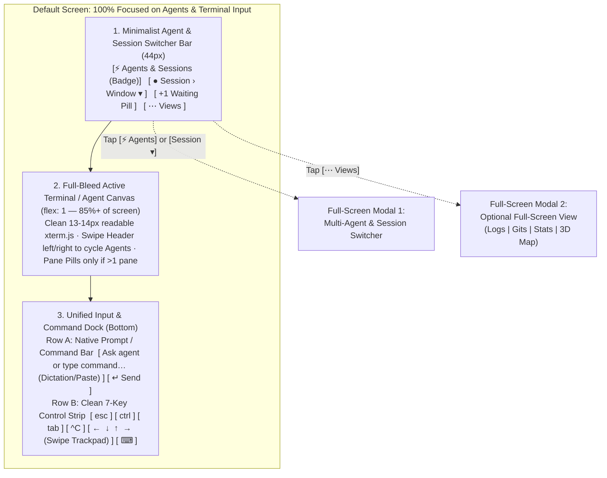

# Sparkmux Minimalist Mobile Web Redesign (`mobile_minimal_redesign.md`)

> **Target Devices:** iPhone (Portrait & Landscape) and iPad (Portrait, Landscape, Split View) via Mobile Safari / Standalone Home Screen PWA (`!isTauriRuntime() && isTouch`).
> **Core Mandate:** Radical minimalism. Zero split-screen clutter, zero docked bottom sheets, zero persistent desktop status bars. **100% focus on Multi-Agent / Multi-Session switching and native-grade Input Usability.** All companion tools (Logs, 3D Area Map, Stats, Gits) are strictly **optional Full-Screen Views** launched on demand.

---

## 1. Why the Previous Mobile Layout Failed Usability

1. **Too Many Competing Chrome Bars:**
   - The previous mobile layout stacked a cluttered Top Bar (with 9 tiny `24px` buttons), a Terminal stage, a Quick-Reply Banner, a 2-tier TouchKeyBar, a `64px` peeking Bottom Sheet (`MobileBottomSheet`), and a Desktop `StatusBar`—leaving barely 40–50% of the screen for actual work and causing constant fat-finger mis-taps.
2. **Overview Scale (`scale(0.45)`) Rendered Text Unreadable:**
   - Scaling a 160-column desktop terminal down by `0.45x` on a phone turned characters into 4-pixel-tall unreadable dust and broke touch scrolling.
3. **Raw `xterm.js` Typing on Mobile Safari Is Painful:**
   - Typing long prompts to Claude Code, Grok Build, or Antigravity directly inside a raw `xterm` canvas fights iOS autocorrect, voice dictation, and cursor placement.
4. **iPad Fell Back to Desktop Chrome:**
   - Because `ipad-pro` was excluded from the `phone` branch in `App.tsx`, iPads rendered tiny desktop hover-splitters, desktop sidebars, and desktop popout buttons that do not work well in a mobile browser.
5. **Companion Panels Were Jammed Into Half-Screens:**
   - Rendering 3D Area Maps, Git Diffs, and Logs inside a `48vh` bottom sheet or narrow slide-over drawer crushed both the terminal and the companion view.

---

## 2. New Design Architecture: The 3-Zone Minimalist Shell

When running in a touch/mobile browser (`isMobileWeb`: `!isTauriRuntime() && postureInfo.isTouch`, or when posture is `"phone-compact" | "phone-landscape" | "ipad-pro"`), Sparkmux renders a dedicated, ultra-clean **3-Zone Mobile Workspace** (`MobileWorkspace.tsx`):



### Core Invariants of the New Design
1. **No Bottom Sheet (`MobileBottomSheet` is removed).**
2. **No Desktop `StatusBar` on Mobile Web.**
3. **No CSS `scale(0.45)` Overview Shrinking.** Terminals always render at a crisp, human-readable `13px–15px` font size.
4. **Full-Screen Modals Only for Secondary Views:** Logs (`ArtifactPanel`), Gits (`ChangeGraph`), Stats, and 3D Map (`AnalyticsHud`) **never** share the screen with the terminal. They open as a **100% Full-Screen View** with a prominent `[← Back to Terminal]` header button.

---

## 3. Zone 1: Minimalist Multi-Agent Header & Instant Switcher (`44px`)

### 3.1 The 3-Element Top Bar (`MobileHeader.tsx`)
Instead of 9 tiny buttons, the top bar has **exactly 3 large, thumb-friendly touch targets** (`min-height: 36px`, `font-size: 13px`):

```
┌──────────────────────────────────────────────────────────────────────────┐
│ [ ⚡ 3 Agents ● ]       [ sparkmux › claude-code ▾ ]          [ ⋯ Views ] │
└──────────────────────────────────────────────────────────────────────────┘
```

1. **Left Pill — `[ ⚡ Agents (N) ]` (Multi-Agent Command Center Trigger):**
   - Displays the count of active AI agents/sessions.
   - If **any** agent across **any** session is in `waiting` (`needs_user` / `pending_ask`) or `failed`, this pill glows **Amber/Coral** (`#f59e0b` / `#f07178`) with a pulsing dot and reads **`[ ⚡ 1 Waiting ]`**.
   - **Single Tap:** Opens the **Full-Screen Multi-Agent & Session Switcher** (Section 3.2).
2. **Center Pill — `[ Session › Window ▾ ]` (Active Target + Swipe Carousel):**
   - Shows the current session and window name in bold (`14px`), plus a status dot (`●` green = running/idle, `●` amber = waiting for user, `●` blue = finished).
   - **Tap:** Opens the **Full-Screen Multi-Agent & Session Switcher**.
   - **Horizontal Swipe Left / Right on the Header:** Instantly cycles to the previous/next active Agent or Window with haptic feedback (`navigator.vibrate?.(8)`), just like swiping Safari address bars on iOS!
3. **Right Pill — `[ ⋯ Views ]` (Full-Screen View Launcher):**
   - Opens a clean, large-target iOS Action Sheet / Menu with:
     - **`📄 Agent Logs (Readable Feed)`** → Opens Full-Screen `ArtifactPanel`
     - **`⬡ Git Changes & Diffs`** → Opens Full-Screen `ChangeGraph`
     - **`📊 Telemetry & Quota Stats`** → Opens Full-Screen `AnalyticsHud` (Telemetry view)
     - **`🌐 3D Area Map`** → Opens Full-Screen `AnalyticsHud` (3D Map view)
     - **`⚡ Command Recipes (?)`** → Opens `RecipesDialog`
     - **`📐 Terminal Size: Fit Device (54×34) / Keep Server Size`** → 1-tap toggle

### 3.2 Full-Screen Multi-Agent & Session Switcher (`MobileAgentHub.tsx`)
When managing multiple agents across sessions on an iPhone or iPad, a tiny sidebar tree is too cramped. Tapping `[ ⚡ Agents ]` or `[ Session › Window ▾ ]` opens a **Full-Screen Mission Control View** with two sections:

```
┌──────────────────────────────────────────────────────────────────────────┐
│ ⚡ MULTI-AGENT & SESSION HUB                      [+ Session]  [✕ Close] │
├──────────────────────────────────────────────────────────────────────────┤
│ NEEDS YOUR INPUT (1)                                                     │
│ ┌──────────────────────────────────────────────────────────────────────┐ │
│ │ ● WAITING   sparkmux › api-refactor (%1)              Claude 4 Opus  │ │
│ │ "Should I update the WebSocket frame schema in web_protocol.rs?"     │ │
│ │ [ 1. Yes, proceed ]   [ 2. Skip ]   [ 💬 Quick Reply… ]   [ Open → ] │ │
│ └──────────────────────────────────────────────────────────────────────┘ │
│                                                                          │
│ ACTIVE AGENTS (2)                                                        │
│ ┌──────────────────────────────────────────────────────────────────────┐ │
│ │ ◉ RUNNING   sparkmux › frontend-ui (%0)               Grok 4.7       │ │
│ │ Editing apps/desktop/src/App.tsx (+48 / -12)              [ Open → ] │ │
│ └──────────────────────────────────────────────────────────────────────┘ │
│ ┌──────────────────────────────────────────────────────────────────────┐ │
│ │ ✓ FINISHED  backend › auth-tests (%2)                 Antigravity    │ │
│ │ All 42 workspace tests passed.                            [ Open → ] │ │
│ └──────────────────────────────────────────────────────────────────────┘ │
│                                                                          │
│ ALL SESSIONS & WINDOWS                                      [+ New Tab]  │
│  ▾ sparkmux (live)                                                       │
│    ┌───────────────┐  ┌───────────────┐  ┌───────────────┐               │
│    │ 1: frontend * │  │ 2: api-refac! │  │ 3: zsh        │               │
│    └───────────────┘  └───────────────┘  └───────────────┘               │
└──────────────────────────────────────────────────────────────────────────┘
```

- **Inline Quick-Reply Directly From the Hub:**
  - If an agent is `WAITING`, its card in the Hub displays the `pending_ask` question and **inline 1-tap response buttons** (`[1. Yes]`, `[2. No]`, `[Approve ↵]`) or `[Open →]`. You can approve or answer multiple agents in seconds from a single screen!
- **Session & Window Grid:**
  - Below the Agent cards, all tmux sessions and their windows are displayed as large `48px`-tall touch cards (2 columns on iPhone, 3–4 columns on iPad), with `+ New Session`, `+ New Tab`, and `× Close` actions.

---

## 4. Zone 2: Clean Full-Bleed Terminal Stage & Pane Switcher

### 4.1 Readable Terminal Geometry (No More Micro-Scaling)
- **Remove `computeOverviewScale` CSS shrinking** on mobile.
- **Default Sizing Behavior on Mobile Web (`fit-phone` by default):**
  - When opening Sparkmux on an iPhone or iPad, the user wants text to wrap and fit their screen so they can actually read and interact with their agents.
  - Default `defaultSizingMode()` to **`"fit-phone"`** (which sends `window_resize` with `force: true` for the active window), while keeping the `"mirror"` option in the `[ ⋯ Views ]` menu for users who explicitly want to lock desktop dimensions.
  - When `"mirror"` mode is selected, use clean horizontal touch scrolling (`overflow-x: auto`) at full `13px–14px` font size rather than shrinking the canvas to `0.45x`.

### 4.2 Multi-Pane Handling inside a Window
- **On iPhone Portrait (`phone-compact`):**
  - Always shows **1 zoomed pane at a time** at full width so text is never squished into 20-column slivers.
  - If the active window has multiple panes (`visiblePanes.length > 1`), a clean `32px` **Segmented Pane Pill Bar** appears right below the top bar:
    `[ %0 claude * ]  [ %1 cargo watch ]  [ + Split ]`
- **On iPhone Landscape (`phone-landscape`) & iPad (`ipad-pro`):**
  - Supports **Side-by-Side Tiled Panes** (`LeftRight`) or **1-tap Zoom** via the Segmented Pane Pill Bar.

---

## 5. Zone 3: Unified Input & Command Dock (`MobileInputDock.tsx`)

This is the centerpiece of **Input Usability**. Instead of forcing the user to type inside the raw `xterm` canvas—or hiding the composer behind a tiny `💬` icon—the bottom of the screen features a **always-ready, minimalist 2-row Input Dock**:

```
┌──────────────────────────────────────────────────────────────────────────┐
│ ⚡ "Allow bash command: cargo test --workspace?"   [ Yes ↵ ]  [ No (n) ] │  <-- Auto-appears ONLY when agent asks a question
├──────────────────────────────────────────────────────────────────────────┤
│ ┌────────────────────────────────────────────────────────────┐ ┌───────┐ │
│ │ Type or dictate to %0 (claude)…                            │ │ Send↵ │ │  <-- Row 1: Native iOS Input Bar (40px)
│ └────────────────────────────────────────────────────────────┘ └───────┘ │
│  [ esc ]  [ ctrl ]  [ opt ]  [ tab ]  [ ^C ]   [ ←   ↓   ↑   → ]  [ ⌨ ]  │  <-- Row 2: 7-Key Minimal Control Strip (36px)
└──────────────────────────────────────────────────────────────────────────┘
```

### 5.1 Row 1: Always-Accessible Native iOS Input Bar
- A clean, native `<textarea rows={1}>` (`font-size: 16px` — **crucial on iOS Safari so WebKit never auto-zooms the page on focus!**).
- **Why this transforms mobile usability:**
  1. **Native iOS Dictation (🎙️), Autocorrect, Swipe-to-Type, and Selection Loupe** work 100% natively before anything is sent to the terminal.
  2. **Multi-line Paste & Prompting:** Pasting code or writing a 3-sentence instructions prompt to Claude/Grok/Antigravity happens in a real text field that expands smoothly up to `120px`.
  3. **Instant Dispatch (`[ Send ↵ ]` or Return key):** Sends the text bytes + `\r` (`0x0d`) directly into the active pane via `paneWrite` and clears the input.
  4. **Direct Terminal Keystrokes Still Work:** Tapping directly on the `xterm` canvas still focuses `xterm` for interactive TUIs (`vim`, `htop`, arrow-key menus), while tapping the Native Input Bar lets you type/dictate effortlessly.

### 5.2 Contextual Smart-Choice Strip (Above Row 1 when Waiting)
- When the focused pane has `attention_label === "needs_user"` or `pending_ask`, or when `extractQuickOptions` detects `[y/n]` / numbered options (`1.`, `2.`, `3.`), a single-row **Quick Choice Strip** slides open right above the input bar:
  - Displays the 1-line question and large tappable pills: **`[ 1. Yes ]`**, **`[ 2. No ]`**, **`[ Enter ↵ ]`**, **`[ Esc ]`**.
  - Even when no question is pending, if an interactive CLI is running, quick action chips like **`[ ↵ Enter ]`**, **`[ ↑ Prev Cmd ]`**, **`[ /clear ]`** can be tapped with one thumb.

### 5.3 Row 2: Decluttered 7-Key Control Strip + Trackpad
Instead of 16 cramped buttons in `TouchKeyBar`, the mobile control strip contains **only the 7 essential terminal controls** with generous `44px+` touch widths:
1. **`esc`** (sends `0x1b`)
2. **`ctrl`** (tap to latch, double-tap to lock)
3. **`opt`** (tap to latch, double-tap to lock)
4. **`tab`** (sends `\t`, or `Shift+Tab` `\x1b[Z` on long-press)
5. **`^C`** (sends interrupt `0x03`)
6. **`[ ←  ↓  ↑  → ]` Unified Arrow & Swipe Trackpad Pill:**
   - Tap individual arrows for single steps, **or** slide your thumb horizontally/vertically across the arrow pill to scrub the cursor smoothly across characters/lines (`touchTrackpadSteps`).
7. **`[ ⋯ / ⌨ ]` Pane Actions & Keyboard Toggle:**
   - Hides the software keyboard if open, or opens a clean popover for `Split Horizontal`, `Split Vertical`, `Find in Scrollback`, `Paste Clipboard`, `^D`, `^Z`, `^L`.

---

## 6. Optional Full-Screen Views (`MobileFullscreenModal.tsx`)

All secondary tools—**Logs**, **Gits**, **Stats / Quota**, and **3D Area Map**—are removed from the main terminal screen and rendered **exclusively inside a Full-Screen Modal Overlay** (`position: fixed; inset: 0; z-index: 500; background: #07080a`) when selected from `[ ⋯ Views ]`:

```
┌──────────────────────────────────────────────────────────────────────────┐
│ [ ← Back to Terminal ]     sparkmux › claude      [Logs|Gits|Stats|3D]   │  <-- 44px Full-Screen Modal Header
├──────────────────────────────────────────────────────────────────────────┤
│                                                                          │
│                                                                          │
│                   100% FULL-SCREEN VIEWPORT AREA                         │
│        (Readable Agent Logs / Unified Git Diffs / Stats / 3D Map)        │
│                                                                          │
│                                                                          │
└──────────────────────────────────────────────────────────────────────────┘
```

1. **Unified Full-Screen Switcher Header (`44px`):**
   - **Left:** Prominent **`[ ← Terminal ]`** button (`background: rgba(91, 141, 239, 0.18)`, `color: #93c5fd`) that immediately closes the full-screen view and returns to the live terminal.
   - **Right:** Segmented switcher **`[ Logs ] [ Gits ] [ Stats ] [ 3D Map ]`** so once the user is in the Full-Screen Companion overlay, they can flip between Logs, Git Diffs, Token/Quota Stats, and the 3D Map at 100% screen size.
2. **Logs (`ArtifactPanel` in Full-Screen):**
   - Displays the conversation turns (`PromptCard` list and `PromptDetailModal`) at full width with comfortable `14px` typography.
3. **Gits (`ChangeGraph` in Full-Screen):**
   - Full-screen file list and Unified Diff reader with plenty of room to read code changes on iPhone and iPad.
4. **Stats & Quota (New Mobile Summary + `AnalyticsHud`):**
   - Includes the Model Quota cards (Session Cost, Today's Total, Allowance reset countdowns from `allowance`), CPU/RAM telemetry, Token Spectrum, and Event Stream in a clean vertical full-screen scroll view.
5. **3D Area Map (`AnalyticsHud` Map Pane in Full-Screen):**
   - Gives the WebGL2 `TerrainViewport` (`RECT` and `GLOBE` modes) 100% of the iPhone/iPad screen for smooth 1-finger orbit and 2-finger pinch/pan without any competing terminal chrome.

---

## 7. iPad & Orientation Unification (`src/ios/posture.ts`)

1. **Unify iPhone & iPad Browser Experience:**
   - Add a helper `isMobileBrowserPosture(posture: FormFactorPosture, isTauri: boolean, isTouch: boolean): boolean` in `src/ios/posture.ts`:
     ```ts
     export function isMobileBrowser(posture: FormFactorPosture, isTauri: boolean, isTouch: boolean): boolean {
       if (isTauri) return false;
       return (
         isTouch ||
         posture === "phone-compact" ||
         posture === "phone-landscape" ||
         posture === "ipad-pro" ||
         posture === "duo-book" ||
         posture === "duo-clamshell"
       );
     }
     ```
   - Also allow desktop browsers testing via `postureOverride` (`"phone-compact"`, `"phone-landscape"`, `"ipad-pro"`) to enter the minimalist mobile layout so automated tests and desktop previews work identically.
2. **iPad Refinements (`posture === "ipad-pro"`):**
   - Uses the exact same minimalist 3-Zone layout (Top Agent/Session Bar + Full-Bleed Terminal + Bottom Native Input & Key Dock + Full-Screen Views for Logs/Gits/Stats/3D Map).
   - On iPad (`width >= 768px`), the Native Input Bar and 7-Key Control Strip sit side-by-side or in a sleek centered dock, and the Multi-Agent Hub displays agent cards in a 2-column responsive grid.

---

## 8. File-by-File Implementation Plan for Grok Build

### Step 1: Posture & Sizing Cleanup (`src/ios/posture.ts` & `src/ios/terminalSizing.ts`)
- **`src/ios/posture.ts`**:
  - Export `isMobilePosture(posture: FormFactorPosture): boolean` returning `true` for `"phone-compact"`, `"phone-landscape"`, and `"ipad-pro"` (or when `!isTauriRuntime() && isTouch`).
- **`src/ios/terminalSizing.ts`**:
  - Change `defaultSizingMode(_isHeadless: boolean): MobileSizingMode` to return `"fit-phone"` by default so mobile browsers immediately fit the terminal columns/rows to the iPhone/iPad screen instead of overflowing or shrinking to `0.45x`.
  - Keep `"mirror"` mode selectable via the `[ ⋯ Views ]` menu for users who want fixed desktop dimensions with horizontal scroll (and remove the `scale(0.45)` transform in `App.tsx` so `"mirror"` mode stays at 100% readable font size!).

### Step 2: New Minimalist Mobile Components (`apps/desktop/src/ios/`)
1. **`src/ios/MobileTopBar.tsx` (Redesign in place):**
   - Replace the 9-button cramped bar with the **3-Target Minimalist Header** (`44px` height in portrait, `36px` in landscape):
     1. **Left:** `[ ⚡ Agents (N) ]` button (pulses amber/coral with `"⚡ N Waiting"` when any agent needs input or failed). Clicking opens `MobileAgentHub`.
     2. **Center:** `[ Session › Window ▾ ]` pill. Clicking opens `MobileAgentHub`. Swiping horizontally (`onPointerDown` / `onPointerUp` deltaX > `48px`) cycles to the previous/next window or active agent!
     3. **Right:** `[ ⋯ Views ]` button opening a clean popover sheet to launch full-screen `Logs`, `Gits`, `Stats`, `3D Map`, `Recipes`, or toggle `Fit Device / Mirror Desktop` sizing.
   - If the active window has `> 1` pane, render a clean secondary `32px` **Pane Switcher Strip** (`[%0 cmd] [%1 cmd] [⊞ Tile / ⤢ Zoom] [+ Split]`).
2. **`src/ios/MobileAgentHub.tsx` (New File):**
   - Full-screen modal (`position: fixed; inset: 0; z-index: 520`) for **Multi-Agent & Multi-Session Management**.
   - **Section 1 — Needs Input / Active Agents:** Lists all `agentRows` (`waiting` pinned first, then `failed`, `running`, `finished`).
     - For `waiting` agents, renders the `detail` / `pending_ask` question and inline quick-reply pills (`extractQuickOptions`) so the user can answer an agent directly from the Hub or tap `Open →` to jump to its pane.
   - **Section 2 — Sessions & Windows Grid:** Shows each session with a `+ New Session` button, `+ New Tab` button, and large `48px` touch cards for each window (showing window name, pane count, unread/waiting badge, and close `×` button).
3. **`src/ios/MobileInputDock.tsx` (New File — replaces separate `QuickReplyBanner` + cluttered `TouchKeyBar` on mobile):**
   - Combines:
     - **Conditional Quick-Choice Strip:** Auto-appears at the top of the dock when the active pane has `pending_ask` / `waiting` state, showing the prompt question and 1-tap option pills (`[1. Yes]`, `[2. No]`, `[Enter ↵]`).
     - **Row 1 — Native iOS Prompt & Command Input Bar:**
       - `<textarea rows={1}>` with `font-size: 16px` (preventing iOS Safari auto-zoom!), placeholder `"Message agent or type command…"`, `enterKeyHint="send"`, auto-expanding up to `110px`.
       - `[ Send ↵ ]` button that sends `composerBytes(text)` to the active pane and clears the draft.
     - **Row 2 — Minimalist 7-Key Control Strip:**
       - Large, high-contrast buttons: `esc`, `ctrl` (latch/lock), `opt` (latch/lock), `tab`, `^C`, the swipeable `[ ←  ↓  ↑  → ]` arrow/trackpad cluster (`touchTrackpadSteps`), and a `[ ⋯ ]` utility button (popover for `Paste`, `Find 🔍`, `Split ⬌`, `Split ⬍`, `Shift-Tab`, `^D`, `^L`, `Hide ⌨`).
4. **`src/ios/MobileFullscreenView.tsx` (New File):**
   - Full-screen container (`position: fixed; inset: 0; z-index: 500`) for optional companion views: `"output" | "gits" | "stats" | "map"`.
   - Top bar (`44px`): **`[ ← Terminal ]`** button on the left, current session/window title in the center, and segmented switcher **`[ Logs ] [ Gits ] [ Stats ] [ 3D Map ]`** on the right.
   - Renders `ArtifactPanel` (`"output"`), `ChangeGraph` (`"gits"`), `AnalyticsHud` with `initialPhonePane="telemetry"` + Quota summary (`"stats"`), or `AnalyticsHud` with `initialPhonePane="map"` (`"map"`).

### Step 3: Clean Up `App.tsx` & `index.css`
- **`src/App.tsx`**:
  - Remove `MobileBottomSheet` and `MobileSlideDrawer` usage from the mobile layout.
  - Remove the `overviewScale` CSS `transform: scale(...)` wrapper on `.term-viewport` so mobile terminals always render at 100% crisp native resolution.
  - Hide the desktop `StatusBar` whenever `isMobilePosture(posture)` is true (`phone-compact`, `phone-landscape`, `ipad-pro`), reclaiming vertical space and eliminating duplicate buttons.
  - Render `MobileTopBar` at the top, full-bleed `TiledWindow` in the center, `MobileInputDock` at the bottom, and conditional `MobileAgentHub` / `MobileFullscreenView` full-screen modals when open.
- **`src/index.css`**:
  - Style `.mobile-top-bar`, `.mobile-agent-hub`, `.mobile-input-dock`, and `.mobile-fullscreen-view` with clean, high-contrast OLED minimalism (`#07080a` background, `#12151b` elevated cards, `16px` input font size, `44px` minimum touch target heights, and full `env(safe-area-inset-*)` support).

### Step 4: Tests & Verification (`src/ios/iosLogic.test.ts`)
- Update `src/ios/iosLogic.test.ts` to verify:
  - `defaultSizingMode` defaults to `"fit-phone"` for mobile usability while preserving `"mirror"` when explicitly chosen.
  - Window/Agent horizontal swipe cycling helper (`cycleTargetIndex(currentIndex, total, deltaX)`).
  - Existing posture, `extractQuickOptions`, and `touchTrackpadSteps` unit tests pass.
- Run and pass:
  ```bash
  pnpm --dir apps/desktop run test:shipped
  pnpm --dir apps/desktop run build
  cargo test --workspace
  cargo clippy --workspace -- -D warnings
  cargo fmt --check
  ```
